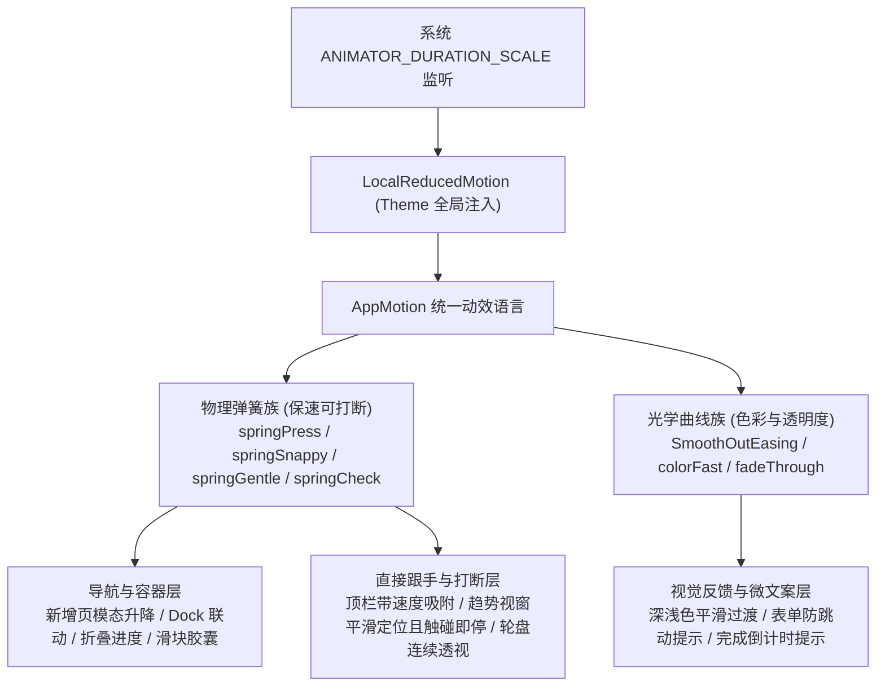

# 血压记录 · 苹果级细腻丝滑动效优化方案

## 目标与设计准则

本次优化不按孤立控件堆砌动画，而是以**“状态变化是否交代清楚因果（从哪来、到哪去、和什么有关）”**为主线，对全项目 20+ 个界面与通用容器做全量走查，同时由 Gemini 从**方案、文案、交互**三个维度协同把关，将「温暖的血压记录本」打磨到 iOS / Apple Health 级别的细腻、跟手、克制与零性能负担。

---

### 一、全项目「状态变化」走查矩阵（现状问题 vs 优化目标）

| 状态变化类型 | 现状代码中的断层 / 跳变 | 因果解释与丝滑化方案 |
| :--- | :--- | :--- |
| **系统底座与曲线统一**<br>（动效语言 & 减少动态效果） | [AppMotion.kt](file:///e:/blood%20pressure%20record/app/src/main/java/com/example/bloodpressurerecord/ui/theme/AppMotion.kt) 仅有 `FastOutSlowIn` 线性时长；[AppNavigation.kt](file:///e:/blood%20pressure%20record/app/src/main/java/com/example/bloodpressurerecord/navigation/AppNavigation.kt#L86)、[AppBackButton.kt](file:///e:/blood%20pressure%20record/app/src/main/java/com/example/bloodpressurerecord/ui/common/AppBackButton.kt#L31)、[BpRangeBar.kt](file:///e:/blood%20pressure%20record/app/src/main/java/com/example/bloodpressurerecord/ui/home/BpRangeBar.kt#L142)、[Buddy.kt](file:///e:/blood%20pressure%20record/app/src/main/java/com/example/bloodpressurerecord/ui/home/Buddy.kt#L52) 各自散落曲线与独立的 `ANIMATOR_DURATION_SCALE` 读取（且 `Buddy` 不响应运行期开关变化）。 | 建立单一动效语言：**空间位移/缩放/滑块统一用保速临界阻尼弹簧（可随时打断转向），透明度/颜色统一用平滑光学减速曲线**；在 [Theme.kt](file:///e:/blood%20pressure%20record/app/src/main/java/com/example/bloodpressurerecord/ui/theme/Theme.kt) 注入全局响应式 `LocalReducedMotion`。 |
| **页面与模态进出**<br>（出现 / 消失 / 空间来源） | 1. 点击底部中央 `+` 进入新增记录时，页面像普通设置子页一样从右侧横推，丢失“从底部呼出”的空间关系；<br>2. 悬浮胶囊 Dock 在进出子页时 `if (showBottomBar)` **0ms 瞬移消失/闪现**；<br>3. 医生报告「周期配置 ↔ PDF 预览」、趋势「竖屏 ↔ 全屏」及宽屏「测量明细侧栏」均为 **0ms 硬切**。 | 1. 新增记录改为**自下而上模态升起、保存/关闭向下落回**，与底部 `+` 建立物理呼应；父子层级保持横向推入并完整支持预测式返回；<br>2. 悬浮 Dock 随顶级路由切换平滑下沉淡出/上浮显现；<br>3. 报告配置↔预览按步骤方向过渡，宽屏趋势明细侧栏从右侧滑入/收回。 |
| **选项与胶囊移动**<br>（移动 vs 原地变色） | [AppComponents.kt](file:///e:/blood%20pressure%20record/app/src/main/java/com/example/bloodpressurerecord/ui/common/AppComponents.kt#L293) `SegmentedPillGroup` 与 [TrendScreen.kt](file:///e:/blood%20pressure%20record/app/src/main/java/com/example/bloodpressurerecord/ui/history/TrendScreen.kt#L800) `SegmentedControl` 各选项各自原地淡入淡出背景色，阴影 0ms 跳变，看不出选中态从哪格移到哪格；底部 Dock Tab 文字与圆点 0ms 瞬切。 | 分段控制器升级为**单一共享胶囊滑块跟手滑移**（弹簧驱动 `x` 与 `width`，中途连点实时转向）；底部 Dock Tab 补齐色彩过渡、微缩放与底部圆点弹簧生长。 |
| **模块折叠与尺寸变化**<br>（变大小 / 内容显隐） | [ExpandableSection.kt](file:///e:/blood%20pressure%20record/app/src/main/java/com/example/bloodpressurerecord/ui/common/ExpandableSection.kt#L103-L109) 收起瞬间第 1 帧就把内部高度置 `0` 且不放置子节点，导致**内容第 1 帧瞬间消失，随后外层空白卡片缓慢收缩**，摘要文字也 0ms 顶出。 | 改为单一 `expandProgress` 同时驱动子容器裁剪高度、透明度与摘要显隐：内容保持常驻组合（不丢图表状态）、折叠收尾彻底不放置（不漏触摸与无障碍焦点），收放途中随时点击可原位丝滑反向。 |
| **按下与触感反馈**<br>（按下 / 悬停 / 触觉） | 仅 `DataCard` 有按压反馈；主次危险按钮、Dock 中央 `+`、顶栏返回键、早晚待测槽、服药打卡章、“再加一组”均无按压缩放；历史日历格因 `combinedClickable` 等双击窗口有 ~300ms 延迟，手指按下毫无即时视觉反馈。 | 封装零重排 `Modifier.pressableScale()`（纯 `graphicsLayer` 缩放，触控热区不变），覆盖按钮、Dock `+`、顶栏返回、待测槽与日历格（手指触碰 0ms 即响应）；在服药打卡、时间滚轮跨格、记录完成等关键节点加入克制的轻触觉反馈。 |
| **表单输入与条件区显隐**<br>（焦点 / 出现 / 防误触重排） | 1. 数字框获焦仅细描边变色，上方“高压/低压/脉搏”标签无联动；<br>2. 输入第 2 组最后一位数字使 `canSave = true` 时，按钮上方的禁用提示 `disabledReason` **0ms 消失，导致「保存记录」按钮在手指即将点击瞬间突然上跳 ~24dp**；<br>3. 本组分级条、高低压倒置报错、设置/报告异步进度条均 0ms 顶开布局；<br>4. [EditSessionScreen.kt](file:///e:/blood%20pressure%20record/app/src/main/java/com/example/bloodpressurerecord/ui/history/EditSessionScreen.kt) 缺少新增页已有的标题与补充页过渡，组别切换 0ms 硬切。 | 1. 数字框获焦时上方标签、描边与柔和底色同步点亮；<br>2. 禁用原因、本组分级条、报错提示、线性进度条全部改用平滑高度+淡入淡出，彻底消除“按钮突然跳走”；主按钮可用态色彩平滑点亮；<br>3. 拉齐修改页与新增页全套过渡，组别切换与“读数 ↔ 补充情况”均带前后方向感。 |
| **数值跳动与图表过渡**<br>（数值变化 / 视窗移动） | 1. [Type.kt](file:///e:/blood%20pressure%20record/app/src/main/java/com/example/bloodpressurerecord/ui/theme/Type.kt) 仅 `displayMedium` 开启了 `tnum`，导致趋势图滑动读数、均值重算、轮盘滚动时数字宽度变化引起右侧单位文字**逐帧左右抖动**；<br>2. 首页新增记录返回后，仅区间三角移动，Hero 背景色、大数字、风险提示条与本周柱高均 0ms 硬跳；<br>3. 趋势页点击「最新 / 上一条跨窗 / 恢复 / 双击」时视窗 1 帧瞬移，用户迷失时间方向；达标率圆环（且深色底轨硬编码浅色 `0xFFDDE8DF`）与分布条 0ms 跳变。 | 1. 全局数字样式统一启用 `fontFeatureSettings = "tnum"`，彻底消除数值跳动重排；<br>2. 首页 Hero 背景/字色平滑演进、均值卡与打卡计数微滚过渡、周柱高与达标率圆环/分布条平滑舒展（修复深色圆环底轨色）；<br>3. 趋势图**手势缩放/平移/长按擦除保持 100% 0ms 跟手**，离散按钮触发的视窗跳转平滑过渡且**手指一碰立即打断接管**。 |
| **轮盘、日历与深浅色**<br>（换内容 / 换外观 / 性能） | 1. [Buddy.kt](file:///e:/blood%20pressure%20record/app/src/main/java/com/example/bloodpressurerecord/ui/home/Buddy.kt#L87) 使用 `.offset(y = (...).dp)` 造成首页与“我的”页 **60–120Hz 无限每帧重组与重测量**；<br>2. [WheelTimePicker.kt](file:///e:/blood%20pressure%20record/app/src/main/java/com/example/bloodpressurerecord/ui/common/WheelTimePicker.kt#L166) 跨中心线时字号 18sp↔24sp 离散跳变；<br>3. 历史切换月份仅标题淡变，日历网格 0ms 硬换，无前后月方向；<br>4. 顶栏 `HideOnScrollState` 松手吸附丢弃了惯性速度；切换深浅色主题全屏 1 帧闪白/闪黑。 | 1. `Buddy` 迁至纯 GPU `graphicsLayer`（0 重组/0 重排），“我的”页静态头像停用无限浮动；<br>2. 时间轮盘按距中心像素距离在 `graphicsLayer` 连续插值缩放、透视倾角与透明度；<br>3. 月历翻月按时间先后向左右轻滑过渡；<br>4. 顶栏松手承接 `onPostFling` 速度弹簧吸附；`Theme.kt` 支持深浅色暖调柔和过渡。 |

---

### 二、Gemini 方案、文案与交互顾问审阅

1. **「记录完成」自动关闭的心理预期管理（交互 + 文案 + 动效）**
   - **现状问题**：[SessionFormComponents.kt](file:///e:/blood%20pressure%20record/app/src/main/java/com/example/bloodpressurerecord/ui/common/SessionFormComponents.kt#L605) 中 `SessionCompletedDialog` 弹出后没有任何提示，5 秒一到突然消失并返回首页，对中老年用户极易造成“我还没看清怎么自己关了”的困惑。
   - **顾问方案**：保留「记录完成」「关闭」「修改」原有按钮契约，顶部增加柔和生长的完成勾选徽章，底部增加一条不抢戏的暖色细进度条与温润提示文案 **`"已记入血压本 · X 秒后自动返回"`**（开启减少动态效果时仅静态显示秒数提示），让自动返回从“突然消失”变成“贴心代劳”。
2. **「读数 ↔ 补充情况」的双向往返闭环（交互 + 文案）**
   - **现状问题**：在新增页/修改页点击 `"补充情况（选填）"` 后，底部入口按钮直接消失，页面正中没有返回读数的入口，且填完返回读数页后按钮仍写 `"补充情况（选填）"`，用户不确定刚才填的备注是否还在。
   - **顾问方案**：在补充页同一位置提供明确的 **`"返回读数"`** 按钮；返回读数页后若已填写不适或影响因素，按钮文案自动切换为 **`"补充情况（已填写）"`** 并带暖色小圆点提示，做到状态有回音、来去有路标。
3. **搜索空白态与异步状态微文案统一（文案顾问）**
   - **搜索历史备注空白态**：[NoteSearchScreen.kt](file:///e:/blood%20pressure%20record/app/src/main/java/com/example/bloodpressurerecord/ui/history/NoteSearchScreen.kt#L117) 初始空白态目前直接重复顶栏标题 `"搜索历史备注"`，改为更有方向感的引导语 **`"输入头晕、散步、服药等关键词，快速找回当时的记录"`**。
   - **数据管理加载态文案与标点统一**：[SettingsDataManagementScreen.kt](file:///e:/blood%20pressure%20record/app/src/main/java/com/example/bloodpressurerecord/ui/settings/SettingsDataManagementScreen.kt#L434-L453) 中导出与导入按钮在执行时同时变成英文三点 `"正在处理..."`，既违反全站中文省略号 `"…"` 规范，又让两个不同按钮显示完全相同的文案。统一修正为中文省略号 `"…"` 并按当前触发动作区分按钮禁用态与平滑文案切换，同时锁死按钮最小高度防止跳动。

---

## User Review Required

> [!IMPORTANT]
> **确认范围与兼容性边界**
> 1. **不触碰任何数据契约与医学规则**：Room 数据库（v9）、Excel/加密备份（v6）、血压分级阈值、代表值计算、草稿存储均保持 100% 原样。
> 2. **严格保护现有自动化测试契约**：所有已被 UI 测试与基准测试断言的文案、无障碍 `contentDescription`、`testTag` 及关闭系统动画后同帧落位行为（如 `BpRangeBarTest`、`SessionFormComponentsTest`、`TrendReadoutAccessibilityTest`、`ReportScreenTest`、`CriticalUserJourneys`）均逐一核对保留。
> 3. 若你认可上述「状态变化矩阵 + Gemini 交互文案微调」方案，点击确认后我将一次性高质量落地并完成全套编译、Lint 与单测验证。

---

## Proposed Changes



### 1. 动效底座、排版防抖与主题过渡（`ui/theme` & `ui`）

#### [MODIFY] [AppLocals.kt](file:///e:/blood%20pressure%20record/app/src/main/java/com/example/bloodpressurerecord/ui/AppLocals.kt)
- 新增 `LocalReducedMotion = compositionLocalOf { false }` 与 `@Composable fun rememberSystemReducedMotion(): Boolean`（通过 `ContentObserver` 实时监听 `Settings.Global.ANIMATOR_DURATION_SCALE == 0f`，在 `LocalInspectionMode` 下安全降级），替代原先散落在 `BpRangeBar.kt` 与 `Buddy.kt` 的两套重复逻辑。

#### [MODIFY] [AppMotion.kt](file:///e:/blood%20pressure%20record/app/src/main/java/com/example/bloodpressurerecord/ui/theme/AppMotion.kt)
- 建立全应用唯一的动效 Token 体系：
  - **弹簧规格（用于位移、缩放、滑块、折叠、跟手吸附）**：
    - `springPress`: `spring(dampingRatio = Spring.DampingRatioNoBouncy, stiffness = 900f)` —— 按压即刻响应、松手干净回位；
    - `springSnappy`: `spring(dampingRatio = 0.94f, stiffness = 520f)` —— 分段胶囊滑块、日历选中、顶栏吸附，连点可实时继承速度转向；
    - `springGentle`: `spring(dampingRatio = Spring.DampingRatioNoBouncy, stiffness = 340f)` —— 模块折叠、Dock 收放、血压区间三角、趋势按钮视窗定位，丝滑零过冲；
    - `springCheck`: `spring(dampingRatio = 0.78f, stiffness = 480f)` —— 服药打勾、完成徽章、小压轻戳的克制微弹。
  - **光学曲线（用于透明度、背景色、文字色、页面层级）**：
    - `SmoothOutEasing = CubicBezierEasing(0.22f, 1.0f, 0.36f, 1.0f)` 与 `SmoothInEasing = CubicBezierEasing(0.32f, 0f, 0.67f, 0f)`；
    - 提供带方向感的 `directionalSlideFade(forward: Boolean, distancePx: Int, reducedMotion: Boolean): ContentTransform`（供月历翻页、表单“读数 ↔ 补充情况”、修改页组别切换、报告“配置 ↔ 预览”共用）以及 `verticalNumericRoll()`（供打卡计数、均值数字微滚更新共用）。

#### [MODIFY] [Type.kt](file:///e:/blood%20pressure%20record/app/src/main/java/com/example/bloodpressurerecord/ui/theme/Type.kt)
- 新增常量 `const val TabularFeatureSettings = "tnum"` 及便捷扩展 `TextStyle.tabularNums()`，并在承载读数与统计值的排版层级统一补齐等宽数字特性，消除数值跳动引发的同行文字左右抖动。

#### [MODIFY] [Theme.kt](file:///e:/blood%20pressure%20record/app/src/main/java/com/example/bloodpressurerecord/ui/theme/Theme.kt)
- 在 `BloodPressureRecordTheme` 中注入 `LocalReducedMotion`；
- 新增轻量 `animateColorScheme(targetScheme, reducedMotion)`，在用户在“我的”页手动切换深浅色外观时提供 ~200ms 暖色表面柔和过渡（`reducedMotion` 开启或首帧渲染时零延迟直出，不影响任何截图与像素单测）。

---

### 2. 导航转场与全局通用组件（`navigation` & `ui/common`）

#### [MODIFY] [AppNavigation.kt](file:///e:/blood%20pressure%20record/app/src/main/java/com/example/bloodpressurerecord/navigation/AppNavigation.kt)
- 移除私有硬编码曲线，全部接入 `AppMotion` 与 `LocalReducedMotion`；
- 为 `AddMeasurement` 路由配置专属**自下而上模态升起（`SlideDirection.Up` + 淡入）与向下收起（`SlideDirection.Down` + 淡出）**，背景顶级页微缩/微暗形成空间纵深，同时保留 Android 13+ 预测式返回手势进度；其余父子详情/设置子页统一使用顺滑横向层级转场；
- 将悬浮 `AppBottomDock` 从 `if (showBottomBar)` 硬切改为 `AnimatedVisibility`，随顶级页切换轻柔下沉淡出/上浮出现（非顶级页期间立即禁用触控与语义暴露，杜绝误触）。

#### [MODIFY] [AppComponents.kt](file:///e:/blood%20pressure%20record/app/src/main/java/com/example/bloodpressurerecord/ui/common/AppComponents.kt)
- 新增通用零重排按压修饰符 `Modifier.pressableScale(enabled, pressedScale = 0.97f)`（`clickable` 外置保障触控热区恒定，内部仅驱动 `graphicsLayer` 的 `scaleX/scaleY`）；
- 为 `AppPrimaryButton`、`AppSecondaryButton`、`AppDangerButton` 接入按压微缩反馈与启用/禁用容器色平滑过渡（`animateColorAsState`），并在文案切换时支持平稳微过渡；
- 统一 `AppTopBar` 返回按钮与 [AppBackButton.kt](file:///e:/blood%20pressure%20record/app/src/main/java/com/example/bloodpressurerecord/ui/common/AppBackButton.kt) 的按压缩放与底色平滑反馈；
- `StatusChip` 支持分级变化时的底色、文字色与圆点色平滑过渡；
- 重构 `SegmentedPillGroup`：在等宽选项行底层绘制**单一共享弹簧滑块**（`springSnappy` 驱动水平位移），保留原 `Role.RadioButton` 与选中无障碍语义。

#### [MODIFY] [AppBottomDock.kt](file:///e:/blood%20pressure%20record/app/src/main/java/com/example/bloodpressurerecord/ui/common/AppBottomDock.kt)
- Dock 收起/展开改用 `AppMotion.springGentle`（滑动方向快速反转时可无损打断接续）；
- 中央 `AddMeasurementButton`（`+`）加入 `0.92f` 跟手按压回弹；
- `DockTab` 补齐选中态图标轻抬微缩放、文字/图标颜色过渡，以及底部 4dp 指示圆点的弹簧显隐动画。

#### [MODIFY] [ExpandableSection.kt](file:///e:/blood%20pressure%20record/app/src/main/java/com/example/bloodpressurerecord/ui/common/ExpandableSection.kt)
- 修复“收起第 1 帧内容瞬间消失、空白框干缩”的问题：移除外层互相打架的 `animateContentSize`，改由单一 `expandProgress`（`AppMotion.springGentle`）同时控制：
  1. 子容器测量后的布局高度 `(placeable.height * progress).roundToInt()`（`progress > 0f` 时保持放置并做底部裁剪，完全收起 `progress == 0f` 时不放置以隔离触摸和语义）；
  2. 子容器 `graphicsLayer { alpha = progress }`；
  3. 折叠态摘要行 `AnimatedVisibility(!expanded)` 平滑显隐与右侧箭头平滑旋转。

#### [MODIFY] [HideOnScroll.kt](file:///e:/blood%20pressure%20record/app/src/main/java/com/example/bloodpressurerecord/ui/common/HideOnScroll.kt)
- `onPostFling` 调用 `settle(initialVelocity = available.y)`，将手指离开时的剩余纵向滚动速度直接传入 `AppMotion.springSnappy` 进行吸附：快速轻拂即可顺势收起或展开顶栏，不再僵硬按半高死线重起动画。

#### [MODIFY] [WheelTimePicker.kt](file:///e:/blood%20pressure%20record/app/src/main/java/com/example/bloodpressurerecord/ui/common/WheelTimePicker.kt)
- 保持原有 `LazyColumn`、`SnapFlingBehavior`、点选滚动与无障碍语义（确保 `SessionFormComponentsTest` 100% 通过）；
- 利用 `LazyListLayoutInfo` 计算每一可见行相对中心高亮带的归一化距离 `fraction`，在 `graphicsLayer` 中连续插值 `alpha`、`scaleX/scaleY` 与轻微滚筒倾角 `rotationX`，并启用 `tabularNums()`；用户手动拨动跨过整点/整分时触发轻柔 `HapticFeedbackType.TextHandleMove` 刻度感。

---

### 3. 首页：情绪陪伴、读数落位与打卡反馈（`ui/home`）

#### [MODIFY] [Buddy.kt](file:///e:/blood%20pressure%20record/app/src/main/java/com/example/bloodpressurerecord/ui/home/Buddy.kt)
- **性能关键修复**：将 `.offset(y = (tapOffset.value - bob * 3f).dp)` 迁移为纯绘制层 `.graphicsLayer { translationY = ...; scaleX = ...; scaleY = ... }`，消除首页与设置页无限每帧 Layout 重排；
- 新增 `animateIdle: Boolean = true` 参数（首页开启呼吸与眨眼，“我的”页静态头像设为 `false` 节省帧开销），统一读取 `LocalReducedMotion.current`；
- 优化点击小压时的轻跳微形变（轻微蓄力压扁→跃起→`springCheck` 落回）与表情颜色平滑过渡。

#### [MODIFY] [BpRangeBar.kt](file:///e:/blood%20pressure%20record/app/src/main/java/com/example/bloodpressurerecord/ui/home/BpRangeBar.kt)
- 改用全局 `LocalReducedMotion.current`（保留系统关闭动画时同帧直达目标像素位置，严格通过 `BpRangeBarTest.disabledSystemAnimationsMoveMarkerDirectlyToNewPosition`），开启正常动效时三角游标升级为 `AppMotion.springGentle` 丝滑落位，区间标签字色同步平滑过渡。

#### [MODIFY] [DashboardScreen.kt](file:///e:/blood%20pressure%20record/app/src/main/java/com/example/bloodpressurerecord/ui/home/DashboardScreen.kt)
- `ReadingHero`：背景色 `look.soft` 与主字色 `look.ink` 接入 `animateColorAsState`；最新记录变更时大数字与脉搏平滑过渡；小压对话气泡增加轻量尺寸自适应；高风险提示条使用 `AnimatedVisibility`；
- `MeasurementSlot`：待测槽增加 `pressableScale` 按压反馈，待测态↔已测读数态通过 `AnimatedContent` 自然切换；
- `MedicationRow` 与 `SectionHeader`：修复打卡对勾双重 `alpha` 叠加变淡问题，为打卡章增加按压回弹、轻触觉反馈与对勾 `springCheck` 弹出；`"X/Y 已打卡"` 进度文字支持轻量数字过渡；
- `WeekCard`：自然周 7 日柱高与柱色在数据变化时平滑过渡，所有血压与连续天数数字统一开启 `tabularNums()`。

---

### 4. 录入与编辑流：零跳动高效输入与完成预期（`ui/record`, `ui/common`, `ui/history`）

#### [MODIFY] [SessionFormComponents.kt](file:///e:/blood%20pressure%20record/app/src/main/java/com/example/bloodpressurerecord/ui/common/SessionFormComponents.kt)
- `CompactNumberField`：通过 `MutableInteractionSource` 感知焦点态，获焦时上方标签（高压/低压/脉搏）与边框同步平滑点亮为主色，数字启用 `tabularNums()`，不改变 76dp 高度与内部排版测量；
- `MeasurementReadingCard`：本组计算结果条与“低压要小于高压”错误提示改用平滑 `AnimatedVisibility` 展开/收起，消除输入第 2 位数字时的突兀跳动；删除组按钮增加微按压反馈；
- `DateTimePillButton` 与 `SessionChoiceChip`：补齐按压缩放与选中色平滑过渡；
- `SessionAverageCard`：代表值与有效组数变化时采用轻量微过渡并启用 `tabularNums()`；
- `InlineSessionAction`：将 `disabledReason` 包入 `AnimatedVisibility`，**彻底解决输完第 2 组瞬间保存按钮突然上跳 ~24dp 的问题**；
- `SessionCompletedDialog`：顶部加入温和的完成勾选微动效，底部加入 `"已记入血压本 · X 秒后自动返回"` 提示与柔和倒计时细进度条，让 5 秒自动关闭清晰可预期。

#### [MODIFY] [AddMeasurementScreen.kt](file:///e:/blood%20pressure%20record/app/src/main/java/com/example/bloodpressurerecord/ui/record/AddMeasurementScreen.kt)
- 「记一次血压 ↔ 补充情况」切换升级为带前后方向感的 `directionalSlideFade`；
- 底部次级操作补齐双向往返闭环：读数态显示 `"补充情况（选填）"`（有内容时显示 `"补充情况（已填写）"` 及暖色圆点），补充态显示 `"返回读数"`；
- 表单底部提示消息 `formMessage` 包入平滑 `AnimatedVisibility`；`DashedAddGroupButton` 增加按压缩放与禁用态透明度过渡。

#### [MODIFY] [EditSessionScreen.kt](file:///e:/blood%20pressure%20record/app/src/main/java/com/example/bloodpressurerecord/ui/history/EditSessionScreen.kt)
- 全面拉齐与新增页一致的动效水准：
  - 加载态→表单内容平滑淡入；
  - 顶栏标题与主体「修改读数 ↔ 补充情况」带方向过渡，底部同步提供 `"补充情况（选填/已填写）"` ↔ `"返回读数"`；
  - 点击顶部 `"第 1 组 / 第 2 组 / 第 3 组"` 切换当前编辑卡片时，按组号大小执行左右微移过渡（`targetIndex > initialIndex`），让用户清楚知道切到了前一组还是后一组；
  - 平均值卡片与错误提示统一使用 `AnimatedVisibility`。

---

### 5. 历史、搜索与趋势：空间方向感与跟手图表（`ui/history`）

#### [MODIFY] [HistoryScreen.kt](file:///e:/blood%20pressure%20record/app/src/main/java/com/example/bloodpressurerecord/ui/history/HistoryScreen.kt) & [strings.xml](file:///e:/blood%20pressure%20record/app/src/main/res/values/strings.xml)
- `CalendarMonth`：月份标题与日历网格共同接入按 `YearMonth` 比较方向的 `directionalSlideFade`（翻上月向右滑出、翻下月向左滑出；左右 `<` `>` 按钮保持在动画容器外固定不动，确保连续快速点击 12 次依然瞬时响应且不丢焦点）；
- `CalendarDay`：加入手指按下的即时 `0.92f` 缩放反馈（化解 `combinedClickable` 双击判定窗口带来的迟滞感），选中描边透明度平滑过渡；
- 日历/近期模式切换、加载/空月/错误状态切换及选中日期标题变化加入克制的淡入淡出；搜索定位高亮卡片除底色外增加一次温和的边框提示脉冲。

#### [MODIFY] [HistoryDetailScreen.kt](file:///e:/blood%20pressure%20record/app/src/main/java/com/example/bloodpressurerecord/ui/history/HistoryDetailScreen.kt)
- 记录详情内容与“记录已删除（等待撤销）”状态之间使用 `AnimatedContent` 平滑衔接，点击底部 Snackbar「撤销」恢复时卡片自然浮现回原位；全部读数启用 `tabularNums()`。

#### [MODIFY] [NoteSearchScreen.kt](file:///e:/blood%20pressure%20record/app/src/main/java/com/example/bloodpressurerecord/ui/history/NoteSearchScreen.kt)
- 搜索框清空按钮 `Clear` 加入缩放+淡变显隐；
- `Idle / Loading / Empty / Error / Results` 状态切换使用轻量 `fadeThrough`；初始空白态升级为具象引导文案（新增 `R.string.note_search_idle_hint`，保留 `R.string.note_search_title` 供顶栏与无障碍按钮继续使用）。

#### [MODIFY] [TrendChartModels.kt](file:///e:/blood%20pressure%20record/app/src/main/java/com/example/bloodpressurerecord/ui/history/TrendChartModels.kt), [TrendChart.kt](file:///e:/blood%20pressure%20record/app/src/main/java/com/example/bloodpressurerecord/ui/history/TrendChart.kt), [TrendChartGestures.kt](file:///e:/blood%20pressure%20record/app/src/main/java/com/example/bloodpressurerecord/ui/history/TrendChartGestures.kt)
- **严守手势直接跟手铁律**：双指缩放 `zoomBy`、单指平移 `panBy`、长按滑动读数 `scrubTo` 保持 **0ms 同步直改**；
- 为离散命令式视窗跳转（点击「最新」「上一条/下一条跨出窗口」「恢复」及双击复位）提供可选 UI 协程平滑插值 `animateWindowTo`（JVM 单测无 UI 作用域或 `LocalReducedMotion` 开启时自动走 0ms 同步落位，保证全部 `TrendViewModelTest` 与 `TrendChartInteractionTest` 零改动通过），且**手指一旦按下图表（`awaitFirstDown`）立即取消在途视窗动画并无缝接管**。

#### [MODIFY] [TrendScreen.kt](file:///e:/blood%20pressure%20record/app/src/main/java/com/example/bloodpressurerecord/ui/history/TrendScreen.kt) & [TrendFullscreenScreen.kt](file:///e:/blood%20pressure%20record/app/src/main/java/com/example/bloodpressurerecord/ui/history/TrendFullscreenScreen.kt)
- `SegmentedControl`（范围 7/30/180/365/全部、粒度、指标）升级为与 `SegmentedPillGroup` 同一套**共享弹簧胶囊滑块**（兼容小屏/大字横向滚动场景与全部 `TrendReadoutAccessibilityTest` 断言）；
- 竖屏 ↔ 全屏容器切换加入轻量过渡；宽屏（`>= 650.dp`）右侧 320dp「测量明细」面板接入横向滑入/滑出 `AnimatedVisibility`；
- `TrendPeriodOverview`：达标率圆环 `sweepAngle` 与六级分布条占比随周期切换平滑舒展，修正圆环底轨在深色模式下的硬编码浅色为 `MaterialTheme.colorScheme.surfaceContainerHighest`；全部读数与统计数字启用 `tabularNums()`。

---

### 6. 我的、数据管理、医生报告与更新（`ui/settings`, `ui/report`, `update`）

#### [MODIFY] [SettingsScreen.kt](file:///e:/blood%20pressure%20record/app/src/main/java/com/example/bloodpressurerecord/ui/settings/SettingsScreen.kt) & [SettingsSubpages.kt](file:///e:/blood%20pressure%20record/app/src/main/java/com/example/bloodpressurerecord/ui/settings/SettingsSubpages.kt)
- 资料入口行、`SettingRow`、`SettingsSwitchRow` 增加温润按压反馈；资料卡片静态 `Buddy` 传入 `animateIdle = false` 避免后台常驻无限动画；
- 提醒中心：通知权限提示卡、系统日历已开启详情区、药品编辑弹窗中的时间条目增删及底部保存提示 `SettingsMessage` 统一接入平滑 `AnimatedVisibility`。

#### [MODIFY] [SettingsDataManagementScreen.kt](file:///e:/blood%20pressure%20record/app/src/main/java/com/example/bloodpressurerecord/ui/settings/SettingsDataManagementScreen.kt) & [BpZoneTargetSheet.kt](file:///e:/blood%20pressure%20record/app/src/main/java/com/example/bloodpressurerecord/ui/home/BpZoneTargetSheet.kt)
- 数据操作进度条与结果提示接入 `AnimatedVisibility`，不再突兀顶跳下方按钮；
- 统一按钮异步文案中文省略号 `"…"`，区分当前执行动作与其余禁用按钮文案；`BpZoneTargetSheet` 错误提示平滑显隐。

#### [MODIFY] [ReportOptionsScreen.kt](file:///e:/blood%20pressure%20record/app/src/main/java/com/example/bloodpressurerecord/ui/report/ReportOptionsScreen.kt), [ReportPreviewScreen.kt](file:///e:/blood%20pressure%20record/app/src/main/java/com/example/bloodpressurerecord/ui/report/ReportPreviewScreen.kt), [UpdateUi.kt](file:///e:/blood%20pressure%20record/app/src/main/java/com/example/bloodpressurerecord/update/UpdateUi.kt)
- `ReportScreen`：「配置周期 ↔ 报告预览」采用方向性 `directionalSlideFade` 平滑切换；7 日监测模板说明与统计周期列表变化平滑过渡；
- `PdfPagePreview`：PDF 页面位图渲染完成时从加载态柔和淡入，切换隐私开关重新生成预览时进度条平滑展开；
- `UpdateSettingsContent`：`IDLE / CHECKING / CURRENT / AVAILABLE / FAILED` 检查状态区域使用轻量过渡消除跳变。

---

## Verification Plan

### Automated Tests
在项目根目录一次性串联执行编译、Lint、JVM 单元测试与测试包构建验证：

```powershell
.\gradlew.bat testDebugUnitTest lintDebug assembleDebug assembleDebugAndroidTest
```

并补充针对本次动效底座与状态逻辑的单元测试（例如 `AppMotion` 减少动态效果分支与 `TrendTimeViewportState` 视窗定位/中断一致性测试），确保：
1. 全部 340+ 项既有 JVM 单测通过；
2. `lintDebug` 0 错误；
3. `assembleDebug` 与 `assembleDebugAndroidTest`（含全部 17 个 Compose UI / Room 测试类编译校验）零报错通过。

### Manual Verification
在真机或模拟器上按以下矩阵逐项核验手感与帧率：
1. **核心高频路径（首页 → 新增记录 → 完成 → 首页）**：点击底部中央 `+` 观察模态自下升起与 Dock 平滑退场；输入两组血压观察数字框焦点点亮、分级芯片浮现、输满第 2 组时「保存记录」按钮高度稳定不跳动；切换「补充情况」并点「返回读数」确认方向感与“已填写”圆点；保存后观察完成弹窗倒计时进度条，返回首页后观察 Hero 颜色、数字与区间三角协同落位。
2. **跟手与可打断性**：在分段选择器（历史日历/近期、趋势 7天/30天/全部）上快速连点不同项，确认胶囊滑块中途丝滑转向不闪跳；在「原始读数 / 脉搏趋势 / 显示设置」折叠标题上快速双击，确认展开途中平滑反向且无第 1 帧内容闪空；在子页滚动并轻拂松手，确认顶栏顺着惯性速度自然收起或展开。
3. **跨形态、深浅色与无障碍**：
   - 在「我的」切换**深色模式**与**大字模式**，并在系统开发者选项/无障碍中将动画缩放设为 **关闭动画（0x）**，确认所有界面无闪烁、无文字溢出、无卡死，小压停止无限浮动，区间三角与页面切换同帧直达；
   - 在窄屏（320dp 宽 + 大字）与横屏全屏趋势（含宽屏明细侧栏开关）下检查无裁切、无数字横向抖动。
