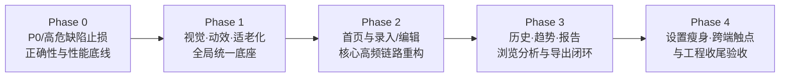

# 家庭血压记录 App · UI/UX、用户体验与动效综合优化总方案（交叉审计合并版）

- **代码基线**：`com.yang.bloodpressure` Android 客户端，`versionName = 2.3.9`（`versionCode = 50`），`compileSdk / targetSdk = 36`，`minSdk = 26`，Jetpack Compose + Material 3
- **来源文档**：
  - **文档 A**：[UI_UX_AUDIT.md](file:///e:/blood%20pressure%20record/UI_UX_AUDIT.md)（全面 UI/UX 审计报告，28 项分级问题 `UX-01`～`UX-28`）
  - **文档 B**：[MOTION_OPTIMIZATION_PLAN.md](file:///e:/blood%20pressure%20record/MOTION_OPTIMIZATION_PLAN.md)（苹果级细腻丝滑动效优化方案）
  - **文档 C**：[UX_OPTIMIZATION_PLAN.md](file:///e:/blood%20pressure%20record/UX_OPTIMIZATION_PLAN.md)（全项目用户体验审查与优化方案）
- **合并目标**：消除三份文档间的 **8 项直接冲突/架构互斥** 与 **14 处高频重复修改**，保留各文档独有价值，按代码依赖关系重排为可一次落地的零返工实施总方案。

---

## 一、零破坏约束与必须保留的设计护栏

所有优化严格遵守以下边界：
1. **零存储与医学规则破坏**：不修改 Room 数据库结构（保持 v9）、不修改 `.xlsx` / `.bpx` 备份格式（保持 v6）、不修改已持久化的代表值计算与《中国高血压防治指南》分级阈值。
2. **保留 5 项既有优秀设计（禁止过度改造）**：
   - 主操作珊瑚橙 `#B94B39`（浅）/ `#FFA997`（深）与正文对比度设计（完整保留）；
   - `MeasurementReadingCard` 常规三栏 / 窄屏大字自动退化“上二下一”与反向折算字号机制（保留并复用到编辑页）；
   - 底部悬浮胶囊 Dock 独立图层架构与收起时 `clearAndSetSemantics` 防幽灵焦点机制（保留架构，仅优化弹簧与弹性高度）；
   - `UpdatePromptGate` 在录入/编辑/全屏趋势/备份期间静默避让更新弹窗机制（完整保留）；
   - 医生报告默认不勾选姓名年龄且不记忆、切换隐私开关后重算完成才允许导出的隐私安全机制（完整保留）。
3. **测试契约保护**：凡涉及既有 UI/JVM 测试断言变更的项目（如周一起始、保存弹窗取舍、脉搏选填标签、报告日历选期），均在对应阶段显式列出需同步更新的测试类，并在 `LocalReducedMotion` 开启时保证所有动效 0ms 同帧落位。

---

## 二、三份文档交叉审计报告

### 2.1 直接冲突与架构互斥裁决表（共 8 项）

| 冲突编号 | 冲突主题 | 文档间矛盾点 | 裁决与合并方案 |
| :--- | :--- | :--- | :--- |
| **C-01**（重大） | **编辑页表单形态**（`EditSessionScreen`） | **A(`UX-09`) & C(模块二)**：废弃旧版横向 Chip 单组切换，重构为与新增页 **100% 同构的纵向多组平铺**。<br>**B(第4节)**：基于旧版横向单组切换，设计了“点击第 1/2/3 组 Chip 时按组号左右微移过渡”的动效。 | **采纳 A & C（重构为纵向多组同构表单）**。废弃 B 的横向单组切换动效（避免先写后删返工）；保留 B 的加载态淡入、卡片增删平滑过渡与错误/高风险条 `AnimatedVisibility`。 |
| **C-02**（重大） | **「补充情况（选填）」交互形态** | **A(`UX-19`) & B(二.2/第4节)**：保留「读数 ↔ 补充情况」整页切换，在补充页补 `"返回读数"` 按钮、主表单回显 `"补充情况（已填写）"` + `directionalSlideFade` 过渡。<br>**C(原则6 / Q3-A)**：取消整页切换，改为读数卡片下方的**原地折叠展开区 `ExpandableSupplementCard`** + 常用词点选胶囊。 | **列为待决项 `D-02`（默认推荐 C 的原地折叠展开）**，并复用 B 的 `ExpandableSection` 统一折叠进度动效；若选择保留子页切换（`D-02` 备选），则采纳 A & B 的双向按钮与方向滑移，同时在子页内保留 C 的常用词胶囊。无论哪种形态，均兼容 A(`UX-08`) 条件展示旧版 `note`。 |
| **C-03**（重大） | **保存血压后的反馈方式**（`SessionCompletedDialog`） | **A(`UX-19`)**：保留弹窗 + 补分级芯片 + 倒计时延至 8s 或按钮显示 `关闭(5s)`。<br>**B(二.1/第4节)**：保留 5s 弹窗及原有按钮契约 + 顶部勾选微动效 + 底部细进度条 + `"已记入血压本 · X 秒后自动返回"`。<br>**C(原则6 / Q1-A)**：彻底取消弹窗阻断，新增与修改均直返原页面 + 底部 5s 轻提示 `"已保存 125/80 mmHg · [再改改]"`。 | **拆分为两路径处理**：<br>1. **编辑保存**：三方方向一致，统一按 **A(`UX-06`) & C** 直接 `popBackStack()` 返回详情页 + 全局 Snackbar `"修改已保存"`，不弹窗。<br>2. **新增保存**：列为待决项 **`D-01`**——默认推荐 **C(无阻断直返 + 含分级的轻提示)**；若需零改动保护现有 UI 测试契约，则采用 **A + B 融合版**（保留 5s 完成弹窗 + 补分级 `StatusChip` + 勾选微动效 + 底部倒计时细进度条与文案）。 |
| **C-04**（中度） | **详情页删除后的撤销流程**（`HistoryDetailScreen`） | **A(`UX-04`)**：留在详情页内展示撤销 Snackbar，修复点是给页内 `SnackbarHost` 补 `pageContentBottomPadding()`。<br>**B(第5节)**：给详情页内“内容 ↔ 已删除等待撤销”加 `AnimatedContent` 过渡。<br>**C(模块三)**：改为**删除即退**（立即 `popBackStack()` 回列表/日历），由全局 `BloodPressureAppRoot` 的 `SnackbarHost` 展示 `"记录已删除 · [撤销]"`。 | **采纳 C（删除即退 + 全局撤销）**，消除空白详情页干等数秒的割裂感；同时**严格落实 A(`UX-04`) 的两点硬修复**：① 确保外层全局 `SnackbarHost` 避让悬浮 Dock 与三键导航栏；② 详情页新增 `loading = true` 初态，彻底消除首帧闪现“未找到记录”。 |
| **C-05**（中度） | **`AppBackButton.kt` 的去留** | **A(`UX-25`)**：指出 `AppBackButton` 实际调用路径恒为 `null`（死组件），与 `AppTopBar` 重复，建议清理删除。<br>**B(第2节)**：计划修改 `AppBackButton.kt` 补充按压缩放与 `LocalReducedMotion`。 | **采纳 A，直接清理/收敛 `AppBackButton`**，将 B 的 `pressableScale` 与底色平滑反馈统一落在唯一的 `AppTopBar` 返回按钮上，避免维护死代码。 |
| **C-06**（中度） | **双“目标”命名与四色条说明文案** | **A(`UX-05`, `UX-12`)**：建议改名「首页区间条分界」，说明含具体 `90/60、120/80、140/90` 参考值。<br>**C(文案表/模块六)**：建议资料改「达标高压/达标低压」、入口改「首页四色条区间」，说明偏口语化。 | **融合定稿（见第三章）**：资料称 `达标高压 / 达标低压`，入口称 `首页四色条区间`，说明同时保留 `90/60、120/80、140/90 mmHg` 透明参考值与“不影响医学分级”的清晰口语提示。 |
| **C-07**（轻度） | **备注搜索空白态文案与形态** | **B(二.3/第5节)**：纯文本引导 `"输入头晕、散步、服药等关键词，快速找回当时的记录"` + `fadeThrough`。<br>**C(文案表/模块三)**：文案列举症状/因素/备注词 + **快捷搜索词芯片**一键填入。 | **融合 B + C + A(4.1)**：采用 C 的具象文案与快捷词芯片、B 的 `R.string.note_search_idle_hint` 与 `fadeThrough` 过渡，并落实 A(4.1) 将顶栏搜索框由浮动 `label` 改为 `placeholder` 防大字撑高顶栏。 |
| **C-08**（轻度） | **固定高度约束与 Dock 收起方向** | **A(`UX-11`, `UX-26`)**：所有固定 `.height(...)` 按钮改 `.heightIn(min = ...)`、`fontScale` 加 `2.0f` 上限；建议评估 Dock 收起停靠右下角。<br>**B(第2/4节)**：`CompactNumberField` 保持 `76dp` 高度、Dock 收起直接换 `springGentle`。 | **按序协同**：① `InlineSessionAction`、空态按钮、`DashedAddGroupButton` 必须改 `.heightIn(min = ...)`，`CompactNumberField` 改为 `.heightIn(min = 76.dp)` 兼顾常规高度与极端大字；② Dock 收起停靠方向经实机确认后再与 B 的 `springGentle` 同步调整。 |

---

### 2.2 重复修改与高频重叠去重表（共 14 处）

以下模块被两份或三份文档同时覆盖，合并后按**单次触碰、一次改完**原则收敛：

| 编号 | 涉及文件 / 模块 | 重叠来源 | 合并后的统一实施要点 |
| :--- | :--- | :--- | :--- |
| **O-01** | `SettingsSubpages.kt` (`MedicationEditorDialog`) | A(`UX-02`) + B(6) + C(6) | 弹窗内前置校验（未通过绝不关闭丢字）+ 新建默认带入 `"08:00"` + 点击已有时间可直接修改 + 时间项增删 `AnimatedVisibility` |
| **O-02** | `BpZoneTargetSheet.kt` + `strings.xml` | A(`UX-05`) + B(6) + C(6) | 清除“待产品确认”占位语 + 新增「恢复默认区间」一键复位 + 校验错误提示 `AnimatedVisibility` |
| **O-03** | `EditSessionScreen.kt` + `EditSessionViewModel.kt` + `AppNavigation.kt` | A(`UX-06/08/09`) + B(4) + C(2) | 复用新增页纵向多组表单 + 注入 `highRiskAlertEnabled` + 条件展示旧版 `note` + 保存后 `popBackStack()` 回详情页 + 统一过渡动效 |
| **O-04** | `ReportOptionsScreen.kt` + `ReportPreviewScreen.kt` | A(`UX-07/17/23`) + B(6) + C(5) | 自定义周期改 `DatePickerDialog`（7 日自动算终点、禁选未来日）+ 预览页 `BackHandler` 退回选项页 + 导出栏固定至底部安全区 + 根容器补背景色 + 方向切换与 PDF 淡入 |
| **O-05** | `TrendScreen.kt`（空状态 + 达标率圆环） | A(`UX-16`) + B(5) + C(4) | 无数据时隐藏全屏按钮/粒度切换/空统计壳，仅留范围栏与单张引导卡；深色圆环底轨改 `surfaceContainerHighest` + 进度平滑舒展 + 合并无障碍语义 |
| **O-06** | `TrendFullscreenScreen.kt` | A(4.5) + B(5) + C(4) | 顶栏外露「上一条 / 下一条 / 明细」+「时分」改胶囊选中态 + 宽屏明细侧栏滑入动画 + 根容器补背景色 |
| **O-07** | `DashboardScreen.kt`（首页卡片穿透与反馈） | A(`UX-18`) + B(3) + C(1) | 绑定 `ReadingHero` 读数区与已测早/晚槽点击直达 `HistoryDetail` + 接线 `onViewTodayRecords` + 接入 `pressableScale` 与背景/数字平滑过渡 |
| **O-08** | `DashboardViewModel.kt` + `NaturalWeek.kt` | A(`UX-12`) + C(1) | 首页早/晚槽统一对齐 `SessionStatisticsCalculator`（`05:00–11:59` / `18:00–23:59`），午后/凌晨记录在下方温和提示并可跳当日详情；周起点统一为周一（见 `D-04`） |
| **O-09** | `SettingsScreen.kt` + `SettingsSubpages.kt`（显示与资料） | A(`UX-21`) + B(6) + C(6) | 「显示趋势图」「启用高风险提醒」合入“我的 → 显示”消除大字开关重复；资料「性别」改点选胶囊 + 补 `imePadding()` + 脏状态返回拦截；静态小压关闭无限浮动 |
| **O-10** | `SessionFormComponents.kt`（录入体验与对比度） | A(`UX-10`, 4.3) + B(4) + C(2) | 未聚焦边框提至 `≥3:1` + 获焦标签/边框点亮 + `脉搏（选填）` + 非末组 `ImeAction.Next` + 生理上限自动跳格 + `disabledReason` 防按钮跳动 + 平均卡补标题与分级芯片 |
| **O-11** | `ReminderReceiver.kt` + `BloodPressureWidget.kt` + `MainActivity.kt` | A(`UX-22/24`) + C(6) | 测量通知与小组件空态/`+ 记一次` 直达 `AddMeasurement`；小组件接入深浅色 `ColorProvider`、补全“· 高风险”文字后缀、统一低压深蓝；服药通知加“已服用”快捷打卡并跳过已打卡项 |
| **O-12** | `HistoryScreen.kt` | A(4.4) + B(5) + C(3) | 月历年月加 `▾` 下拉箭头 & 按需“回到今天” + 图例改色块/圆点/`!` 一一对应 + 近期空态移除 `--` 壳 + 月历左右方向翻页 + 日历格即时按压缩放 |
| **O-13** | `SettingsDataManagementScreen.kt` | A(`UX-20/27`) + B(二.3/6) + C(6) | 导入改名支持 `.xlsx / .bpx` + 清空数据双保险 + 统一中文省略号 `…` 区分执行态 + 进度条/结果提示 `AnimatedVisibility` + 备份口令框加明文切换眼睛 |
| **O-14** | `BpRangeBar.kt` + `LocateBpZoneUseCase.kt` + `ReadingHero` | A(`UX-01/03/10`) + B(3) | 先修 `LocateBpZoneUseCase` P0 单轴偏低误判、`ReadingHero` 补六级 `GradeChip`、去 `mmHg` 透明度衰减；再接入 `LocalReducedMotion` 与 `springGentle` 三角游标 |

---

### 2.3 实施前需确认的 4 个最终交互取舍（Open Decisions）

> 以下 4 项均已给出结合三份文档交叉审计后的顾问推荐方案；回复 **“全部按推荐执行”** 即可直接进入编码，或针对任意条目指定偏好。

1. **`D-01` · 新增血压保存后的反馈方式（源于冲突 `C-03` / 文档 C Q1）**
   - **（推荐）方案 A**：无阻断直返首页 + 全局底部 5 秒可交互提示条 `"已保存 125/80 mmHg（正常高值） · [再改改]"`（修改历史记录同样直返详情页 + `"修改已保存"`）。
   - **方案 B（零测试破坏保底）**：新增保留 5 秒 `SessionCompletedDialog` 契约，补齐分级 `StatusChip` + 勾选微动效 + 底部细进度条与 `"已记入血压本 · X 秒后自动返回"`；修改历史记录不弹窗直接退回详情页。
2. **`D-02` · 录入/编辑页「补充情况（选填）」形态（源于冲突 `C-02` / 文档 C Q3）**
   - **（推荐）方案 A**：改为读数卡片下方**原地折叠展开 `ExpandableSupplementCard`** + 常用症状/因素点选胶囊（点一下填入、再点收回），无需整页跳转。
   - **方案 B**：保留整页子视图切换，补齐 `"返回读数"` 按钮、`"补充情况（已填写）"` 暖色圆点及 `directionalSlideFade` 过渡，并在子页内加入常用词胶囊。
3. **`D-03` · 医生报告「是否包含姓名与年龄」隐私确认方式（源于文档 C Q2）**
   - **（推荐）方案 A**：将隐私开关（`包含姓名与年龄` 每次重进默认关闭、`包含备注`、`包含药品`）前置到“导出医生报告”首屏卡片（未填个人资料时自动置灰说明），点击“生成预览”一步直达。
   - **方案 B**：保留弹窗确认，但检测到姓名与年龄均为空时自动跳过弹窗。
4. **`D-04` · 首页「这一周」起始日统一（源于文档 A `UX-12` / 文档 C Q4）**
   - **（推荐）方案 A**：统一改为 **周一开头（一 二 三 四 五 六 日）**，与历史日历和“本周”统计完全一致。
   - **方案 B**：维持首页周日开头不变，仅补充起止日期标注。

---

## 三、全项目统一规范定稿（文案 · 色彩 · 动效）

### 3.1 核心文案定稿对照表

| 位置 | 当前文案 | 定稿文案 | 依据 |
| :--- | :--- | :--- | :--- |
| 录入/编辑 · 脉搏框 | `脉搏` | `脉搏（选填）` | C(原则8) |
| 录入/编辑 · 平均卡 | `125 / 80 mmHg` / `2 次测量` | `本次平均（2 组）` + `125 / 80 mmHg` + `[分级芯片]` | C(原则8) |
| 录入/编辑 · 校验语 | `第1组：收缩压和舒张压必须为整数。` | `请把第 1 组的高压和低压填完整` | C(原则4) |
| 首页 · 空服药标题 | `今日服药` · `0/0 已打卡` | `今日服药`（无药品时隐藏 `0/0`） | C(原则2) |
| 首页 · 0 天连续卡 | `0 天` / `连续记录` | `今天开始` / `每天记一记，养成好习惯` | C(原则2) |
| 首页 · 小压轮播语 | `尚未设置服药提醒` 等 | `测血压前先静坐休息 5 分钟，结果更准哦～` / `平时少吃咸，睡个好觉，血压更平稳～` | C(文案表) |
| 历史 · 空状态按钮 | `新增测量` | `记一次血压` | C(原则4) |
| 搜索 · 初始空白态 | `搜索历史备注`（与顶栏重复） | `输入不舒服症状、影响因素或备注词（如：头晕、没睡好、漏服药）` + 快捷词芯片 | C-07 融合 |
| 设置 · 资料目标 | `目标高压` / `目标收缩压（可选）` | `达标高压 / 达标低压（用于趋势参考线与达标率）` | C-06 融合 |
| 设置 · 四色条入口与说明 | `血压目标范围` + `…待产品确认。` | 入口：`首页四色条区间`<br>说明：`默认范围参考常用成人血压区间（90/60、120/80、140/90 mmHg），仅用于调整首页四色条的显示位置，不改变医学血压分级；可按医生建议微调。` | C-06 融合 |
| 数据管理 · 恢复与加载态 | `从 Excel 备份导入` / `正在处理...` | `从备份文件恢复（支持 .xlsx / .bpx）` / 按动作区分并统一中文省略号 `…` | B(二.3) + C(6) |
| 数据管理 · 清空提示 | 简略提示 | `将永久清空本机全部血压记录、药品与服药打卡、个人资料。建议先导出备份。` | C(6) |

### 3.2 统一视觉语义与无障碍对比度基准

- **跨端指标色唯一基准**（`UX-13`）：全应用（端内趋势图、桌面小部件、医生报告 PDF）统一 **收缩压（高压）= 暖陶土/珊瑚橙**（端内 `#B94B39`/`#FFA997`，PDF `#C4513E`），**舒张压（低压）= 深蓝/天蓝**（端内 `#02578B`/`#8BD2FF`，PDF `#1F5FA8`）。
- **六级血压色盘单源化**（`UX-14`）：在 `Theme.kt` 通过 `LocalIsDarkTheme` 与 `LocalBpGradePalette` 统一分发，收敛 `DesignSystem`、`Dashboard`、`History`、`Trend` 重复硬编码，移除 `background.red < 0.5f` 暗色猜测；`BpRangeTokens` 的 `LOW` 段改用柔和蓝紫色系（与正常绿拉开区分）；冷启动 `res/values/colors.xml` 同步为 `#FAF6EF`、`values-night/colors.xml` 同步为 `#1A1512`。
- **WCAG 2.1 硬底线**（`UX-10`）：`CompactNumberField` 未聚焦边框对比度 `≥3:1`；深色趋势图高风险圆环改取 `scheme.error`；`ReadingHero` 去掉 `mmHg` 与组数文字的二次透明度衰减（恢复 `≥4.56:1`）；小部件次级文字加深至 `#645C55`（浅）/ `#B6B0A9`（深）。

### 3.3 统一动效语言底座（`AppMotion` & `LocalReducedMotion`）

- **全局减少动态效果监听**：`AppLocals.kt` 新增 `LocalReducedMotion` 与 `rememberSystemReducedMotion()`（`ContentObserver` 实时监听 `ANIMATOR_DURATION_SCALE == 0f`），在 `Theme.kt` 注入，替代 `BpRangeBar` 与 `Buddy` 散落实现。
- **单一动效族**：
  - 物理弹簧（保速可打断，用于位移/缩放/滑块/折叠/吸附）：`springPress`（无过冲 900）、`springSnappy`（0.94 / 520）、`springGentle`（无过冲 340）、`springCheck`（0.78 / 480）；
  - 光学曲线（用于颜色/透明度/页面层级）：`SmoothOutEasing (0.22, 1, 0.36, 1)`、`SmoothInEasing (0.32, 0, 0.67, 0)`、`directionalSlideFade`、`verticalNumericRoll`；
  - 全局 `TextStyle.tabularNums()`（`fontFeatureSettings = "tnum"`）覆盖全部读数、统计值与时间轮盘。

---

## 四、分阶段零返工实施路线图



### Phase 0：P0 / 高危缺陷止损与性能底线（优先落地）

1. **修正首页区间条单轴偏低误判（`UX-01`）**：修改 [LocateBpZoneUseCase.kt](file:///e:/blood%20pressure%20record/app/src/main/java/com/example/bloodpressurerecord/domain/calculator/LocateBpZoneUseCase.kt)，优先级对齐 `BloodPressureRules.category()`（先判 `HIGH > ELEVATED`，未升高时任一轴为 `LOW` 即判 `LOW`，双轴 `NORMAL` 才判 `NORMAL`），同步更新 `LocateBpZoneUseCaseTest`。
2. **修复药品编辑弹窗丢数据（`UX-02` / `O-01`）**：修改 [SettingsSubpages.kt](file:///e:/blood%20pressure%20record/app/src/main/java/com/example/bloodpressurerecord/ui/settings/SettingsSubpages.kt)，在 `MedicationEditorDialog` 内部前置校验 `name.isNotBlank() && times.isNotEmpty()`，未通过时禁用保存并红字内联提示，绝不关闭弹窗；新建默认预填 `"08:00"`，已有时间支持点击直接修改。
3. **补齐首页主卡分级芯片与对比度硬修复（`UX-03` / `UX-10`）**：
   - [DashboardScreen.kt](file:///e:/blood%20pressure%20record/app/src/main/java/com/example/bloodpressurerecord/ui/home/DashboardScreen.kt)：`ReadingHero` 补齐 `GradeChip` 并去掉 `mmHg`/组数文字的 `0.7f` 透明度衰减；
   - [SessionFormComponents.kt](file:///e:/blood%20pressure%20record/app/src/main/java/com/example/bloodpressurerecord/ui/common/SessionFormComponents.kt)：`CompactNumberField` 未聚焦边框提至 `≥3:1`；
   - [TrendChartDrawing.kt](file:///e:/blood%20pressure%20record/app/src/main/java/com/example/bloodpressurerecord/ui/history/TrendChartDrawing.kt)：深色高风险圆环改取 `scheme.error`。
4. **修复详情页初态闪屏、全局撤销安全区与两处返回栈断裂（`UX-04` / `UX-06` / `UX-07` / `UX-23`）**：
   - [HistoryDetailViewModel.kt](file:///e:/blood%20pressure%20record/app/src/main/java/com/example/bloodpressurerecord/ui/history/HistoryDetailViewModel.kt) 新增 `loading = true` 初态；确认外层 `SnackbarHost` 避让悬浮 Dock 与底部系统导航栏；
   - [AppNavigation.kt](file:///e:/blood%20pressure%20record/app/src/main/java/com/example/bloodpressurerecord/navigation/AppNavigation.kt) 中 `HistoryEdit.onSaved` 统一为 `navController.popBackStack()`；
   - [ReportPreviewScreen.kt](file:///e:/blood%20pressure%20record/app/src/main/java/com/example/bloodpressurerecord/ui/report/ReportPreviewScreen.kt) 接入 `BackHandler` 与顶栏返回调用 `viewModel.returnToOptions()`；
   - 为 `TrendScreen`、`TrendFullscreenScreen`、`ReportOptionsScreen`、`ReportPreviewScreen` 根容器补 `.background(MaterialTheme.colorScheme.background)`。
5. **消除研发占位语与小压 120Hz 无限重排（`UX-05` / 文档 B 性能关键修复）**：
   - 更新 `strings.xml` 中 `bp_zone_config_placeholder_note` 并在 [BpZoneTargetSheet.kt](file:///e:/blood%20pressure%20record/app/src/main/java/com/example/bloodpressurerecord/ui/home/BpZoneTargetSheet.kt) 增加「恢复默认区间」；
   - [Buddy.kt](file:///e:/blood%20pressure%20record/app/src/main/java/com/example/bloodpressurerecord/ui/home/Buddy.kt) 将 `.offset(y = ...)` 迁至纯 GPU `.graphicsLayer`，新增 `animateIdle: Boolean = true`（“我的”页静态头像传 `false`）。

---

### Phase 1：视觉、动效与适老化全局底座（`ui/theme` & `ui/common` & `navigation`）

1. **主题、色盘与排版底座**：
   - [AppLocals.kt](file:///e:/blood%20pressure%20record/app/src/main/java/com/example/bloodpressurerecord/ui/AppLocals.kt)：注入 `LocalReducedMotion`、`LocalIsDarkTheme`、`LocalBpGradePalette`；
   - [AppMotion.kt](file:///e:/blood%20pressure%20record/app/src/main/java/com/example/bloodpressurerecord/ui/theme/AppMotion.kt)：落地四档弹簧族与光学曲线族；
   - [Type.kt](file:///e:/blood%20pressure%20record/app/src/main/java/com/example/bloodpressurerecord/ui/theme/Type.kt)：全局读数/统计样式补齐 `tabularNums()`；
   - [Theme.kt](file:///e:/blood%20pressure%20record/app/src/main/java/com/example/bloodpressurerecord/ui/theme/Theme.kt) + `res/values*/colors.xml`：收敛六级色盘、修正冷启动底色、加入深浅色 ~200ms 暖调柔和过渡；
   - [MainActivity.kt](file:///e:/blood%20pressure%20record/app/src/main/java/com/example/bloodpressurerecord/MainActivity.kt)（`UX-11`）：对合成 `fontScale` 增加 `coerceAtMost(2.0f)` 上限保护，将全站固定 `.height(...)` 按钮改为 `.heightIn(min = ...)`。
2. **导航与通用容器升级**：
   - [AppNavigation.kt](file:///e:/blood%20pressure%20record/app/src/main/java/com/example/bloodpressurerecord/navigation/AppNavigation.kt)：`AddMeasurement` 改为自下而上模态升起/向下落回（保留预测式返回）；`AppBottomDock` 进出子页改 `AnimatedVisibility` 平滑下沉/上浮；
   - [AppComponents.kt](file:///e:/blood%20pressure%20record/app/src/main/java/com/example/bloodpressurerecord/ui/common/AppComponents.kt)：清理冗余 [AppBackButton.kt](file:///e:/blood%20pressure%20record/app/src/main/java/com/example/bloodpressurerecord/ui/common/AppBackButton.kt)（`C-05`），封装零重排 `Modifier.pressableScale()` 覆盖主次危险按钮与 `AppTopBar` 返回键；`SegmentedPillGroup` 升级为单一共享弹簧胶囊滑块；`StatusChip` 补齐颜色平滑过渡；
   - [AppBottomDock.kt](file:///e:/blood%20pressure%20record/app/src/main/java/com/example/bloodpressurerecord/ui/common/AppBottomDock.kt)：收放改用 `springGentle`，中央 `+` 加 `0.92f` 按压回弹，Tab 补齐色彩/微缩放/圆点弹簧生长（并结合实机评估 `UX-26` 右下角停靠）；
   - [ExpandableSection.kt](file:///e:/blood%20pressure%20record/app/src/main/java/com/example/bloodpressurerecord/ui/common/ExpandableSection.kt)：改为单一 `expandProgress` 同时驱动裁剪高度、透明度与摘要显隐，彻底解决收起第 1 帧内容闪空；
   - [HideOnScroll.kt](file:///e:/blood%20pressure%20record/app/src/main/java/com/example/bloodpressurerecord/ui/common/HideOnScroll.kt)：`onPostFling` 承接惯性速度弹簧吸附；
   - [WheelTimePicker.kt](file:///e:/blood%20pressure%20record/app/src/main/java/com/example/bloodpressurerecord/ui/common/WheelTimePicker.kt)：按距中心像素距离在 `graphicsLayer` 连续插值缩放/倾角/透明度 + `tabularNums()` + 跨格轻触觉反馈。

---

### Phase 2：核心高频链路重构（首页看板 + 录入/编辑同构流）

1. **首页口径统一、卡片穿透与丝滑反馈（`ui/home` & `domain/time`）**：
   - [NaturalWeek.kt](file:///e:/blood%20pressure%20record/app/src/main/java/com/example/bloodpressurerecord/domain/time/NaturalWeek.kt) & [DashboardViewModel.kt](file:///e:/blood%20pressure%20record/app/src/main/java/com/example/bloodpressurerecord/ui/home/DashboardViewModel.kt)：按 `D-04` 统一周一开头；早/晚槽对齐 `SessionStatisticsCalculator`（`05:00–11:59` / `18:00–23:59`），新增 `todayOtherSessions` 与 `streakCapped`（`365+ 天`）；
   - [DashboardScreen.kt](file:///e:/blood%20pressure%20record/app/src/main/java/com/example/bloodpressurerecord/ui/home/DashboardScreen.kt) & [BpRangeBar.kt](file:///e:/blood%20pressure%20record/app/src/main/java/com/example/bloodpressurerecord/ui/home/BpRangeBar.kt)：
     - 激活 `ReadingHero` 读数区与已测早/晚槽点击直达 `HistoryDetail`，接线 `onViewTodayRecords` 承接其他时段提示行；
     - 空态减负（无记录隐藏空 `BpRangeBar`、无药隐藏 `0/0`、0 天连续记录温暖起步文案、更新小压陪伴语）；
     - 区间游标升级 `springGentle`；Hero 背景/字色/数字与周柱高平滑演进；修复服药打卡对勾双重 `alpha` 变淡，补齐按压回弹与 `springCheck` 弹出及轻触觉。
2. **极速无感录入与新增/编辑 100% 同构（`ui/record`, `ui/common`, `ui/history`）**：
   - [SessionFormComponents.kt](file:///e:/blood%20pressure%20record/app/src/main/java/com/example/bloodpressurerecord/ui/common/SessionFormComponents.kt) & [SessionFormLogic.kt](file:///e:/blood%20pressure%20record/app/src/main/java/com/example/bloodpressurerecord/ui/common/SessionFormLogic.kt)：
     - 焦点联动（获焦同步点亮上方标签与边框）+ 智能自动跳格 `shouldAutoAdvanceField`（自动避让无障碍触摸浏览模式，退格/中间编辑不误跳）+ 非末组脉搏 `ImeAction.Next`；
     - `脉搏（选填）` 标签、`SessionAverageCard` 补 `"本次平均（X 组）"` + 分级芯片、校验语口语化；
     - 组内分级条、高低压报错、`InlineSessionAction` 的 `disabledReason` 全部接入 `AnimatedVisibility`（消除输满第 2 组时保存按钮突然上跳 ~24dp）；
     - 按 `D-02` 落地原地折叠 `ExpandableSupplementCard` + 常用症状/因素点选胶囊（编辑页若旧版 `note` 非空，在展开区内条件展示可编辑输入框，解决 `UX-08`）；
   - [AddMeasurementScreen.kt](file:///e:/blood%20pressure%20record/app/src/main/java/com/example/bloodpressurerecord/ui/record/AddMeasurementScreen.kt) & [HomeViewModel.kt](file:///e:/blood%20pressure%20record/app/src/main/java/com/example/bloodpressurerecord/ui/home/HomeViewModel.kt)：
     - 空白进入自动聚焦第 1 组高压、点「再加一组」自动聚焦新组高压；移除第 3+ 组支持底部 Snackbar 撤销；
     - 跨天草稿恢复提示移至页首「测量时间」上方，附带「清空重记 / 用当前时间」入口（`UX-20`）；
     - 按 `D-01` 落地新增保存后反馈；
   - [EditSessionScreen.kt](file:///e:/blood%20pressure%20record/app/src/main/java/com/example/bloodpressurerecord/ui/history/EditSessionScreen.kt) & [EditSessionViewModel.kt](file:///e:/blood%20pressure%20record/app/src/main/java/com/example/bloodpressurerecord/ui/history/EditSessionViewModel.kt)：
     - 彻底复用与新增页一致的纵向多组表单、实时高风险横幅、移除组撤销与补充情况区；注入 `highRiskAlertEnabled` 与 `updateNote()`。

---

### Phase 3：历史、趋势与医生报告升级（`ui/history` & `ui/report`）

1. **历史日历、备注搜索与详情防误删**：
   - [HistoryScreen.kt](file:///e:/blood%20pressure%20record/app/src/main/java/com/example/bloodpressurerecord/ui/history/HistoryScreen.kt)：年月标题加 `▾` 下拉提示、按需显示「回到今天」；图例与色块/圆点/`!` 一一对应；近期空态移除全 `--` 统计壳；月历翻页按时间方向 `directionalSlideFade`；日历格加 0ms 即时 `0.92f` 按压缩放；搜索定位高亮卡增温和边框脉冲；
   - [NoteSearchScreen.kt](file:///e:/blood%20pressure%20record/app/src/main/java/com/example/bloodpressurerecord/ui/history/NoteSearchScreen.kt)：顶栏输入框用 `placeholder` 替代浮动 `label`；空白态展示具象文案与常用词快捷搜索芯片；状态切换用 `fadeThrough`；
   - [HistoryDetailScreen.kt](file:///e:/blood%20pressure%20record/app/src/main/java/com/example/bloodpressurerecord/ui/history/HistoryDetailScreen.kt)：底部主按钮突出全宽「修改记录」，「删除」移入低误触次级位置；确认删除后按 `C-04` 立即退回上一页并由全局 `SnackbarHost` 提供「撤销」。
2. **趋势图可读性、空态减负与跟手视窗**：
   - [TrendScreen.kt](file:///e:/blood%20pressure%20record/app/src/main/java/com/example/bloodpressurerecord/ui/history/TrendScreen.kt) & [TrendChartDrawing.kt](file:///e:/blood%20pressure%20record/app/src/main/java/com/example/bloodpressurerecord/ui/history/TrendChartDrawing.kt)：
     - 无数据时隐藏全屏按钮、粒度切换与空壳折叠卡，仅留范围栏 + 单张引导卡；
     - 补双指标图例与 `mmHg` 单位、区分 `140/90` 长虚线与个人目标点状虚线/右端标签、读数栏补分级芯片（`UX-15`）；
     - `SegmentedControl` 升级共享弹簧胶囊滑块；达标率圆环底轨改 `surfaceContainerHighest` + 进度平滑舒展 + 合并语义；
   - [TrendChartGestures.kt](file:///e:/blood%20pressure%20record/app/src/main/java/com/example/bloodpressurerecord/ui/history/TrendChartGestures.kt) & [TrendChartModels.kt](file:///e:/blood%20pressure%20record/app/src/main/java/com/example/bloodpressurerecord/ui/history/TrendChartModels.kt)：再次点击已选节点取消固定十字线；手势缩放/平移/长按擦除保持 0ms 跟手，按钮触发视窗跳转支持平滑过渡且手指按下即刻打断；
   - [TrendFullscreenScreen.kt](file:///e:/blood%20pressure%20record/app/src/main/java/com/example/bloodpressurerecord/ui/history/TrendFullscreenScreen.kt)：顶栏外露「上一条 / 下一条 / 明细」，「时分」改胶囊选中态，宽屏右侧明细面板接入横向滑入/滑出。
3. **医生报告日历选期、PDF 配色统一与常驻导出栏**：
   - [ReportTheme.kt](file:///e:/blood%20pressure%20record/app/src/main/java/com/example/bloodpressurerecord/export/report/ReportTheme.kt)：对调高压/低压色为「高压暖橙、低压深蓝」，与端内趋势图 100% 一致（`UX-13`）；
   - [ReportOptionsScreen.kt](file:///e:/blood%20pressure%20record/app/src/main/java/com/example/bloodpressurerecord/ui/report/ReportOptionsScreen.kt) & [ReportPreviewScreen.kt](file:///e:/blood%20pressure%20record/app/src/main/java/com/example/bloodpressurerecord/ui/report/ReportPreviewScreen.kt)：
     - 重写 `CustomPeriodDialog` 为 `DatePickerDialog` 点选（禁选未来日，7 日模板选起点自动算出第 7 天终点）；
     - 按 `D-03` 首屏直管隐私开关；配置 ↔ 预览接入 `directionalSlideFade`；PDF 页面渲染完成柔和淡入；
     - 导出操作移至底部常驻安全区栏（主按钮「分享 PDF」+ 次级「保存到文件 / 打印 / 存摘要图」），全部替换为公共 `AppPrimaryButton` / `AppSecondaryButton`（`UX-25`）。

---

### Phase 4：设置中心瘦身、延伸触点与工程收尾

1. **设置中心与数据管理升级（`ui/settings` & `update`）**：
   - [SettingsScreen.kt](file:///e:/blood%20pressure%20record/app/src/main/java/com/example/bloodpressurerecord/ui/settings/SettingsScreen.kt) & [SettingsSubpages.kt](file:///e:/blood%20pressure%20record/app/src/main/java/com/example/bloodpressurerecord/ui/settings/SettingsSubpages.kt)：
     - 「显示趋势图」「启用高风险提醒」合入“我的 → 显示”，消除大字开关重复；
     - 用户资料「性别」改点选胶囊，补 `imePadding()`，新增 `isProfileDirty` 与 `BackHandler` 未保存拦截；
     - 药品卡片整行点按编辑，「删除药品」收进编辑弹窗底部（配二次确认 + 删除后全局 Snackbar 撤销）；修改晨/晚提醒时间自动联动开启对应提醒开关；设置操作反馈改用 Snackbar 或就近区分 `error` 色（`UX-20`）；替换 40dp 原生 `Button`（`UX-25`）；
   - [SettingsDataManagementScreen.kt](file:///e:/blood%20pressure%20record/app/src/main/java/com/example/bloodpressurerecord/ui/settings/SettingsDataManagementScreen.kt)：导入改名支持 `.xlsx / .bpx`；5000 条分卷提示按需展示；备份口令框增加 `Visibility / VisibilityOff` 明文切换与 `KeyboardType.Password`（`UX-27`）；清空数据弹窗增“先导出备份”入口与确认勾选框；统一加载态中文省略号 `…` 与 `AnimatedVisibility`；
   - [UpdateUi.kt](file:///e:/blood%20pressure%20record/app/src/main/java/com/example/bloodpressurerecord/update/UpdateUi.kt)：更新检查五态区域加入轻量过渡。
2. **延伸触点增强（小部件与系统通知）**：
   - [BloodPressureWidget.kt](file:///e:/blood%20pressure%20record/app/src/main/java/com/example/bloodpressurerecord/widget/BloodPressureWidget.kt)：接入深浅色 `ColorProvider`、加深次级字对比度、低压曲线同步深蓝、单组高风险拼接 `"· 高风险"` 后缀；空状态及顶栏 `+ 记一次` 点击直达 `AddMeasurement`；
   - [ReminderReceiver.kt](file:///e:/blood%20pressure%20record/app/src/main/java/com/example/bloodpressurerecord/reminder/ReminderReceiver.kt) & [MainActivity.kt](file:///e:/blood%20pressure%20record/app/src/main/java/com/example/bloodpressurerecord/MainActivity.kt)：测量提醒点击直达 `AddMeasurement`；服药通知跳过当日已打卡项并增加“已服用”快捷 Action。
3. **工程清理与版本说明对齐（`UX-28`）**：
   - 移除未引用的 `app/src/main/res/font/caprasimo_regular.ttf`、`R.string.bp_range_edit_hint`、`MonthEncouragementBar()` 及 `showDate` 死参数；
   - 修正 [AppInfoContent.kt](file:///e:/blood%20pressure%20record/app/src/main/java/com/example/bloodpressurerecord/ui/settings/AppInfoContent.kt) 中 `2.3.8` / `2.3.9` 版本说明错位。

---

## 五、统一验证与真机验收清单

### 5.1 自动化构建与测试验证

每阶段收尾在项目根目录执行：

```powershell
.\gradlew.bat testDebugUnitTest lintDebug assembleDebug assembleDebugAndroidTest
```

重点新增/同步测试覆盖：
- `LocateBpZoneUseCaseTest`：单轴 `LOW` + 另一轴 `NORMAL` 准确落入 `LOW`；
- `NaturalWeekTest` & `DashboardViewModelTest`：周一起始、早晚时段（`05:00–11:59` / `18:00–23:59`）与午后/凌晨分流、`365+ 天` 上限；
- `SessionFormLogicDynamicTest` & 自动跳格单测：正向输入自动跳格、退格/中间编辑绝不误跳；
- `EditSessionViewModelTest`：`highRiskAlertEnabled = false` 不弹窗、旧版 `note` 可编辑回写；
- `AppMotion` / `TrendTimeViewportState` 单测：`LocalReducedMotion` 0ms 落位与视窗动画触碰打断一致性；
- `SettingsViewModelTest`、`DashboardLayoutTest`、`SessionFormComponentsTest`、`ReportScreenTest`、`BpRangeBarTest`、`TrendReadoutAccessibilityTest` 全部对齐并通过。

### 5.2 真机/模拟器专项验收矩阵（`R-01`～`R-08`）

| 编号 | 验收场景 | 测试条件与重点核查指标 |
| :--- | :--- | :--- |
| **R-01** | **极端字体叠加排版** | 320dp 窄屏 + 系统 `200%` 字号 + 应用大字模式：检查保存按钮、Dock 胶囊、搜索顶栏、横屏工具栏、报告常驻底栏无文字裁切。 |
| **R-02** | **软键盘弹出与闭眼连输** | 第三方高键盘（搜狗/讯飞）：进录入页自动聚焦第 1 组高压，连敲 2 组 6 格顺滑跳格，输满时「保存记录」按钮无 ~24dp 上跳；用户资料页底部输入框不被键盘遮挡。 |
| **R-03** | **TalkBack 逐焦无障碍** | 开启 TalkBack 盲操录入、区间条（含 `85/70` 偏低播报）、月历、趋势读数、时间轮盘与折叠区，确认无自动跳格干扰、无幽灵焦点。 |
| **R-04** | **三键导航 vs 手势导航** | 切换三键与手势导航（深/浅色各一次）：核查删除记录后的全局「撤销」Snackbar 不被系统底栏或 Dock 遮挡；评估 Dock 收起停靠左/右下角手感。 |
| **R-05** | **跟手、可打断与关闭动画（0x）** | 分段滑块连点转向、折叠区快速双击反向、顶栏轻拂惯性吸附、趋势按钮跳转中手指按下立即接管；系统动画 `0x` 下所有状态同帧直达、小压停止浮动。 |
| **R-06** | **防丢字与反悔闭环** | 药品弹窗漏填信息点保存不丢字；删除第 3 组读数/记录/药品均可一键「撤销」；编辑历史记录保存后稳留原详情页。 |
| **R-07** | **跨端一致性核验** | 下午 14:30 记一条血压，核对首页、趋势、7 日报告口径一致；核对端内趋势图、深色桌面小部件、PDF 报告高压橙/低压蓝完全一致。 |
| **R-08** | **大屏/折叠屏与国产 ROM 表现** | 平板/折叠屏展开态趋势全屏与宽屏明细侧栏比例；国产 ROM 中英数字基线对齐与 120Hz 帧率平稳度。 |
