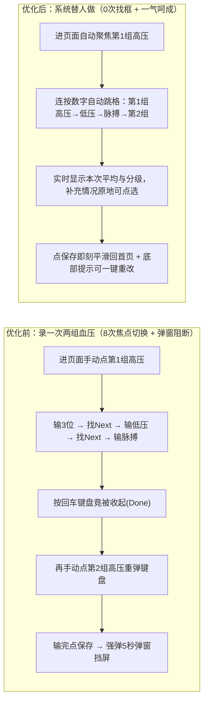

# 全项目用户体验审查与优化方案

## 目标与全项目体验诊断总览（顾问视角）

本方案面向产品的核心人群——**独立查看血压计、录入读数、回看趋势的中老年用户**，以 **“复杂应该留给我们系统，不要留给用户，用户体验至高无上”** 为最高准则，在不改变 Room v9 数据库结构、v6 备份兼容格式与医学血压分级阈值的前提下，对全应用所有页面、弹窗、文案、通知及小组件进行了代码级逐行审查与重塑。

### 八大原则全项目问题诊断矩阵

| 审查原则 | 现有项目典型体验痛点（代码事实） | 优化后系统承担方式 |
| :--- | :--- | :--- |
| **1. 系统能判断的，不留给用户** | • 医生报告自定义周期让用户手敲 `2026-11-18` 并自己心算“恰好 7 天”（[ReportOptionsScreen.kt](file:///e:/blood%20pressure%20record/app/src/main/java/com/example/bloodpressurerecord/ui/report/ReportOptionsScreen.kt#L144-L178)）<br>• 读数输满位数（如高压 `128` 或 `95`、低压 `82`）后仍需手动点下一格 | • 改用日历点选，7 日模板选起点后**系统自动算出第 7 天终点**并禁选未来日<br>• 结合生理上限（300/200/250）实现**输满自动跳下一格**与跨组键盘 `Next` 串联 |
| **2. 此刻没用的，就不出现** | • 趋势页无数据时，仍展示顶栏`全屏`及底下 5 个写满`暂无数据`的空壳折叠卡（[TrendScreen.kt](file:///e:/blood%20pressure%20record/app/src/main/java/com/example/bloodpressurerecord/ui/history/TrendScreen.kt#L139-L205)）<br>• 首页未添药却显示 `0/0 已打卡`，0 记录显示空灰条与 `0 天`<br>• 数据管理常驻 `超过 5000 条自动分卷` 提示；区间设置暴露 `待产品确认` 研发占位语 | • 无数据时仅保留单张引导卡，隐藏无效工具栏与空统计壳<br>• 未添药隐藏 `0/0` 角标，无记录隐藏灰色空色条<br>• 分卷提示仅在记录接近/超过上限时出现；清理全部工程占位话术 |
| **3. 能替人做的，就直接做** | • 进入“记一次血压”或点“再加一组”不自动聚焦唤起键盘<br>• 用户资料“性别”需切中文输入法手打<br>• 新建药品默认 0 个时间点；提醒关着时改了提醒时间却仍不响<br>• 点测量提醒通知/空小组件只进首页，还要再找一次 `+` | • 进入空白录入页自动聚焦第 1 组高压；新增组自动聚焦新组高压<br>• 性别改为 `男 / 女` 点选胶囊；补充情况提供常用词胶囊一键带入<br>• 新建药品默认带入 `08:00`；改提醒时间自动联动开启开关；通知与小组件直达录入页 |
| **4. 同一件事，处处一样** | • **新增页 vs 编辑页割裂**：新增是纵向平铺+虚线按钮+遵从高风险开关；编辑却是旧版横向单组切换+无实时高风险条+强制弹窗+保存后踢回首页（[EditSessionScreen.kt](file:///e:/blood%20pressure%20record/app/src/main/java/com/example/bloodpressurerecord/ui/history/EditSessionScreen.kt#L159-L218)）<br>• **时段与周起点割裂**：首页 14:00 算“晚上”、周日开头；趋势/报告 18:00 才算晚间、历史周一开头<br>• 两套“目标血压”重名打架；`高压/收缩压`、`记一次血压/新增测量` 混用 | • 编辑页重构为与新增页 **100% 同构**的纵向多组表单与高风险开关逻辑，保存后留在原详情上下文<br>• 全应用统一**早间（05:00–11:59）/ 晚间（18:00–23:59）**与**周一起始**<br>• 统一日常口语 `高压 / 低压` 与 `记一次血压`，明确区分“达标目标”与“首页四色条区间” |
| **5. 按下去有回应，再按能收回** | • 误删第 3+ 组读数瞬间消失无撤销<br>• 首页已测的“早上/晚上”卡和最近读数卡点按无反应（[DashboardScreen.kt](file:///e:/blood%20pressure%20record/app/src/main/java/com/example/bloodpressurerecord/ui/home/DashboardScreen.kt#L434-L435)）<br>• 趋势节点点中后无法再点取消；区间设置无“恢复默认”；日历翻远无“回到今天” | • 移除额外读数组、删除记录、删除药品均提供底部 **Snackbar 一键「撤销」**<br>• 首页已测槽位与最近读数卡点按带微缩放反馈并直达详情<br>• 趋势节点支持再按取消选中；区间设置补齐“恢复默认”；日历按需浮现“回到今天” |
| **6. 不打断人手上的事** | • 每次保存记录/修改都强弹 5 秒模态框挡屏，编辑历史记录保存竟把人从历史/趋势踢回首页（[AppNavigation.kt](file:///e:/blood%20pressure%20record/app/src/main/java/com/example/bloodpressurerecord/navigation/AppNavigation.kt#L375-L387)）<br>• 填补充情况需整页切走；报告预览按系统返回直接退回数据管理丢掉周期 | • 保存后无阻断直返原上下文 + 底部可交互轻提示<br>• 补充情况改为读数页内原地平滑展开/收起<br>• 报告预览接入 `BackHandler` 返回“选择周期”而非退出整个模块 |
| **7. 常用的好做，会丢东西的难误碰** | • 历史详情底部红色`删除`与`编辑` 50:50 等大并排（[HistoryDetailScreen.kt](file:///e:/blood%20pressure%20record/app/src/main/java/com/example/bloodpressurerecord/ui/history/HistoryDetailScreen.kt#L195-L198)）<br>• 药品卡片右侧 `[编辑][删除]` 紧挨易误触；且**新建药品漏填时间点点保存会直接关弹窗丢光输入**（[SettingsSubpages.kt](file:///e:/blood%20pressure%20record/app/src/main/java/com/example/bloodpressurerecord/ui/settings/SettingsSubpages.kt#L340-L347)）<br>• 用户资料改完按返回无未保存保护；报告导出按钮埋在十几页 PDF 最底下 | • 详情页底部突出`修改记录`，`删除`移入低误触次级位置；药品卡整行点按编辑，`删除`移入弹窗内<br>• 修复药品弹窗校验逻辑，未通过绝不关闭弹窗丢字；资料页增加未保存退出保护<br>• 报告预览高频`分享 PDF / 保存到手机`常驻底部；`清空所有数据`增加备份引导与防误触确认 |
| **8. 界面自己说明自己** | • 录入页`脉搏`未标“选填”，实时平均卡无标题无分级<br>• 数据管理恢复按钮叫`从 Excel 备份导入`，用户不知道 `.bpx` 加密包点哪恢复<br>• 日历年月标题看不出能点选，备注红点靠隐藏双击；横屏高频操作藏进 `⋮` | • 明确标注 `脉搏（选填）`，平均卡展示 `本次平均（2 组）` 与实时分级芯片<br>• 恢复按钮改名 `从备份文件恢复（支持 .xlsx / .bpx）`<br>• 日历年月加 `▾` 箭头与清晰图例；横屏外露 `上一条 / 下一条 / 明细`，`时分`改胶囊开关态 |



---

## User Review Required

> [!IMPORTANT]
> **全应用“早/晚”统计口径与“自然周起点”统一**
> 1. **早/晚时段统一**：目前首页 `DashboardViewModel` 用 `hour < 12` / `hour >= 12` 判定“早上/晚上”（导致下午 14:00 的记录点亮“晚上”，凌晨 02:00 点亮“早上”），而趋势页与医生报告均按 `05:00–11:59`（早间）、`18:00–23:59`（晚间）统计。拟将首页早晚卡片统一对齐 `SessionStatisticsCalculator` 的早/晚定义；若当天在凌晨或下午也有测量，在早晚卡片下方温和展示 `"今天其他时段还测了 X 次 · 查看详情"`，确保首页、趋势、医生报告三处数字严丝合缝。
> 2. **自然周起点统一**：目前首页“这一周”从**周日**开始，而历史页“日历”与“近期·本周”从**周一**开始。拟统一为符合中文习惯的 **周一开始（一～日）**，并同步更新相关单测与布局测试。

> [!WARNING]
> **保存成功后的反馈机制调整**
> 移除或调整 `SessionCompletedDialog`（5 秒倒计时弹窗）及医生报告每次生成前的“姓名年龄二次弹窗”会涉及现有自动化测试（如 `HomeViewModelDynamicTest`、`ReportScreenTest`）的断言同步更新，具体取舍见下方 **Open Questions**。

> [!IMPORTANT]
> **零存储破坏承诺**
> 所有优化仅作用于 UI、交互状态机、文案与派生展示层，**不修改** Room 数据库版本（保持 v9）、**不修改** `.xlsx` / `.bpx` 备份文件结构（保持 v6）、**不修改**历史记录已持久化的代表值与《中国高血压防治指南》分级计算规则。

---

## Open Questions

以下 4 个关键交互取舍会影响具体实现细节，我已给出顾问推荐方案；您可以直接回复“**全部按推荐执行**”，或针对任意条目指定偏好：

1. **Q1 · 保存血压后的反馈方式（「不打断人手上的事」）**
   - **（推荐）方案 A**：**无阻断直返 + 底部可撤回轻提示**。点击保存后立即平滑返回原页面（新增回首页，修改回原记录详情页），底部弹出 5 秒提示条 `"已保存 125/80 mmHg · [再改改]"`。
   - **方案 B**：**新增**保留精简版完成确认卡（缩短至 2.5 秒并配可视倒计时条），但**修改历史记录**不再弹窗、不再跳回首页，直接退回详情页提示 `"修改已保存"`。

2. **Q2 · 医生报告「是否包含姓名和年龄」弹窗简化（「系统能判断的不留给用户」）**
   - **（推荐）方案 A**：将隐私开关（`包含姓名与年龄` 默认关闭且每次重进重置为关闭、`包含备注`、`包含药品`）直接放在“导出医生报告”首屏卡片上（若用户未填过姓名年龄则自动置灰并注明 `未填写个人资料`），点击“生成预览”**一步直达预览**，不再每次弹窗拦截。
   - **方案 B**：保留弹窗确认，但当系统检测到用户资料中姓名和年龄均为空时，**自动跳过该弹窗**直接生成预览。

3. **Q3 · 录入/编辑页「补充情况（选填）」形态（「按下去有回应，再按能收回」）**
   - **（推荐）方案 A**：改为读数卡片下方的**原地折叠展开区** + **常用词点选胶囊**（如 `头晕`、`胸闷` / `没睡好`、`刚运动`、`漏服药`，点一下填入、再点收回，同时保留自由打字，无需整页跳转）。
   - **方案 B**：保留切换子页模式，但在子页底部增加显式 `"返回核对读数"` 按钮，且在主表单回显已填文字摘要。

4. **Q4 · 首页「这一周」周起点统一**
   - **（推荐）方案 A**：统一改为 **周一开头（一 二 三 四 五 六 日）**，与历史页日历及“本周”统计完全一致。
   - **方案 B**：维持首页周日开头不变，仅在卡片内补充起止日期说明。

---

## Proposed Changes

### 全项目文案顾问焕新对照表（精选核心改动）

| 位置 | 当前文案 | 优化后文案（顾问定稿） | 优化理由 |
| :--- | :--- | :--- | :--- |
| 录入/编辑 · 脉搏框 | `脉搏` | `脉搏（选填）` | 界面自己说明自己，避免无脉搏读数时卡住 |
| 录入/编辑 · 平均卡 | `125 / 80 mmHg` / `2 次测量` | `本次平均（2 组）` + `125 / 80 mmHg` + `[正常高值]` | 明确告知这是保存后的代表值与对应分级 |
| 录入/编辑 · 校验语 | `第1组：收缩压和舒张压必须为整数。` | `请把第 1 组的高压和低压填完整` | 告别程序术语，统一口语“高压/低压” |
| 首页 · 空服药标题 | `今日服药` · `0/0 已打卡` | `今日服药`（无药品时不显示右侧 `0/0`） | 此刻没用的不出现 |
| 首页 · 小压轮播语 | `尚未设置服药提醒` / `戳我干嘛～...` | `测血压前先静坐休息 5 分钟，结果更准哦～` / `平时少吃咸，睡个好觉，血压更平稳～` | 不预设用户一定吃药，陪伴语更温暖实用 |
| 首页 · 0天连续卡 | `0 天` / `连续记录` | `今天开始` / `每天记一记，养成好习惯` | 消除新用户的“0分挫败感” |
| 历史 · 空状态按钮 | `新增测量` | `记一次血压` | 全站行动号召词统一 |
| 搜索 · 初始提示 | `搜索历史备注`（与标题重复） | `输入不舒服症状、影响因素或备注词（如：头晕、没睡好、漏服药）` | 消除复读，给出一眼即懂的示例 |
| 设置 · 资料目标 | `目标高压` / `目标收缩压（可选）` | `达标高压（用于趋势参考线与达标率）` | 与“首页四色条区间”彻底消歧 |
| 设置 · 四色条说明 | `默认数字只是占位示例，不构成医学标准，实际分级与默认目标范围待产品确认。` | `仅用于调整首页四色条的显示位置，不改变医学血压分级。可按医生建议微调。` | 清除内部研发占位语，让说明清晰安心 |
| 数据管理 · 导入 | `从 Excel 备份导入` | `从备份文件恢复（支持 .xlsx / .bpx）` | 明确告知加密 `.bpx` 备份也从此处恢复 |
| 数据管理 · 清空 | `此操作会永久删除所有测量记录和用户资料，且无法撤销...` | `将永久清空本机全部血压记录、药品与服药打卡、个人资料。建议先导出备份。` | 完整披露影响范围，配合备份快捷入口防误删 |

---

### 模块一：领域时间口径对齐与首页看板体验打磨

统一“早晚”与“自然周”定义，激活首页已测卡片跳转，清理新用户空状态视觉噪音。

#### [MODIFY] [NaturalWeek.kt](file:///e:/blood%20pressure%20record/app/src/main/java/com/example/bloodpressurerecord/domain/time/NaturalWeek.kt)
- 新增 `weekStartMonday(date: LocalDate)` 并将 `naturalWeekDates(date)` 调整为以周一至周日升序生成 7 天（与 [CalendarModels.kt](file:///e:/blood%20pressure%20record/app/src/main/java/com/example/bloodpressurerecord/ui/history/CalendarModels.kt) 完全同源）。

#### [MODIFY] [DashboardViewModel.kt](file:///e:/blood%20pressure%20record/app/src/main/java/com/example/bloodpressurerecord/ui/home/DashboardViewModel.kt)
- `todayMorning` / `todayEvening` 改用 `SessionStatisticsCalculator.isMorning(it.measuredAt, zoneId)` 与 `isEvening(it.measuredAt, zoneId)`；新增 `todayOtherSessions: List<SessionSummary>` 承接凌晨（`00:00–04:59`）与午后（`12:00–17:59`）记录。
- 增加 `streakCapped: Boolean`（当连续天数达到 365 天统计窗口上限时置为 `true`，UI 显示 `"365+ 天"`）。

#### [MODIFY] [DashboardScreen.kt](file:///e:/blood%20pressure%20record/app/src/main/java/com/example/bloodpressurerecord/ui/home/DashboardScreen.kt) & [AppNavigation.kt](file:///e:/blood%20pressure%20record/app/src/main/java/com/example/bloodpressurerecord/navigation/AppNavigation.kt)
- 新增 `onOpenSessionDetail: (String) -> Unit` 回调：点击首页顶部 `ReadingHero` 的读数区域，或点击“今天的测量”中已测量的“早上 / 晚上”卡片，带微缩放按压反馈直达对应 `HistoryDetail` 详情页；若存在 `todayOtherSessions`，在早晚槽下方显示轻量可点击提示行跳转当日历史记录。
- 空状态减负：`EmptyHero` 移除 `BpRangeBar(BpRangeUiState.Empty)`；`medicationSlots.isEmpty()` 时 `SectionHeader("今日服药", null)` 不显示 `"0/0 已打卡"`；`streakDays == 0` 时展示温暖起步文案；更新小压陪伴语列表与星期标签 `listOf("一", "二", "三", "四", "五", "六", "日")`。

---

### 模块二：无感极速录入、原地补充情况与“新增/编辑”同构统一

把焦点切换和格式校验留给系统，彻底统一新增页与编辑页的交互与视觉。

#### [MODIFY] [SessionFormComponents.kt](file:///e:/blood%20pressure%20record/app/src/main/java/com/example/bloodpressurerecord/ui/common/SessionFormComponents.kt) & [SessionFormLogic.kt](file:///e:/blood%20pressure%20record/app/src/main/java/com/example/bloodpressurerecord/ui/common/SessionFormLogic.kt)
- **智能焦点链与自动跳格**：
  - 为 `MeasurementReadingCard` 增加可选的字段级 `FocusRequester`（高压、低压、脉搏）及 `onAdvanceNextGroup: (() -> Unit)?`、动态 `pulseImeAction: ImeAction`（非末尾组使用 `ImeAction.Next`，末尾组使用 `ImeAction.Done`）。
  - 在非无障碍触摸浏览模式（`!accessibilityManager.isTouchExplorationEnabled`）下，当单次正向追加数字（`next.length == prev.length + 1`）使值达到确定完成条件时自动推进焦点：
    ```kotlin
    internal fun shouldAutoAdvanceField(previous: String, next: String, maxTwoDigitPrefix: Int): Boolean {
        if (next.length != previous.length + 1 || !next.startsWith(previous)) return false
        val value = next.toIntOrNull() ?: return false
        return next.length == 3 || (next.length == 2 && value > maxTwoDigitPrefix)
    }
    // 高压 max=300 -> prefix=30；低压 max=200 -> prefix=20；脉搏 max=250 -> prefix=25
    ```
- **自解释表单与平均卡**：
  - 脉搏列标题改为 `脉搏（选填）`（窄屏/大字自适应防截断，保留既有 `contentDescription = "第 X 组脉搏（选填）"`）。
  - `SessionAverageCard` 增加 `"本次平均（$measurementCount 组）"` 标题、可选平均脉搏展示及实时 `StatusChip`。
- **补充情况原地折叠与快捷词胶囊**：
  - 新增 `ExpandableSupplementCard`，默认收起（若编辑已有记录含补充内容则默认展开或外显已填摘要），展开后在两个输入框上方分别提供可点击追加、**再按移除收回**的常用词胶囊（不舒服：`头晕`、`头痛`、`胸闷`、`心慌`、`乏力`；影响因素：`没睡好`、`刚运动`、`漏服药`、`情绪紧张`、`饮酒或浓茶`），直接读写 `symptomNote` / `factorNote` 文本。
- 优化 `SessionFormLogic` 中的校验提示语为统一、亲切的“高压 / 低压”口语表达。

#### [MODIFY] [AddMeasurementScreen.kt](file:///e:/blood%20pressure%20record/app/src/main/java/com/example/bloodpressurerecord/ui/record/AddMeasurementScreen.kt) & [HomeViewModel.kt](file:///e:/blood%20pressure%20record/app/src/main/java/com/example/bloodpressurerecord/ui/home/HomeViewModel.kt)
- 新建空白记录首次进入时自动聚焦第 1 组高压；点击 `DashedAddGroupButton("再加一组")` 后自动聚焦新组高压并滚入可视区。
- 移除第 3+ 组读数时记录临时快照 `RemovedExtraReading(index, reading)`，弹出 Snackbar `"已移除第 X 组读数 · [撤销]"`，点撤销原位恢复。
- 接入原地展开式 `ExpandableSupplementCard`；按 Q1 方案优化保存后直返与全局提示条。

#### [MODIFY] [EditSessionScreen.kt](file:///e:/blood%20pressure%20record/app/src/main/java/com/example/bloodpressurerecord/ui/history/EditSessionScreen.kt), [EditSessionViewModel.kt](file:///e:/blood%20pressure%20record/app/src/main/java/com/example/bloodpressurerecord/ui/history/EditSessionViewModel.kt) & [AppNavigation.kt](file:///e:/blood%20pressure%20record/app/src/main/java/com/example/bloodpressurerecord/navigation/AppNavigation.kt)
- **重构编辑页 UI**：废弃旧版横向 Chip 单组切换，直接复用与 `AddMeasurementScreen` 相同的纵向多组读数列表、`DashedAddGroupButton("再加一组")`、实时高风险提示横幅、移除组可撤销及原地 `ExpandableSupplementCard`。
- **统一高风险开关规则**：向 `EditSessionViewModel` 传入 `highRiskAlertEnabled: Flow<Boolean>`（在 `AppNavigation` 中从 `settingsRepository` 注入），关闭开关时编辑保存不再强制弹出高风险阻断框。
- **不打断浏览上下文**：`AppNavigation.kt` 中 `HistoryEdit` 的 `onSaved` 统一改为 `navController.popBackStack()` 回到刚才查看的 `HistoryDetail` 页面，并通过全局 `Snackbar` 提示 `"修改已保存"`。

---

### 模块三：历史日历可发现性、详情防误删与搜索引导

#### [MODIFY] [HistoryDetailScreen.kt](file:///e:/blood%20pressure%20record/app/src/main/java/com/example/bloodpressurerecord/ui/history/HistoryDetailScreen.kt) & [AppNavigation.kt](file:///e:/blood%20pressure%20record/app/src/main/java/com/example/bloodpressurerecord/navigation/AppNavigation.kt)
- **防误删布局重排**：将底部原本左右等宽的 `[删除][编辑]` 改为：主按钮全宽 `AppPrimaryButton("修改记录", onClick = { onEdit(sessionId) })`；下方留出安全间距后放置轻量的文字危险入口（或顶栏右上角删除图标），保留二次确认弹窗。
- **删除即退 + 全局撤销**：确认删除后立即返回上一页，将撤销快照交由外层 `BloodPressureAppRoot` 的 `SnackbarHost` 展示 `"记录已删除 · [撤销]"`，消除空白详情页干等数秒的割裂体验。

#### [MODIFY] [HistoryScreen.kt](file:///e:/blood%20pressure%20record/app/src/main/java/com/example/bloodpressurerecord/ui/history/HistoryScreen.kt) & [NoteSearchScreen.kt](file:///e:/blood%20pressure%20record/app/src/main/java/com/example/bloodpressurerecord/ui/history/NoteSearchScreen.kt)
- 日历顶部 `"2026年11月"` 标题旁增加 `Icons.Default.ArrowDropDown` 视觉提示；当 `displayedMonth != YearMonth.from(today)` 或 `selectedDate != today` 时，按需显示小巧的 **`回到今天`** 按钮。
- 日历图例优化：用圆角方色块表达 6 档血压分级，用小圆点表达“有备注”，用红色 `!` 表达“含高风险”，与日历格子真实视觉符号一一对应。
- 近期模式当 `recentRecords.isEmpty()` 时，不再先渲染全是 `--` 的 `RecentSummaryCard`，直接干净展示 `EmptyRecentState`（按钮统一文案 `"记一次血压"`）。
- `NoteSearchScreen` 在 `Idle` 状态下展示具体搜索提示与常用症状/因素快捷搜索词芯片（点一下直接填入搜索并收起键盘）。

---

### 模块四：趋势图无数据减负与横屏高频操作外露

#### [MODIFY] [TrendScreen.kt](file:///e:/blood%20pressure%20record/app/src/main/java/com/example/bloodpressurerecord/ui/history/TrendScreen.kt)
- 当 `series.points.isEmpty()` 时：
  - 顶栏隐藏 `全屏` 按钮；
  - 隐藏 `TrendAggregationControl`（无数据时切换每次/每日无意义）及下方全部 `ExpandableSection`（`血压趋势`、`脉搏趋势`、`平均血压`、`昼夜统计`、`更多统计`），仅保留范围选择栏与单张清晰的 `TrendEmptySection`。

#### [MODIFY] [TrendChartGestures.kt](file:///e:/blood%20pressure%20record/app/src/main/java/com/example/bloodpressurerecord/ui/history/TrendChartGestures.kt)
- 在单击命中逻辑 `handleTap` 中，若命中的节点恰为当前已固定选中的节点（`selectedPoint()?.id == hit.id`），则调用 `onPointSelected(null)` 收回十字线固定态（双击复位视窗逻辑保持不变）。

#### [MODIFY] [TrendFullscreenScreen.kt](file:///e:/blood%20pressure%20record/app/src/main/java/com/example/bloodpressurerecord/ui/history/TrendFullscreenScreen.kt)
- 将高频操作 **`上一条`、`下一条`、`明细`** 直接提取到横屏顶栏工具区（紧凑触控按钮），`⋮` 更多菜单仅收纳 `脉搏副图`、`恢复默认视野`、`回到最新` 等视图级操作；
- `"时分"` 按钮增加圆角胶囊选中底色（`primaryContainer`），让开/关状态一目了然。

---

### 模块五：医生报告日历化选期、返回保护与常驻导出栏

#### [MODIFY] [ReportOptionsScreen.kt](file:///e:/blood%20pressure%20record/app/src/main/java/com/example/bloodpressurerecord/ui/report/ReportOptionsScreen.kt), [ReportPreviewScreen.kt](file:///e:/blood%20pressure%20record/app/src/main/java/com/example/bloodpressurerecord/ui/report/ReportPreviewScreen.kt) & [ReportViewModel.kt](file:///e:/blood%20pressure%20record/app/src/main/java/com/example/bloodpressurerecord/ui/report/ReportViewModel.kt)
- **重写 `CustomPeriodDialog`**：
  - 移除手敲 `yyyy-MM-dd` 的 `OutlinedTextField`，改为两个清晰的日期胶囊按钮唤起 `DatePickerDialog`（通过 `SelectableDates` 直接置灰未来日期，从源头杜绝选错）。
  - **7 日监测自动算期**：当模板为 `ReportTemplate.HOME_SEVEN_DAY` 时，弹窗只让用户选择**开始日期**（最晚不超过 `today.minusDays(6)`），系统自动计算并实时回显 `结束日期 = 开始日期 + 6 天（共 7 天）`。
  - 普通模板实时显示 `"共 X 天（最多 365 天）"`，若开始日期晚于结束日期自动联动调整或即时温和提示。
- **首屏直管隐私选项**（按 Q2 确认方案）：在首屏展示隐私开关，省去每次点“生成预览”时的弹窗打断。
- **返回手势保护**：`ReportPreviewScreen` 注册 `BackHandler(enabled = !state.isSaving) { viewModel.returnToOptions() }`，顶栏返回按钮同样回到选项页而非直接退出。
- **底部常驻导出操作栏**：将 `ReportPreviewScreen` 的导出操作从 `LazyColumn` 末尾移至 `Scaffold.bottomBar` 安全区容器：主按钮突出 **`分享 PDF（发给医生/家人）`**，次级并排 **`保存到文件`**、**`打印`**、**`存摘要图`**；页面尚未完成首屏渲染时显示 `"正在准备报告画面…"` 说明。

---

### 模块六：设置页信息架构瘦身、防丢输入、备份自解释与跨端直达

#### [MODIFY] [SettingsScreen.kt](file:///e:/blood%20pressure%20record/app/src/main/java/com/example/bloodpressurerecord/ui/settings/SettingsScreen.kt), [SettingsSubpages.kt](file:///e:/blood%20pressure%20record/app/src/main/java/com/example/bloodpressurerecord/ui/settings/SettingsSubpages.kt), [BpZoneTargetSheet.kt](file:///e:/blood%20pressure%20record/app/src/main/java/com/example/bloodpressurerecord/ui/home/BpZoneTargetSheet.kt), [SettingsViewModel.kt](file:///e:/blood%20pressure%20record/app/src/main/java/com/example/bloodpressurerecord/app/src/main/java/com/example/bloodpressurerecord/ui/settings/SettingsViewModel.kt) & [strings.xml](file:///e:/blood%20pressure%20record/app/src/main/res/values/strings.xml)
- **显示设置去重与扁平化**：将 `显示趋势图` 与 `启用高风险提醒` 直接合入“我的 → 显示”分组（移除重复的二级跳转行，同时保留 `SettingsDisplay` 路由定义兼容导航测试）。
- **两套“目标”概念澄清与区间一键复位**：
  - 更新资料卡与资料页文案为 `达标高压 / 达标低压`；更新首页色条入口文案为 `首页四色条区间`，替换 `strings.xml` 中 `bp_zone_config_placeholder_note` 研发占位语；
  - 在 `BpZoneTargetSheet` 顶部/底部新增 **`恢复默认区间`** 按钮（调用 `BpZoneTargetDraft.from(BpZoneConfig.Default)`），按错数值一键收回。
- **用户资料页升级**：
  - `性别` 改为 `SegmentedPillGroup` / 胶囊单选（`男` / `女` / `不填`）；
  - 增加 `isProfileDirty` 状态暴露与 `BackHandler` 未保存拦截弹窗；保存成功弹出 Snackbar 并平滑返回“我的”主页。
- **提醒中心与药品管理防丢字、防误删**：
  - **修复 `MedicationEditorDialog`**：新建药品初始默认包含 `"08:00"` 时间点；已有时间行点击可直接打开 `WheelTimePickerDialog` 修改（无需先删再加）；弹窗内校验 `name.isNotBlank() && times.isNotEmpty()`，不满足时禁用“保存”并内联提示，绝不无条件关闭弹窗丢失输入。
  - **药品卡片防误触**：整张卡片点击打开编辑弹窗；将“删除药品”收进编辑弹窗底部（配二次确认 + 删除后支持 Snackbar 撤销恢复）。
  - **测量提醒时间智能联动**：修改晨间/晚间提醒时间时，若对应提醒开关当前为关闭，自动开启该开关并触发通知权限检查。

#### [MODIFY] [SettingsDataManagementScreen.kt](file:///e:/blood%20pressure%20record/app/src/main/java/com/example/bloodpressurerecord/ui/settings/SettingsDataManagementScreen.kt)
- 导入按钮改名为 **`从备份文件恢复（支持 .xlsx / .bpx）`**；仅当需要分卷或用户点击了解详情时展示 5000 条分卷规则。
- **清空数据双保险**：确认弹窗完整列出将被清除的数据项，提供 **`先导出备份`** 快捷按钮，并增加 `"我已知晓清空后无法恢复"` 勾选框，勾选后“永久清空”按钮才可点击。

#### [MODIFY] [ReminderReceiver.kt](file:///e:/blood%20pressure%20record/app/src/main/java/com/example/bloodpressurerecord/reminder/ReminderReceiver.kt), [BloodPressureWidget.kt](file:///e:/blood%20pressure%20record/app/src/main/java/com/example/bloodpressurerecord/widget/BloodPressureWidget.kt), [MainActivity.kt](file:///e:/blood%20pressure%20record/app/src/main/java/com/example/bloodpressurerecord/MainActivity.kt) & [AppNavigation.kt](file:///e:/blood%20pressure%20record/app/src/main/java/com/example/bloodpressurerecord/navigation/AppNavigation.kt)
- 定义安全内部导航 Extra `EXTRA_OPEN_DESTINATION = "open_destination"`：
  - 晨间/晚间血压测量提醒通知点击后直达 `AddMeasurement` 录入页；
  - 桌面小组件在 `latest == null`（空状态 `"点击开始记一次"`）时点击直达录入页，有记录时在顶栏右侧提供紧凑 `+ 记一次` 入口直达录入页、主体点击打开首页。

---

## Verification Plan

### Automated Tests
完成代码修改后，一次性串联运行全部本地构建、静态检查与单元测试，并同步更新受影响的测试断言：
```powershell
.\gradlew.bat testDebugUnitTest lintDebug assembleDebug assembleDebugAndroidTest
```
重点新增与更新的测试用例：
- `NaturalWeekTest` / `DashboardViewModelTest`：验证周一起始 7 日映射、早晚时段（`05:00–11:59` / `18:00–23:59`）与午后/凌晨记录分流、365+ 连续天数边界。
- `SessionFormLogicDynamicTest` / 新增自动跳格单测：验证高压（`>30` 两位数及三位数）、低压（`>20`）、脉搏（`>25`）正向输入自动跳格，退格删除与中间编辑**绝不误跳**。
- `EditSessionViewModel` 单测：验证 `highRiskAlertEnabled = false` 时编辑高风险读数可直接保存不弹窗，开启时正常确认。
- `SettingsViewModelTest`：验证区间恢复默认、提醒时间修改自动启用开关、个人资料脏状态拦截与清空保护。
- `DashboardLayoutTest` / `SessionFormComponentsTest` / `ReportScreenTest`：对齐更新后的星期顺序、脉搏选填标签、日历化报告周期选择与隐私开关断言，确保 `assembleDebugAndroidTest` 100% 编译通过且在小屏（320dp）+ 2.0x 大字号下零截断。

### Manual Verification
在真机或模拟器上按中老年真实使用场景逐项走查：
1. **闭眼连输测试**：打开“记一次血压” → 确认键盘自动弹出在“第 1 组高压” → 连续敲击 `1` `2` `8` `8` `2` `7` `2` `1` `2` `4` `7` `9` `7` `0`，观察光标是否丝滑自动跳完两组 6 格、实时算出 `126/81 mmHg · 正常高值`。
2. **反悔与防误触测试**：添加第 3 组填数后点删除 → 点底部“撤销”确认数据恢复；进入历史详情确认“修改记录”醒目易按、删除后退回列表可一键“撤销”；新建药品清空药名点保存，确认弹窗不关闭、已填剂量不丢失。
3. **一致性测试**：下午 14:30 记一条血压，核对首页早晚槽、趋势早晚均值、7 日医生报告早晚表三处口径一致；核对首页“这一周”与历史“日历”同为周一开始。
4. **极端显示环境走查**：开启应用“大字模式” + 系统大字体 + 深色/浅色切换 + 键盘弹起态，检查录入页、横屏趋势工具栏、医生报告常驻底栏无文字裁切或按钮遮挡。
