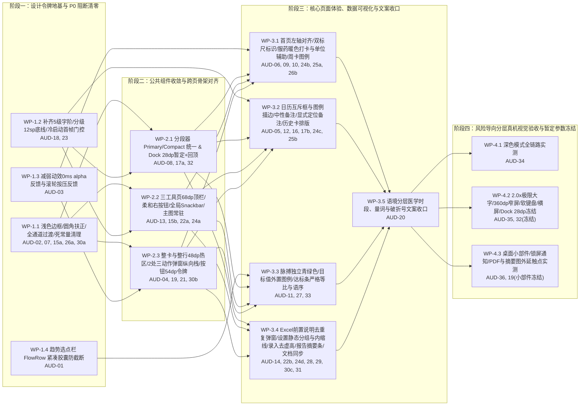

# Blood Pressure Record 最终 UI/UX 优化实施路线图（Optimization Roadmap — Final）

- **项目名称**：Blood Pressure Record（家庭血压记录）
- **应用标识 / 源码包名**：`applicationId = com.yang.bloodpressure` / 源码包 `com.example.bloodpressurerecord`
- **基线版本**：`v2.3.13`（`versionCode 54`）
- **规划基准**：**仅包含经七轮决策正式批准的实施事项**（`ACCEPTED` 11 项 + `MODIFIED` 22 项 + 阶段四真机验收 `VERIFY` 3 项）；全部被拒绝的原审计子建议（详见 `DESIGN-DECISION-RECORD.md` 第三节）均已严格剔除。
- **执行策略**：**“先令牌地基、再公共组件、后业务页面、终风险导向真机验收”**；按高频文件修改顺序隔离批次，避免返工与冲突，坚持风险导向分层验证，不做无必要的重复构建与全量模拟器回归。

---

## 一、总体分阶段架构与前置依赖

### 阶段总览

| 阶段 | 核心目标 | 包含工作包 | 复杂度 | 回归测试策略 |
| :--- | :--- | :---: | :---: | :--- |
| **阶段一** | 清零全部 3 项 P0 缺陷，夯实色彩、圆角、字阶、动效底层令牌 | `WP-1.1` ～ `WP-1.4` | 低 ～ 中 | 针对性色彩对比度单测 + 选点栏/减弱动效 UI 测试 |
| **阶段二** | 统一分段器、工具页顶栏、全局 Snackbar、整行热区与 2 处三动作弹窗 | `WP-2.1` ～ `WP-2.3` | 中 | 受影响组件与弹窗/表单/导航单测及精准 UI 回归 |
| **阶段三** | 落地首页、历史、趋势、设置、数据管理、报告预览精细优化与文案收口 | `WP-3.1` ～ `WP-3.5` | 中 | 更新 D6-1/D6-4 受影响测试断言 + 核心业务单测 |
| **阶段四** | 执行风险导向分层真机验收，冻结 3 项暂定参数并标记不可测环境 | `WP-4.1` ～ `WP-4.3` | 低（验证） | 仅针对实测暴露的明确缺陷做最小修补与复验 |

---

## 二、分阶段工作包详细规范

> 所有 Kotlin 文件路径相对根目录均为 `app/src/main/java/com/example/bloodpressurerecord/`。

---

### 阶段一：设计令牌地基与 P0 阻断清零

#### WP-1.1：浅色边框对比度、`AppShapes` 扶正、深色偏低提亮、主题全通道过渡与死常量清理
- **关联决策与 AUD**：`D1-2 (AUD-02, AUD-26a)`、`D2-2 (AUD-07)`、`D1-5 (AUD-15a)`、`D2-4 (AUD-30a)`
- **前置依赖**：无（全路线图起点）
- **修改文件范围**：
  - `ui/theme/Color.kt`
  - `ui/theme/Theme.kt`
  - `ui/theme/DesignSystem.kt`
  - `ui/common/SessionFormComponents.kt`（移除 `CompactNumberField` 硬编码边界色 + 核对圆角引用）
  - 全部 `MaterialTheme.shapes.medium / large` 调用点（`AppComponents.kt`、`NoteSearchScreen.kt`、`HistoryScreen.kt`、`TrendScreen.kt`、`WheelTimePicker.kt` 等）
- **具体实施内容**：
  1. `Color.kt` 新增 `WarmOutline = Color(0xFF8A8177)`；删除经核实 0 外部引用的死/重复色值常量（`WarmTextFaint` 等），**保留在用的 `Terracotta300`**；
  2. `Theme.kt` 将 `LightColors.outline` 设为 `WarmOutline`（`outlineVariant` 保持 `WarmDivider #E3DDD5`；**深色 `DarkColors.outline` 保持 `#7F7973` 不变**）；删除 `CompactNumberField` 中 `colors.background.red < 0.5f` 与 `Color(0xFFB3A99D)` 硬编码，统一读取 `MaterialTheme.colorScheme.outline`；
  3. `Theme.kt` 将 `AppShapes` 调整为递增阶梯 `12 / 16 / 20 / 26 / 32.dp`（`small=16`, `medium=20`, `large=26`）；逐一核查全部 15+ 处 `shapes` 调用点，确保 `DataCard` 与标准卡片映射 `shapes.large (26.dp)`、按钮/大数字框/分段器映射 `shapes.medium (20.dp)`、普通输入框及备注搜索框映射 `shapes.small (16.dp)`；
  4. `Theme.kt` 的 `animateColorScheme` 补齐 `secondary* / tertiary* / error* / outline / outlineVariant`，严格沿用 `AppMotion.colorThemeSpec(200ms)`；
  5. `DesignSystem.kt` 将 `DarkBpGradePalette.low.ink` 提亮至 `Color(0xFFA3A0DE)`（圆点 `mid` 保持 `#8E8BC8`）；
  6. **严禁改动**：不改动 `cardPadding (18.dp)`、`RoundIconBadge (46.dp)`、`calendarDaySize (38.dp)`、`Buddy` 尺寸。
- **风险与防护**：`shapes.medium` 与 `shapes.large` 角色互换若遗漏调用点会导致卡片与按钮圆角对调，须在修改后全局检索 `MaterialTheme.shapes.` 逐条核对。
- **验收与回归要求**：
  - 色彩对比度单测验证 `LightColors.outline` 相对 `#FFFDFA / #FAF6EF / #F2ECE3` 均 `≥ 3.0:1`，深色 `low.ink` 相对混色底 `≥ 4.5:1`；
  - 切换深浅色模式全屏同步 `200ms` 过渡无瞬跳色块；所有卡片、按钮、输入框圆角符合 `12/16/20/26/32.dp`。

#### WP-1.2：补全 5 级字阶、分级 `12.sp` 底线与冷启动异步首帧门控
- **关联决策与 AUD**：`D2-3 (AUD-18)`、`D1-5 (AUD-23)`
- **前置依赖**：无（可与 `WP-1.1` 并行）
- **修改文件范围**：
  - `ui/theme/Type.kt`
  - `ui/theme/BpRangeTokens.kt`
  - `ui/common/SessionFormComponents.kt`（`CompactNumberField` 显式 `lineHeight` 及单位 `12.sp`）
  - `ui/home/WeekCard.kt`（淘汰非必要 `10.sp` 微字；7 列刻度/星期保留空间受限 `11.sp` 兜底）
  - `MainActivity.kt`、`ui/settings/SettingsViewModel.kt`
- **具体实施内容**：
  1. 严格保留 `Type.kt` 已有 10 级字阶，补齐缺失 5 级：`displayLarge (58/62sp NumberFontFamily)`、`displaySmall (34/40sp NumberFontFamily)`、`headlineSmall (24/32sp)`、`titleSmall (15/21sp)`、`labelSmall (12/16sp, letterSpacing = 0.sp)`；
  2. 逐一核对现有 `labelSmall`（19 处）、`titleSmall`（5 处）、`headlineSmall`（3 处）、`displaySmall`（1 处）调用点，确保无未经确认的字号突变或容器溢出；
  3. 常规辅助文字、四色条标签（`BpRangeTokens.labelSize = 12.sp`）与单位升至 `≥ 12.sp`；底部 Dock、密集图表刻度与紧凑桌面小部件允许空间受限时 `11.sp` 兜底且不损用户缩放；
  4. `MainActivity` / `SettingsViewModel` 引入异步偏好读取 + 首帧门控机制（偏好就绪前保持轻量暖纸启动背景），**禁止主线程阻塞 IO**。
- **风险与防护**：`WeekCard` 标注微升字号后需核查相近高压/低压值防碰撞偏移；冷启动门控须实测确保不明显增加启动耗时。
- **验收与回归要求**：关闭大字模式并手动选深/浅色后强杀冷启动，首帧零闪跳；19 处 `labelSmall` 无英文松散字距。

#### WP-1.3：减弱动态效果 `0ms alpha = 0.84f` 瞬态按压反馈与时间滚轮按压反馈
- **关联决策与 AUD**：`D1-3 (AUD-03)`
- **前置依赖**：无
- **修改文件范围**：
  - `ui/common/AppComponents.kt`（`Modifier.pressableScale`）
  - `ui/common/WheelTimePicker.kt`（滚轮相邻可点击项按压态）
- **具体实施内容**：
  1. 升级 `Modifier.pressableScale`（保持函数签名与正常模式缩放动画完全不变）：当 `LocalReducedMotion.current && enabled` 时不启动弹簧动画协程，直接基于 `interactionSource.collectIsPressedAsState()` 在 `graphicsLayer` 中同步设置 `alpha = if (pressed) 0.84f else 1f`；
  2. 为 `WheelTimePicker` 滚轮条目补充轻按压态背景或透明度反馈，覆盖常规与减弱动效双模式。
- **风险与防护**：不扩大公共组件重构范围；确保 `alpha = 0.84f` 在浅色白卡、暖纸底、深色卡片与陶土红按钮上均具肉眼可辨度。
- **验收与回归要求**：开启 `LocalReducedMotion provides true` 跑按压交互回归测试，验证 Dock、分段胶囊、日历格、打卡按钮、时间滚轮按下瞬间有可见反馈且无挂起动画协程。

#### WP-1.4：趋势图选点操作栏 `FlowRow` 紧凑胶囊防截断
- **关联决策与 AUD**：`D1-1 (AUD-01)`
- **前置依赖**：`WP-1.1`、`WP-1.2`
- **修改文件范围**：
  - `ui/common/AppComponents.kt`（新增 `AppCompactActionPill`）
  - `ui/history/TrendScreen.kt`（`TrendSelectionReadout`）
- **具体实施内容**：
  1. 新增脱离 `TextButton` `64.dp` 最小宽度约束的 `AppCompactActionPill`（`minWidth = 48.dp`, `minHeight = 48.dp`, 合理水平内距，`labelMedium`）；
  2. `TrendSelectionReadout` 移除无提示 `horizontalScroll`，改用 `FlowRow` 容纳「上一条 / 下一条 / 明细 / 最新 / 复位视野」，保留完整文案与禁用态、大字号自然换行，**绝不通过缩小字号或热区强挤单行**。
- **验收与回归要求**：运行 `TrendReadoutAccessibilityTest` 验证 `360dp / 393dp` 1.0x 单行完整显示「复位视野」、`2.0x` 自然换行且全部热区 `≥ 48dp × 48dp`。

---

### 阶段二：公共组件收敛与跨页骨架对齐

#### WP-2.1：分段选择器双规格统一 & 底部 Dock 暂定 `28.dp` 展开阈值与回顶联动
- **关联决策与 AUD**：`D3-1 (AUD-08)`、`D5-3 (AUD-17a)`、`D3-5 (AUD-32)`
- **前置依赖**：`WP-1.1`、`WP-1.2`
- **修改文件范围**：
  - `ui/common/AppComponents.kt`（扩展 `SegmentedPillGroup` 支持 `Primary` / `Compact`）
  - `ui/history/TrendScreen.kt`（删除私有 `SegmentedControl`，全量切回 `SegmentedPillGroup`）
  - `ui/history/HistoryScreen.kt`（`RecentPeriodSelector` 切为独立外层 `Compact` 变体）
  - `ui/common/DockScrollState.kt`、`navigation/AppNavigation.kt`（配合页面滚动回顶信号）
- **具体实施内容**：
  1. `SegmentedPillGroup` 扩展 `size` 参数：`Primary`（**保留 `16.sp`** + `primaryContainer` 珊瑚滑块）、`Compact`（`13.sp` + `surface` 滑块），统一 `4.dp` 内距、`20dp / 16dp` 同心圆角、动效与无障碍；多项（5 项）窄屏/大字优先自适应折行，禁止 5 项全纵向超高堆叠（若采用水平滚动则配可滚动提示与选中项自动定位）；
  2. 删除 `TrendScreen.kt` 私有 `SegmentedControl`；历史「近期」独立外层的「本周/本月」换用 `Compact` 变体；
  3. `DockScrollState` 保持向下收起 `28.dp`，将向上展开由 `18.dp` 调整为**暂定 `28.dp`**，并补充回到页面顶部（含惯性 fling 滑顶）自动展开机制，确保不因图表内部手势误触。
- **验收与回归要求**：历史与趋势页主次分段层级分明；空态/加载态/错误态均可切换本周/本月；Dock `28.dp` 暂定阈值交阶段四 `WP-4.2` 真机手感验证后冻结。

#### WP-2.2：一级工具页 `68.dp` 顶栏统一、柔和右侧按钮、全局单通道 Snackbar 与趋势主图常驻
- **关联决策与 AUD**：`D3-2 (AUD-13)`、`D3-3 (AUD-24a)`、`D1-5 (AUD-15b)`、`D5-4 (AUD-22a)`
- **前置依赖**：`WP-1.1`、`WP-1.2`
- **修改文件范围**：
  - `ui/common/AppComponents.kt`（新增与 `AppBackIconButton` 同系的顶栏右侧柔和按钮组件）
  - `navigation/AppNavigation.kt`（统一全局 Snackbar 优先级调度）
  - `ui/home/DashboardScreen.kt`（问候语 `29.sp → 30.sp`，保留双行独立问候；移除页面级 `SnackbarHost`）
  - `ui/history/HistoryScreen.kt`（保留 `68.dp AppTopBar` 与 `hideOnScroll`，搜索按钮换新组件）
  - `ui/history/TrendScreen.kt`（接入 `68.dp AppTopBar` 随内容自然滚出，全屏按钮换新组件；移除首张血压主图多余 `ExpandableSection` 折叠外壳）
  - `ui/settings/SettingsScreen.kt`（`68.dp AppTopBar` 随内容自然滚出，移除额外 `top = 16.dp`）
- **具体实施内容**：
  1. 历史、趋势、我的三页统一 `68.dp AppTopBar` 基线与首块内容起跑线，消除趋势空态跳动与我的页多余 `16.dp` 顶距；首页保持独立双行问候仅将 `29.sp` 对齐 `headlineLarge (30.sp)`；滚动策略按“首页/趋势/我的自然滚出，历史保留 `hideOnScroll`”落地；
  2. 搜索与全屏按钮采用 `surfaceContainerHighest` 柔和圆角底座（`≥48dp` 热区、可见右缘对齐 `20.dp`，无额外阴影、禁用硬编码 `offset`）；
  3. 趋势页取消首张血压主图折叠外壳直接常驻，下方脉搏/昼夜/更多统计保留折叠；
  4. 移除首页私有 `SnackbarHost`，服药打卡反馈汇入根 `Scaffold`，**强制保障删除撤销等时效性提示优先于普通成功提示，不丢失撤销能力**。
- **验收与回归要求**：三工具 Tab 切换标题基线零跳动；右侧按钮可见右缘与下方卡片共线；执行“删除记录产生撤销条 → 回首页打卡”无叠压且撤销功能完好。

#### WP-2.3：整卡/整行 `48.dp` 热区、表单报错对齐、2 处三动作弹窗纵向栈与 `54.dp` 按钮令牌绑定
- **关联决策与 AUD**：`D1-4 (AUD-04, AUD-19)`、`D3-4 / D6-1 / D7-1 (AUD-21)`、`D2-4 (AUD-30b)`
- **前置依赖**：`WP-1.1`、`WP-1.3`
- **修改文件范围**：
  - `ui/common/AppComponents.kt`（`primaryButtonHeight = 54.dp` 绑定三大按钮；新增纵向三动作弹窗公共组件）
  - `ui/theme/DesignSystem.kt`（修正 `primaryButtonHeight = 54.dp` 及注释，保留 `saveButtonHeight = 58.dp`）
  - `ui/settings/SettingsScreen.kt`（个人资料卡外层 `DataCard` 整卡可点 + 合并语义）
  - `ui/home/WeekCard.kt`、`ui/settings/SettingsSubpages.kt`（两处 `44.dp → 48.dp`）
  - `ui/report/ReportOptionsScreen.kt`、`ui/report/ReportPreviewScreen.kt`、`ui/settings/SettingsDataManagementScreen.kt`（开关/复选框整行 `.toggleable`）
  - `ui/record/AddMeasurementScreen.kt`、`ui/history/EditSessionScreen.kt`、`ui/common/SessionFormComponents.kt`（报错统一在保存键上方 + `LiveRegionMode.Polite`；`UnsavedChangesDialog` 改纵向栈）
  - `widget/BloodPressureWidget.kt`（扩大 `+ 记一次` 有效热区且不损核心血压读数可读性）
- **具体实施内容**：
  1. 仅对实际存在的 **2 处三动作弹窗**（`UnsavedChangesDialog`、清空所有本地数据确认弹窗）改为纵向全宽按钮栈（按操作风险排序、破坏性按钮标 `error` 色）；普通双动作弹窗（含导入范围确认、分卷格式切换弹窗）维持现状；
  2. 新增页 `formMessage` 移至 `InlineSessionAction` 上方并附 `LiveRegionMode.Polite`，字段级可定位错误同步提供字段反馈；
  3. 个人资料卡整卡可点；所有 `Switch / Checkbox` 行改为整行 `.toggleable`（内部回调置 `null`）；两处 `44.dp` 升至 `48.dp`；桌面小部件扩大 `+ 记一次` 热区并交阶段四实机验收；
  4. `AppPrimaryButton / AppSecondaryButton / AppDangerButton` 统一引用 `AppDimensions.primaryButtonHeight (54.dp)`。
- **验收与回归要求**：点击达标磁贴直达资料页；点击报告/导入选项左侧文字可切换；`360dp × 2.0x` 下两处三动作弹窗无挤压；保留全部确认与隐私默认逻辑不变。

---

### 阶段三：核心页面体验、健康可视化精修与文案收口

#### WP-3.1：首页 `ReadingHero` 左轴对齐、双标尺标识、色条柔和衬底、服药暖色打卡与周卡独立图例
- **关联决策与 AUD**：`D4-1 (AUD-06)`、`D4-2 (AUD-09, AUD-24b)`、`D4-3 (AUD-10, AUD-26b)`、`D4-4 (AUD-25a)`
- **前置依赖**：`WP-1.1` ～ `WP-2.3`
- **修改文件范围**：
  - `ui/home/DashboardScreen.kt`
  - `ui/home/BpRangeBar.kt`
  - `ui/home/WeekCard.kt`
  - `ui/settings/SettingsSubpages.kt`（`MedicationEditorDialog` 剂量辅助提示与轻量单位胶囊）
- **具体实施内容**：
  1. `ReadingHero` 改外 `14.dp` + 非点击行补 `6.dp` + 点击读数区 `6.dp`，全卡共线于 `20.dp` 轴线；优化无脉搏与大字缩放下 `mmHg` 基线对齐；
  2. `BpRangeBar` 保留「偏低 / 正常 / 偏高 / 过高」四双字标签，增加克制「参考区间 / 个人参考区间」标识（自定义态额外标「已自定义」），完整说明通过信息图标或设置面板展示；外围加柔和 `surface` 衬底防融底；不改医学分级与阈值计算逻辑；
  3. `MedicationRow` 待打卡按钮改 `primaryContainer / onPrimaryContainer` 暖底强调，外/内圆角规范为 `20/12.dp`；早晚槽去字面量空格改 `spacedBy(4.dp)`；`MedicationEditorDialog` 剂量框加常驻说明与轻量单位胶囊（严格不重复追加/不替换已有单位/不推断换算/不改库）；
  4. `WeekRangeLegend` 拆为 3 项独立 `FlowRow` 图例（含真实虚线，文案对齐个人参考区间且动态取值）；小压与气泡均支持点击切换并附极克制进度微圆点（无自动轮播），补齐无障碍语义。
- **验收与回归要求**：拉线验证 `ReadingHero` 左/右共线；验证有/无脉搏与 3 位数读数；验证剂量单位快捷输入边界用例；验证默认态与自定义态双标尺展示与医学分级回归全绿。

#### WP-3.2：历史日历互斥边框、图例描边、中性备注、显式「定位备注」与历史卡片/近期摘要卡精修
- **关联决策与 AUD**：`D1-5 (AUD-05)`、`D5-1 (AUD-12, AUD-24c, AUD-25b)`、`D5-2 (AUD-16)`、`D5-3 (AUD-17b)`
- **前置依赖**：`WP-2.1`、`WP-2.2`
- **修改文件范围**：
  - `ui/history/HistoryScreen.kt`
  - `ui/history/HistoryDetailScreen.kt`
  - `ui/common/SessionFormComponents.kt`（`SessionAverageCard` 补 `NumberFontFamily`）
- **具体实施内容**：
  1. `CalendarDay` 改互斥单层边框（`selected` 纯净 `2.dp primary`，`today && !selected` `1.5.dp outline`），并在 `today && selected` 时保留「今天」身份可识别性；保持 `38.dp` 尺寸不变；
  2. `CalendarLegend` 6 档色块外加 `1.2.dp` `.mid/.ink` 描边；备注圆点与卡片备注框改中性暖灰；月份标题与下拉箭头统一颜色；
  3. 取消日历双击定位备注（消除单击延迟），在选中日存在备注时于 `SelectedDaySummary` 提供显式轻量「定位备注」入口（备注已全可见时可按需隐藏），与右上角全局搜索完全独立；
  4. `HistorySessionCard` 时间列解除 `54.dp` 死宽改 `widthIn(min = 54.dp)`、基线对齐、右侧胶囊垂直居中，列表首行维持简洁读数、二行补 `次/分`；`HistoryDetailScreen` 完整补齐 `mmHg` 与 `次/分`；读屏输出完整单位；
  5. 紧凑重构 `RecentSummaryCard`（保留全部现有字段与口径，不新增分级判断），为 `RecentSummaryCard` 与 `SessionAverageCard` 补齐 `NumberFontFamily` + `tnum`。
- **验收与回归要求**：日历默认今天边框纯净且可辨「今天」；选日响应无双击延迟；历史卡大字号无裁切；近期摘要卡与均值卡数字字体统一。

#### WP-3.3：脉搏独立专色、血压图目标值外置图例、达标率分布条严格等比与 TalkBack 语序修复
- **关联决策与 AUD**：`D5-4 (AUD-11)`、`D5-5 (AUD-27, AUD-33)`
- **前置依赖**：`WP-1.1`、`WP-1.4`、`WP-2.2`
- **修改文件范围**：
  - `ui/history/TrendChartDrawing.kt`
  - `ui/history/TrendChart.kt`
  - `ui/history/TrendFullscreenScreen.kt`（共享图例与脉搏色同步生效）
  - `ui/history/TrendScreen.kt`
- **具体实施内容**：
  1. `TrendChartPalette` 新增独立 `pulse` 语义色令牌（**暂定候选**：浅 `#2E7D7B` / 深 `#80CBC4`，不复用高压红、不绑定 `secondary` 绿），应用于竖屏与横屏全屏脉搏曲线与节点；
  2. 移除 `drawThresholdLines` 画布内 `10.sp` `"目标 120/80"` 浮动标签，将个人目标具体数值动态展示于图表上方图例，画布内保留干净参考虚线；
  3. 达标率分布条改为外层统一圆角裁剪，**严禁设置任何人工最小分段宽度**，内部色块严格按真实次数等比绘制且分隔线不得吞噬极小色块，依托完整图例与精确次数/必要百分比提升可发现性；
  4. 达标率圆环卡片改为显式 `clearAndSetSemantics`（以 `"达标率"` 开头自然播报）。
- **验收与回归要求**：高压/低压/脉搏三色独立清晰；密集数据画布零压字；`1/184` 样本分布条比例 100% 真实无圆角破碎、不被分隔线吞没；TalkBack 语序测试通过；`chartPulse` 候选色交阶段四深浅色实测冻结。

#### WP-3.4：明文 Excel 前置风险说明去重复弹窗、设置静态分组与内缩分割线、录入标题去虚高、报告预览摘要条、版本号外置与文档同步
- **关联决策与 AUD**：`D6-1 / D7-1 (AUD-14)`、`D6-2 (AUD-22b, AUD-24d)`、`D4-5 (AUD-28)`、`D6-3 (AUD-29, AUD-24d)`、`D6-5 (AUD-31)`、`D2-4 (AUD-30c)`
- **前置依赖**：`WP-2.2`、`WP-2.3`
- **修改文件范围**：
  - `ui/settings/SettingsDataManagementScreen.kt`、`ui/settings/SettingsViewModel.kt`（及对应单测/集成测断言更新）
  - `ui/settings/SettingsScreen.kt`
  - `ui/common/SessionFormComponents.kt`（收紧无删除键组标题 `48.dp` 虚高，**不卡片化**）
  - `ui/report/ReportPreviewScreen.kt`
  - `DESIGN.md`、`PRODUCT.md`
- **具体实施内容**：
  1. **数据管理页（D6-1 & D7-1）**：保留「导出明文 Excel（`.xlsx`）」为 `AppPrimaryButton`，在「导出与备份」第一层前置常驻辅助说明（*「Excel 文件未经加密，请妥善保管。如需保护数据隐私，可选择加密备份。」*）；移除 `showBackupExportConfirm` 重复确认弹窗，点击 Excel 主按钮直达导出准备与系统保存流程；清空弹窗点「先导出备份」关闭弹窗并平滑定位至「导出与备份」区由用户自选格式（不代选、备份后绝不自动恢复清空弹窗或清空数据）；保留分卷格式切换双按钮保护弹窗（确认切换明文后直达导出）及加密备份口令机制；同步修订 `SettingsViewModelTest` 与 `DefaultSettingsRepositoryAndroidTest` 断言；
  2. **我的页（D6-1 / D6-2 / D6-5）**：取消「显示」分组折叠机制（删 `ExpandableSection` 调用与 `settings-display`，5 组统一静态标题）；分组内分割线由语义常量推导内缩 `start = 76.dp, end = 16.dp`；高风险保存前确认改 `primaryContainer` 暖底、四色条换 `Icons.Outlined.Tune`、爱心留给小压；`SettingRow` 增可选 `trailingText`，将动态版本 `v{AppInfoContent.CURRENT_VERSION}` 外置右侧 `>` 前、副标题精简（大字/窄屏自动回落次级行防挤压）；
  3. **测量录入页（D4-5）**：不卡片化以保三栏满宽，仅收紧无删除键组标题 `48.dp` 虚高并优化组间留白/必要弱分割线；
  4. **医生报告预览页（D6-3）**：水平边距统一 `20.dp`（保 PDF 合理缩放与可读性）；顶部收折为逐项明示三项状态的隐私摘要条 + 「调整隐私 ▾」原地展开入口，严守姓名年龄默认关闭与重进重置规则，确保开关变更后同步重绘并杜绝导出旧缓存；
  5. **文档同步（D2-4）**：更新 `DESIGN.md` 与 `PRODUCT.md` 版本（`2.3.13 / 54`）与最新规范说明。
- **验收与回归要求**：数据管理页路径无自相矛盾且受影响单测全绿；我的页 5 组静态对齐、分割线精准贴齐文字左缘；报告预览首屏露出 A4 主体且隐私开关与最终导出文件严格同步。

#### WP-3.5：语境分层医学时段、量词与破折号文案收口
- **关联决策与 AUD**：`D6-4 (AUD-20)`
- **前置依赖**：`WP-3.1` ～ `WP-3.4`（放于全部 UI 改造末尾集中收口，避免合并冲突）
- **修改文件范围**：
  - `app/src/main/res/values/strings.xml`
  - `ui/history/HistoryScreen.kt`、`ui/history/HistoryViewModel.kt`
  - `ui/settings/SettingsSubpages.kt`
  - `export/report/PdfReportRenderer.kt`
  - `widget/BloodPressureWidget.kt`
  - 受影响的文案断言单元测试
- **具体实施内容**：
  1. 趋势、提醒设置（原“晨间→早间”）、PDF 医生报告（原“早晨均值→早间均值”）统一为 **`早间 / 晚间`**；**首页保留亲切「早上 / 晚上」**；昼夜保持 `日间 / 夜间`；**`MeasurementPeriod.kt` 完整保留 5 档（含「清晨」）不动**；
  2. 测量与高风险事件统一用 **`次`**（修正历史近期「0 条→0 次」），多组读数保留 `组`，备注文本保留 `条`；
  3. 缺失数值占位符全局统一为 **`—`**（淘汰 `--`，严禁误替换真实数值 `0`）；
  4. **工程红线**：仅改用户可见文案，严禁改动数据库字段、偏好 Key、备份格式与 Excel 列名。
- **验收与回归要求**：全站与 PDF 导出文案符合语境分层术语表，备份读写兼容测试 100% 通过。

---

### 阶段四：风险导向分层真机视觉验收与暂定参数冻结

详细执行矩阵见配套文档 `VISUAL-VERIFICATION-CHECKLIST.md`：
- **WP-4.1（`AUD-34`）**：深色模式全链路实机目视验收（含 `chartPulse #80CBC4`、四色条衬底、6 级混色与系统栏反色），不提前盲改深色色板，仅对实测确认问题做最小修复；
- **WP-4.2（`AUD-35` + `AUD-32` 冻结）**：`2.0x` 极限大字 × `360dp` 窄屏 × 软键盘弹出态 × 横屏全屏趋势页 + 底部 Dock 暂定 `28.dp` 向上展开阈值真机手感验收与冻结；
- **WP-4.3（`AUD-36` + `AUD-19` 小部件冻结）**：桌面小部件多尺寸热区实测、锁屏隐私通知与服药核对弹窗、医生报告 PDF/摘要图微信预览与黑白打印实测（缺少设备或条件项明确标「未验证」，严格区分兼容 Android 的 HarmonyOS 与不兼容系统）。

---

## 三、高频共享文件防冲突修改顺序表（File Touch Matrix）

| 源码文件（`com/example/bloodpressurerecord/` 下） | 阶段一 | 阶段二 | 阶段三 | 隔离说明 |
| :--- | :--- | :--- | :--- | :--- |
| `ui/theme/Color.kt`、`Theme.kt` | **WP-1.1** | — | — | 阶段一一次性定稿 |
| `ui/theme/Type.kt` | **WP-1.2** | — | — | 阶段一一次性定稿 |
| `ui/theme/DesignSystem.kt` | **WP-1.1** | **WP-2.3** | — | WP-1 改深色 `low.ink`；WP-2 绑 `54.dp` 令牌 |
| `ui/common/AppComponents.kt` | **WP-1.1, 1.3, 1.4** | **WP-2.1, 2.2, 2.3** | — | 按独立函数块递进修改 |
| `ui/common/SessionFormComponents.kt` | **WP-1.1, 1.2** | **WP-2.3** | **WP-3.2, 3.4** | 边框/行高 → 离开弹窗 → 均值字体/组标题 |
| `ui/home/DashboardScreen.kt` | — | **WP-2.2** | **WP-3.1** | 外层问候/Snackbar → 内部卡片精修 |
| `ui/history/HistoryScreen.kt` | **WP-1.1** | **WP-2.1, 2.2** | **WP-3.2, 3.5** | 圆角 → 分段/顶栏 → 日历/卡片 → 文案 |
| `ui/history/TrendScreen.kt` | **WP-1.1, 1.4** | **WP-2.1, 2.2** | **WP-3.3** | 选点栏 → 分段/顶栏/去折叠 → 达标条/语序 |
| `ui/settings/SettingsScreen.kt` | — | **WP-2.2, 2.3** | **WP-3.4** | 顶栏/资料整卡 → 去折叠/分割线/图标/版本 |
| `ui/settings/SettingsDataManagementScreen.kt` | — | **WP-2.3** | **WP-3.4** | 整行复选框/清空纵向栈 → 前置说明/去弹窗/定位 |
| `ui/report/ReportPreviewScreen.kt` | — | **WP-2.3** | **WP-3.4** | 建议在 WP-3.4 与整行开关合并一步落地 |

---

## 四、已批准 36 项 AUD 全量归属速查表

| 阶段 / 工作包 | 覆盖 AUD 编号 | 备注 |
| :--- | :--- | :--- |
| **阶段一 · WP-1.1** | `AUD-02`, `AUD-07`, `AUD-15`(主题动画), `AUD-26`(深色偏低), `AUD-30`(死常量) | 含 P0 `AUD-02` |
| **阶段一 · WP-1.2** | `AUD-18`, `AUD-23` | 15 级字阶 + 冷启动首帧门控 |
| **阶段一 · WP-1.3** | `AUD-03` | P0 减弱动效 `alpha=0.84f` + 滚轮 |
| **阶段一 · WP-1.4** | `AUD-01` | P0 选点栏「复位视野」防截断 |
| **阶段二 · WP-2.1** | `AUD-08`, `AUD-17`(近期分段), `AUD-32`(暂定 `28.dp`) | 分段器双规格 + Dock 阈值 |
| **阶段二 · WP-2.2** | `AUD-13`, `AUD-15`(全局 Snackbar), `AUD-22`(趋势去折叠), `AUD-24`(顶栏右按钮) | 跨页骨架对齐 |
| **阶段二 · WP-2.3** | `AUD-04`, `AUD-19`, `AUD-21`(2 处三动作弹窗), `AUD-30`(`54.dp` 令牌) | 触控热区与弹窗 |
| **阶段三 · WP-3.1** | `AUD-06`, `AUD-09`, `AUD-10`, `AUD-24`(服药/早晚), `AUD-25`(小压/周卡), `AUD-26`(四色条衬底) | 首页全项收口 |
| **阶段三 · WP-3.2** | `AUD-05`, `AUD-12`, `AUD-16`, `AUD-17`(摘要/均值卡), `AUD-24`(月份箭头), `AUD-25`(显式定位备注) | 历史全项收口 |
| **阶段三 · WP-3.3** | `AUD-11`(暂定 `chartPulse`), `AUD-27`, `AUD-33` | 趋势图表与无障碍 |
| **阶段三 · WP-3.4** | `AUD-14`(自定义), `AUD-22`(设置去折叠), `AUD-24`(分割线/报告边距), `AUD-28`(不卡片化), `AUD-29`, `AUD-30`(文档), `AUD-31` | 设置/录入/报告收口 |
| **阶段三 · WP-3.5** | `AUD-20` | 语境分层文案收口 |
| **阶段四 · WP-4.1–4.3** | `AUD-34`, `AUD-35`, `AUD-36` + 3 项暂定参数冻结 | 风险导向真机验收 |
