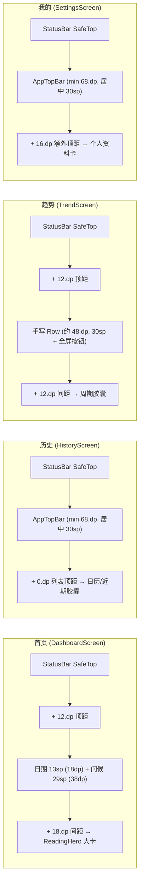

# Blood Pressure Record 视觉对齐与版式几何专项审计报告

本报告聚焦 **视觉对齐（Visual Alignment）、布局网格（Layout Grid）、空间节奏（Spacing & Rhythm）、文字基线（Baseline）、嵌套圆角同心度（Concentric Radii）、光学对齐（Optical Alignment）及视觉重量（Visual Weight）**，结合实机截图与 Jetpack Compose 布局源码开展像素级拆解。

---

## 一、全局栅格与页面容器对齐审计

### 1.1 页面水平基准线（Page Gutter Grid）现状盘点

项目在 `DesignSystem.kt` 中定义了 `AppDimensions.pageHorizontalPadding = 20.dp`，绝大多数业务页遵守了 `20.dp` 外边距，但在部分组件和衍生页面中出现了基准线偏移：

| 页面 / 模块 | 左/右水平边距 | 源码位置 | 对齐评估 | 关联问题 |
| --- | :---: | --- | --- | --- |
| 首页 `DashboardScreen` | `20.dp` | `DashboardScreen.kt#L141` | 外框对齐；但组标题额外 `+2.dp`（`22.dp`），大卡内读数额外 `+6.dp` | `AUD-06` |
| 历史记录 `HistoryScreen` | `20.dp` | `HistoryScreen.kt#L291-L292` | 外框对齐；但单日摘要额外 `+4.dp`（`24.dp`），顶栏搜索图标光学内缩 `12.dp` | `AUD-24` |
| 趋势页 `TrendScreen` | `20.dp` | `TrendScreen.kt#L137` | 外框对齐；但顶栏「全屏」文字光学内缩 `12.dp`，折叠标题额外 `+2.dp` | `AUD-13`, `AUD-24` |
| 我的页 `SettingsScreen` | `20.dp` | `SettingsScreen.kt#L105` | 外框对齐；分组标题额外 `+2.dp` | — |
| 新增/编辑测量页 | `20.dp` | `AddMeasurementScreen.kt#L252` | 外框对齐 | — |
| 设置各子页 / 报告配置页 | `20.dp`（硬编码） | `SettingsSubpages.kt#L1005`, `ReportOptionsScreen.kt#L121` | 数值一致，但未引用 `AppDimensions.pageHorizontalPadding` 令牌 | `AUD-30` |
| **医生报告预览页 `ReportPreviewScreen`** | **`16.dp`（硬编码）** | `ReportPreviewScreen.kt#L152` & `#L270` | **偏离全局 `20.dp` 栅格**（从 `ReportOptionsScreen 20dp` 滑入预览页时左右边距跳变为 `16dp`） | `AUD-24` |
| **底部悬浮胶囊 `AppBottomDock`** | **`16.dp`** | `DesignSystem.kt#L48` | **设计意图合理（保留）**：悬浮层略宽于 `20.dp` 正文卡片（外扩 `4dp`），能明确传达 Z 轴浮起包裹感 | 保留现状 |

> [!TIP]
> **关于分组标题 `+2.dp` 光学微调的评估**：`DashboardScreen.SectionHeader`（`start = 2.dp`）、`ExpandableSection`（`horizontal = 2.dp`）和 `SettingsSectionTitle`（`start = 2.dp`）在 `20.dp` 大圆角（`24–26dp`）卡片上方做了 `2.dp` 内推。由于大圆角卡片左上角弧线在视觉上比数学直角向内退让，标题向右微移 `2.dp` 属于合理的**光学对齐补偿（Optical Compensation）**，但历史页 `SelectedDaySummary`（`HistoryScreen.kt#L968`）用了 `4.dp`，建议统一为 `2.dp`（或 `4.dp`），避免同为列表上方日期标题却缩进不一。

---

### 1.2 四个顶级页面的纵向起跑线（Top Vertical Rhythm）偏差分析

对比实机截图 #1、#2、#4、#6 顶部区域，可以清晰测量出顶栏高度与首卡Y坐标的不一致：

- **基线跳动测算**：
  - 在「历史记录」与「我的」中，`AppTopBar` 最小高度为 `68.dp`，`30.sp`（行高 `38.dp`）标题垂直居中，因此标题顶部距状态栏安全区下沿约 `(68 - 38) / 2 = 15.dp`。
  - 在「血压趋势」中，未包裹 `AppTopBar`，直接 `extra = 12.dp` + `Row`（高度由 `TextButton` 撑起约 `48.dp`），标题顶部距状态栏约 `12 + (48 - 38) / 2 = 17.dp`（若无右侧「全屏」按钮的无数据态，高度仅 `38.dp`，顶距突变为 `12.dp`，有/无数据切换瞬间标题甚至会上下跳动 `5.dp`！）。
  - 首张卡片/控件起点Y坐标（相对状态栏下沿）：历史页 `= 68.dp`；趋势页 `= 12 + 48 + 12 = 72.dp`；我的页 `= 68 + 16 = 84.dp`（比历史页足足下沉 `16.dp`！）。

---

## 二、逐组件像素级对齐诊断

### 2.1 首页 `ReadingHero` 内部左/右对齐线断裂（`AUD-06` · 截图 #1 实锤）

在截图 #1 的绿色情绪大卡中，同一容器内出现了 **两条相差 `6.dp` 的左右边界**：

| 层级 | 组件内容 | 左边界 X（相对屏幕左缘） | 右边界 X（相对屏幕右缘） | 源码依据 |
| --- | --- | :---: | :---: | --- |
| 第 1 层 | 小压 `Buddy` + 白色对话气泡 | `20 + 20 = 40.dp` | `20 + 20 = 40.dp` | `DashboardScreen.kt#L370, #L372` |
| **第 2 层** | **「最近一次…」+ `>` / `109/77` / `● 正常`** | **`20 + 20 + 6 = 46.dp`（内缩 6dp！）** | **`20 + 20 + 6 = 46.dp`（内缩 6dp！）** | `DashboardScreen.kt#L412` `.padding(6.dp)` |
| 第 3 层 | 四色区间条 `BpRangeBar` | `20 + 20 = 40.dp` | `20 + 20 = 40.dp` | `DashboardScreen.kt#L492` |

- **视觉后果**：用户的视线顺着小压左缘往下扫视，在「最近一次」与 `109/77` 处向内跌落 `6dp`，到下方四色条左端又向外弹出 `6dp`；右侧 `>` 箭头也没有与上方白色气泡右缘、下方红色色条右端对齐。
- **修正准则**：卡片内所有全宽模块必须共享唯一左右对齐线（`40.dp`）。若需为点击高亮/焦点环预留呼吸边距，应使用外扩布局或统一外层 `padding(horizontal = 14.dp)` 并给非点击行补齐 `padding(horizontal = 6.dp)`。

---

### 2.2 首页大数字与单位/脉搏基线对齐分析（截图 #1）

在 `ReadingHero`（`DashboardScreen.kt#L433-L462`）中：
- 左侧 `HeroPressureValue`：`fontSize = 58.sp, lineHeight = 62.sp`，斜杠 `/` 采用 `SpanStyle(fontSize = 48.sp, fontWeight = FontWeight.Light, alpha = 0.45f)`。
- 右侧单位与脉搏 `Column`：依赖外层 `Row(verticalAlignment = Alignment.Bottom)` + 硬编码 `Modifier.padding(bottom = 8.dp)` 来模拟基线对齐。
- **风险与微调建议**：当不存在脉搏记录（`detail?.avgPulse == null`）时，右列仅剩单行 `"mmHg"`，此时固定 `bottom = 8.dp` 会使 `"mmHg"` 紧贴底部，与有脉搏时的位置完全不同；当开启 `1.5x–2.0x` 大字模式且左侧数字因宽度限制自动按比例缩小（`scale < 1f`）时，固定 `8.dp` 底部垫高不再匹配缩放后的字体下伸量（Descent）。建议当只有 `"mmHg"` 时使用 `Modifier.alignByBaseline()` 直接与大数字基线对齐，双行时按 `scale` 等比缩放底垫或底对齐微调。

---

### 2.3 趋势页读数操作栏宽度溢出与截断几何分析（`AUD-01` · 截图 #4/#5 实锤）

这是本次审计中最典型的 **Material 3 默认最小尺寸隐式溢出** 案例：

| 计算项 | 宽度公式 / 数值 | 源码 / 规范来源 |
| --- | --- | --- |
| 常规手机逻辑屏宽（以 393dp 为例） | `393.dp` | Android 主流设备视口宽度 |
| 扣除页面水平边距 | `- 20.dp × 2 = -40.dp` | `TrendScreen.kt#L137` |
| 扣除 `TrendCard` 内部水平边距 | `- 16.dp × 2 = -32.dp` | `TrendScreen.kt#L574` |
| **`trendReadoutActions` 可用行宽** | **`321.dp`**（在 `360dp` 屏上仅 **`288.dp`**！） | — |
| 单个 `ReadoutAction`（`TextButton`）最小宽 | **`64.dp`**（四字「复位视野」约 `64–68.dp`） | M3 `ButtonDefaults.MinWidth = 64.dp` |
| 5 个按钮 + 4 个 `4.dp` 间距总宽 | `64 × 4 + 66 + 4 × 4 =` **`338.dp`** | `TrendScreen.kt#L778-L812` |
| **净溢出量（被裁切宽度）** | `338 - 321 =` **`+17.dp`**（`360dp` 屏溢出 **`+50.dp`**！） | 恰好裁掉「野」字（`13sp` 单字宽约 `13dp`）→ **显示为「复位视」** |

- **对齐与布局改进方案**：
  使用不带 `64.dp` 强制宽度的自定义紧凑胶囊按钮（保持 `minWidth = 48.dp, minHeight = 48.dp`，水平内边距 `8.dp`），采用 `FlowRow(horizontalArrangement = Arrangement.SpaceBetween)` 或五项自适应行：
  - `上一条`(`52dp`) + `下一条`(`52dp`) + `明细`(`48dp`) + `最新`(`48dp`) + `复位视野`(`68dp`) + `4 × 4dp` = **`284.dp`**！
  - 在 `360dp`（可用 `288dp`）及 `393dp`（可用 `321dp`）常规屏宽下 **100% 单行完整容纳，零截断**；大字模式下由 `FlowRow` 自然换为两行。

---

### 2.4 历史卡片（`HistorySessionCard`）内部三列基线与重心诊断（`AUD-16` · 截图 #2/#3 实锤）

在 `HistoryScreen.kt#L1017-L1056` 中，单条记录卡内部结构如下：

| 列序 | 内容 | 字号 / 行高 | 当前对齐方式 | 几何偏差实测 |
| --- | --- | --- | --- | --- |
| 左列（固定 `54.dp`） | 第 1 行：`22:14` 第 2 行：`晚上` | `17.sp / 24.sp` `11.sp / 16.sp`（总高 `42dp`） | `Alignment.Top` | `22:14` 基线比中列 `109/77` 基线 **偏高约 `5.dp`**； `晚上` 基线比 `脉搏 65` **偏高约 `7.dp`**； `54.dp` 固定宽在 `2.0x` 大字下容不下 `22:14`（`17sp × 2 = 34dp/字 × 2.8 ≈ 95dp`），会导致时间强行断成两行！ |
| 中列（`weight(1f)`） | 第 1 行：`109/77` 第 2 行：`脉搏 65` | `24.sp / 32.sp` `11.sp / 16.sp`（总高 `50dp`） | `Alignment.Top` | 主视觉中心，总高比左列高 `8dp` |
| 右列（自适应） | `StatusChip("● 正常")` | 高约 `28.dp` | `Alignment.Top` | 仅单枚芯片时紧贴顶边，下方留出 **`22.dp` 空白缺口**，卡片呈“头重脚轻”右倾失衡 |

- **改进方案**：
  1. **解除左列固定 `54.dp` 宽度硬编码**：改为 `Modifier.widthIn(min = 56.dp)` 自适应内容宽度，防止大字模式把 `22:14` 拦腰折断。
  2. **基线对齐双行网格**：将左、中两列的第 1 行（`22:14` 与 `109/77 mmHg`）和第 2 行（`晚上` 与 `脉搏 65 次/分`）分别按水平基线对齐（或采用左侧两行与中侧两行对等行高盒），并将右列状态芯片设为在主信息区内 **`Alignment.CenterVertically`** 垂直居中。

---

### 2.5 顶栏右侧操作控件的光学对齐偏差（`AUD-24` · 截图 #2、#4 实锤）

在排版与图标学中，**触控热区边界（Bounding Box）≠ 视觉图形边界（Optical Edge）**：

1. **历史页顶栏右侧搜索按钮**（截图 #2，`HistoryScreen.kt#L266`）：
   - `AppTopBar` 右内边距为 `20.dp`。`IconButton` 热区宽 `48.dp`，内部 `Search` 图标宽 `24.dp`，因此在图标右侧自带 `(48 - 24) / 2 = 12.dp` 透明留白。
   - 结果：搜索放大镜视觉右缘停在距屏幕右边缘 `20 + 12 = 32.dp` 处，而正下方「日历/近期」胶囊右缘在 `20.dp` 处，肉眼看去搜索图标明显向内缩了一截。
2. **趋势页顶栏右侧「全屏」按钮**（截图 #4，`TrendScreen.kt#L154`）：
   - `TextButton` 默认水平内边距 `12.dp`（且最小宽 `64.dp`），导致「全屏」二字在 `64.dp` 透明盒内居中，其文字右缘停在距屏幕右缘约 `20 + 18 = 38.dp` 处，同样未能与下方周期胶囊条右边缘（`20.dp`）对齐。
3. **统一光学对齐方案**：
   - 方案 A（推荐，与左侧 `AppBackIconButton` 视觉成套）：将顶栏右侧高频动作封装为 `AppTopBarActionButton` / `AppTopBarIconButton`——赋予可见的 `surfaceContainerHighest` 或 `primaryContainer` 柔和圆角底座（`44–48.dp` 高，`16.dp` 圆角），让**可见底座的右外边缘精准落在 `20.dp` 页面右对齐线上**！
   - 方案 B（无底座纯文字/图标）：通过 `Modifier.offset(x = 12.dp)` 将透明触控余量探入 `20.dp` 页面留白区，使图形/文字的光学右缘精确贴齐 `20.dp` 基准线（同时触控热区仍保持 `48×48dp` 且距屏幕物理边缘仍有 `8.dp` 安全区）。

---

## 三、圆角嵌套同心度（Concentric Corner Radius）与间距阶梯审计

### 3.1 嵌套圆角同心公式校验

根据现代 UI 几何规范，当内层圆角容器嵌套在外层圆角容器内部、且距外边缘间距为 `P` 时，理想同心内圆角应满足：
$$R_{\text{inner}} = \max(R_{\text{outer}} - P,\ 4\text{dp})$$

对项目现有嵌套组件逐一核算：

| 所在组件 | 外圆角 $R_{\text{outer}}$ | 容器内边距 $P$ | 理想同心 $R_{\text{inner}}$ | 当前实际 $R_{\text{inner}}$ | 偏差评估 |
| --- | :---: | :---: | :---: | :---: | --- |
| 分段胶囊 `SegmentedPillGroup` | `20.dp` | `4.dp` | `16.dp` | **`16.dp`** | **完美同心（典范）** |
| 底部悬浮 `AppBottomDock` | `32.dp` (64dp×50%) | `6.dp` | `26.dp` | `26.dp` (52dp 圆形中央键) | **同心协调** |
| 首页 `WeekCard` → `WeekStreakHeader` | `26.dp` | `8.dp` | `18.dp` | `22.dp` | 偏大 `+4.dp`（四角外层白边略显夹紧） |
| 首页 `WeekCard` → `WeekSelectedDayBar` | `26.dp` | `8.dp` | `18.dp` | `16.dp` | 基本协调（`-2.dp`） |
| **首页 `MedicationRow` 药丸底座/打卡键** | **`22.dp`** | **`12.dp` / `10.dp`** | **`10.dp`–`12.dp`** | **`15.dp`** | **明显偏大 `+4~5.dp`**（截图 #1 左端粉块四角显鼓） |
| 趋势页 `TrendScreen` `SegmentedControl` | `20.dp` | **`5.dp`（非标）** | `15.dp` | `16.dp` | 差 `1.dp`，应统一为 `4.dp` 内距配 `16.dp` |
| 我的页 `DataCard` → `TargetTile` | `26.dp` | `18.dp` | `8.dp`–`12.dp` | `16.dp` | 因上方隔着姓名行不贴顶角，底部两角建议校准为 `14–16.dp`（外卡统一为 `24.dp`、`16.dp` 内距时内嵌 `12.dp` 更利落） |

---

### 3.2 非标准尺寸与间距离散值盘点（Standard Scale Check）

对照 FormFactor 标准尺寸阶梯（`2, 4, 8, 12, 16, 20, 24, 32, 40, 48, 56, 64, 72, 80`）：

| 类别 | 当前源码中的非标/离散数值 | 出现位置 | 建议规整目标值 |
| --- | --- | --- | --- |
| **图标与徽章尺寸** | **`46.dp`**（`RoundIconBadge`） `38.dp`（`calendarDaySize`） `82×78.dp` / `54.dp`（`Buddy`） `17.dp` / `15.dp` / `25.dp`（零散 `Icon`） | `AppComponents.kt#L804` `DesignSystem.kt#L34` `DashboardScreen.kt#L375`, `SettingsScreen.kt#L131` `SessionFormComponents.kt#L295`, `WeekCard.kt#L183` | **`44.dp` 或 `48.dp`** **`40.dp`** `80×76.dp` / `56.dp` 统一收拢为 **`16.dp / 20.dp / 24.dp`** |
| **内边距与间距** | `18.dp`（`cardPadding`、首页问候下间距） `14.dp`、`10.dp`、`6.dp`、`5.dp`、`9.dp`、`11.dp`、`3.dp` | `DesignSystem.kt#L26` `TrendScreen.kt#L902` (`5.dp`) `AppComponents.kt#L486` (`9.dp, 5.dp`) `DashboardScreen.kt#L508` (`11.dp`) | 通用大卡内距 **`16.dp`（紧凑） / `20.dp`（舒展）**； 淘汰全部奇数 `5/9/11/13/15dp`，严格对齐 **`4dp` 栅格**（微距允许 `2.dp` / `6.dp`） |
| **按钮与触摸高度** | `54.dp`（按钮硬编码） vs `56.dp`（未用常量） vs `58.dp`（保存键） `44.dp`（查看当天、删除药品） `68.dp`（`AppTopBar`） | `AppComponents.kt#L329` `DesignSystem.kt#L29-L31` `WeekCard.kt#L396` `AppComponents.kt#L578` | 主/次按钮统一 **`56.dp`**，表单主保存按钮 **`56.dp`**（合并消除 2dp 微差）； 最小触控统一 **`48.dp`**； 顶栏高度 **`64.dp`** |

---

## 四、视觉重量（Visual Weight）与扫描动线（F-Pattern）评估

1. **首页视觉重心平衡（优秀，局部纠偏）**：
   - 首页遵循清晰的金字塔视觉重量分配：`ReadingHero (58sp 粗体读数 + 情绪色块)` > `今日早晚双栏 (27sp 读数)` > `今日服药列表` > `本周胶囊区间卡` + 右下/底部陶土红 `+` 核心行动点。
   - **唯一失衡点**：在「今日服药」区块，已完成项（薄荷绿底深绿字）视觉重量 `>` 待打卡项（浅灰底灰字，`AUD-09`），导致用户扫视时注意力被“做完的事”吸走，忽略了“还没吃的药”。
2. **历史页视觉重心干扰（需纠偏）**：
   - 日历模式（截图 #2）：16 个右上角陶土红备注圆点（`AUD-12`）与「2026年11月」陶土红大字形成了过强的暖红色噪点场，稀释了真正异常分级色块与 `!` 高风险标记的警示权重。
   - 近期模式（截图 #3）：顶部双层全宽陶土粉胶囊条 + 卡片内珊瑚粉备注底条，抢走了单次测量血压数值与「正常高值」芯片的主视觉地位。
3. **设置页分割线视觉噪点（截图 #6）**：
   - 「我的」页外部已通过 `#FAF6EF` 暖纸底与 `#FFFDFA` 白卡形成了极柔和的“无框分区”，但「显示」分组内部 4 条顶满卡片左右边缘的实线分割线（`AUD-24`）切割感偏重；改为左侧对齐文字起点的 `74.dp` 缩进弱分割线（或仅保留 `4.dp` 组内间距无分割线），将使整页呼吸感显著提升。
