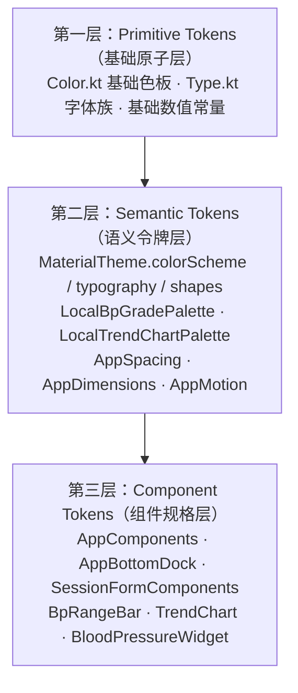

# Blood Pressure Record 统一设计系统规范（Design System Standard）

- **项目名称**：Blood Pressure Record（血压记录，`com.yang.bloodpressure`）
- **适用基线版本**：v2.3.13（versionCode 54）
- **技术栈**：Kotlin · Jetpack Compose · Material 3 · Glance AppWidget · Android Canvas / PdfDocument
- **配套审计文档**：`01-UI-UX-AUDIT-REPORT.md`、`02-VISUAL-ALIGNMENT-AUDIT.md`、`04-OPTIMIZATION-ROADMAP.md`

---

## 一、设计定位与规范状态说明

### 1.1 核心设计气质（Design Principles）

Blood Pressure Record 面向需要长期居家监测血压的中老年及慢病管理人群，核心产品定位为**“零登录、本机离线优先、温暖克制、医学严谨的个人血压健康账本”**。本规范在充分保留现有“暖纸赤陶 + 鼠尾草绿”柔和纸感调性的基础上，消除硬编码、对比度失格、圆角阶梯倒挂与跨页面组件分裂问题：

1. **温和不焦虑（Calm & Reassuring）**：以暖宣纸底色与柔和语义色降低“白大褂焦虑”，避免高饱和纯红/纯黑造成心理压迫，同时严格守住高风险血压（`≥180/120 mmHg`）的临床警示清晰度。
2. **一瞥即读（Glanceable & Tabular）**：核心血压读数与趋势指标优先保证对比度、等宽数字对齐（Tabular Figures）与清晰的单位伴随展示。
3. **适老包容（Elderly-Friendly & Accessible）**：全面满足触控热区 `≥ 48dp × 48dp`、非文本控件边界对比度 `≥ 3.0:1`、正文对比度 `≥ 4.5:1`、最大 `2.0x` 有效字体缩放不裁切，以及“减弱动态效果”模式下的瞬时按压反馈。
4. **语义唯一（Single Semantic Meaning）**：同一色彩、字号阶梯、圆角层级、组件变体与医学术语在全应用（含小组件与导出 PDF 报告）保持唯一明确的语义映射。

### 1.2 规范状态三类标记说明

为明确区分本次审计对现有体系的继承、修正与补齐，本文档所有章节与令牌均标注以下三类状态标签：

| 状态标记 | 含义说明 | 工程实施要求 |
| :--- | :--- | :--- |
| **`[现有规范 · 保留]`** | 现有源码（`Color.kt`、`Type.kt`、`DesignSystem.kt`、`AppMotion.kt` 等）已建立且体验优良的设计决策 | 严禁在后续迭代中随意破坏或回退 |
| **`[建议调整 · 修正]`** | 现有实现存在对比度不达标、比例倒挂、跨页不一致或交互死区的规格（附对应 `AUD-xx` 编号） | 按本规范给出的目标参数统一收敛替换 |
| **`[新增规范 · 补齐]`** | 现有体系尚未定义、导致各页面各自硬编码或缺失兜底逻辑的空白领域 | 在主题层或公共组件层新增标准令牌与契约 |

---

## 二、Design Tokens 架构与治理准则

### 2.1 三层令牌架构（Three-Tier Token Architecture）



### 2.2 令牌治理硬性约束

1. **`[现有规范 · 保留]` 集中式主题分发**：所有页面级 Composable 通过 `MaterialTheme`、`LocalBpGradePalette.current`、`AppSpacing`、`AppDimensions`、`AppMotion` 读取设计参数。
2. **`[建议调整 · 修正]` 禁止在业务组件内嗅探背景色判断深浅色模式**（关联 `AUD-02`）：严禁在业务组件中编写 `colors.background.red < 0.5f` 等启发式逻辑以及内联 `Color(0xFF...)` 魔法色值；深浅色差异必须全部收敛至 `Theme.kt` 或对应的 `CompositionLocal` 调色板。
3. **`[建议调整 · 修正]` 清理废弃与重复令牌**（关联 `AUD-30`）：
   - 删除 `Color.kt` 中重复定义的 `WarmTextFaint = Color(0xFF8F867C)`（与 `WarmTextMuted` 同值）及未被引用的孤立色值常量。
   - 重新激活 `AppDimensions.primaryButtonHeight = 56.dp`，绑定至 `AppPrimaryButton`、`AppSecondaryButton` 与底部保存主按钮，消除令牌悬空。
4. **`[新增规范 · 补齐]` 文档与版本号同步机制**（关联 `AUD-30`）：每次架构或设计令牌变更时同步更新根目录 `DESIGN.md`，确保文档基准版本与 `app/build.gradle.kts` 一致。

---

## 三、色彩体系规范（Color System）

### 3.1 品牌色、表面色与边界色令牌

| 语义角色（M3 / 扩展角色） | 浅色模式（Light） | 深色模式（Dark） | 对比度实测（相对主载体背景） | 状态标记与调整说明 |
| :--- | :--- | :--- | :--- | :--- |
| `background`（全局暖纸底） | `WarmPaper` `#FAF6EF` | `DarkBg` `#171412` | — | **`[现有规范 · 保留]`** 柔和护眼暖纸底色 |
| `surface`（标准卡片底） | `WarmSurface` `#FFFDFA` | `DarkSurface` `#221E1B` | — | **`[现有规范 · 保留]`** 与全局底形成轻盈层差 |
| `surfaceVariant`（次级容器/分段槽） | `WarmSurfaceSubtle` `#F2ECE3` | `DarkSurfaceHigh` `#2C2622` | — | **`[现有规范 · 保留]`** 内部嵌块与胶囊底槽 |
| `surfaceContainerHighest`（深嵌底槽） | `#EAE2D6` | `#362F2A` | — | **`[建议调整 · 修正]`** 明确浅/深色槽位阶差 |
| `primary`（主品牌赤陶色） | `Terracotta600` `#B94B39` | `Terracotta300` `#F2B4A4` | 浅 `4.81:1` / 深 `9.45:1` | **`[现有规范 · 保留]`** 主操作按钮、焦点态、选中态 |
| `onPrimary` | `#FFFFFF` | `#3B140D` | 浅 `4.81:1` / 深 `9.12:1` | **`[现有规范 · 保留]`** 满足 AA 文本对比度 |
| `primaryContainer` | `Terracotta100` `#FCE5DF` | `#532219` | — | **`[现有规范 · 保留]`** 一级分段选中滑块、温和暖色强调底 |
| `onPrimaryContainer` | `Terracotta700` `#8C3223` | `#FFDAD2` | 浅 `6.32:1` / 深 `9.80:1` | **`[现有规范 · 保留]`** 高可读性强调文字 |
| `secondary`（健康鼠尾草绿） | `Sage600` `#357D58` | `Sage400` `#AEBF92` | 浅 `4.92:1` / 深 `8.74:1` | **`[现有规范 · 保留]`** 达标圆环、已打卡正面反馈 |
| `secondaryContainer` | `Sage100` `#DFF2E7` | `#233B2E` | — | **`[现有规范 · 保留]`** 正向健康徽章与隐私承诺卡底 |
| `onSecondaryContainer` | `Sage800` `#1D4D34` | `#CBEBD8` | 浅 `7.85:1` / 深 `10.2:1` | **`[现有规范 · 保留]`** 严禁用于高风险警告图标底（`AUD-14`） |
| `onBackground` / `onSurface` | `WarmTextPrimary` `#231F1B` | `DarkTextPrimary` `#F3ECE4` | 浅 `15.6:1` / 深 `14.8:1` | **`[现有规范 · 保留]`** AAA 级核心读数与标题对比度 |
| `onSurfaceVariant`（次级正文） | `WarmTextSecondary` `#675F56` | `DarkTextSecondary` `#C8BEB2` | 浅 `5.92:1` / 深 `8.65:1` | **`[现有规范 · 保留]`** 辅助说明、单位、时间戳 |
| **`outline`（交互控件结构边框）** | **`WarmOutline` `#8A8177`** | **`DarkOutline` `#9A9085`** | **浅 `3.77:1`（`#FFFDFA`）<br/>浅 `3.55:1`（`#FAF6EF`）<br/>深 `4.82:1`（`#221E1B`）** | **`[建议调整 · 修正]`（`AUD-02`）**<br/>原 `#E3DDD5` 仅 `1.33:1` 严重失格；提升至 `#8A8177` 全面通过 WCAG 1.4.11 `≥3:1`（覆盖输入框、日期胶囊、未选中 `Switch` 轨道） |
| `outlineVariant`（弱装饰分割线） | `WarmDivider` `#E3DDD5` | `DarkDivider` `#3A332E` | 浅 `1.33:1` / 深 `1.42:1` | **`[现有规范 · 保留]`** 仅限卡片内非交互装饰性细分割线 |
| `error` / `errorContainer` | `#BA1A1A` / `#FFDAD6` | `#FFB4AB` / `#690005` | 浅 `6.45:1` / 深 `8.90:1` | **`[现有规范 · 保留]`** 表单校验错误、破坏性删除/放弃操作 |

### 3.2 血压医学六级语义调色板（`BpGradePalette`）

> [!IMPORTANT]
> 医学分级色仅编码《中国高血压防治指南》六档分级及低血压提示，**必须始终搭配文字标签（如 `● 正常高值`）共同呈现**，严禁单独使用无描边的极浅色块传达健康等级。

| 分级键值 | 临床定义（收缩压 / 舒张压） | 浅色 `soft / mid / ink` | 深色 `soft / mid / ink` | 状态标记与对比度规范 |
| :--- | :--- | :--- | :--- | :--- |
| `low`（偏低） | `< 90` 或 `< 60 mmHg` | `#EDECF8 / #6D6AAE / #46437A` | `#312C3A / #8E8BC8 /` **`#A6A3E2`** | **`[建议调整 · 修正]`（`AUD-26`）**<br/>深色 `ink` 由 `#8E8BC8`（`4.30:1`，且与 `mid` 重合）提亮至 `#A6A3E2`（相对 `#312C3A` 达 **`5.85:1`**），拉开圆点与文字明度层级 |
| `normal`（正常） | `90–119` 且 `60–79 mmHg` | `#DCF2E6 / #3D9B6E / #1D6846` | `#1F3329 / #67C494 / #9FE3BE` | **`[现有规范 · 保留]`** 浅 `6.08:1` / 深 `8.92:1` |
| `highNormal`（正常高值） | `120–139` / `80–89 mmHg` | `#EFF3D6 / #8FA32E / #576614` | `#2E311E / #B5C957 / #DCEB94` | **`[现有规范 · 保留]`** 浅 `5.84:1` / 深 `9.40:1` |
| `stage1`（1级高血压） | `140–159` / `90–99 mmHg` | `#FBF0D9 / #D4962A / #805309` | `#382D1B / #E6B04B / #F9D48C` | **`[现有规范 · 保留]`** 浅 `6.12:1` / 深 `9.15:1` |
| `stage2`（2级高血压） | `160–179` / `100–109 mmHg` | `#FCE5DC / #D96B43 / #8F3819` | `#3B241C / #EE8D68 / #FFC1AA` | **`[现有规范 · 保留]`** 浅 `6.35:1` / 深 `8.42:1` |
| `stage3`（3级/高风险） | `≥ 180` 或 `≥ 110 mmHg`<br/>（高风险阈值 `≥ 180/120`） | `#FADCE0 / #C94053 / #8A1C2B` | `#3D1D22 / #EB6B7D / #FFB8C2` | **`[现有规范 · 保留]`** 浅 `7.18:1` / 深 `8.28:1` |

**独立微色块描边规则** **`[新增规范 · 补齐]`**（关联 `AUD-12`、`AUD-26`）：
- 当使用 `BpGradePalette.*.soft` 绘制尺寸 `≤ 16.dp` 的独立图例色块（如历史日历底部图例）时，必须叠加 **`1.2.dp` 宽、`mid.copy(alpha = 0.55f)` 描边**，解决浅色底上对比度仅 `1.12:1–1.18:1` 肉眼难辨的问题。
- 当 `BpRangeBar` 渲染于 `ReadingHero`（底色同为 `.soft`）内部时，四色轨道外围或分段之间须保留 `1.dp` `onSurface.copy(alpha = 0.08f)` 极细描边或 `2.dp` 暖白底衬间距，防止同级段色融入卡片背景。

### 3.3 数据可视化与中性标记色彩规范

| 数据/标记角色 | 浅色模式色值 | 深色模式色值 | 用途与语义边界 | 状态标记 |
| :--- | :--- | :--- | :--- | :--- |
| `chartSystolic`（收缩压/高压） | `#B94B39` | `#F2B4A4` | 血压趋势图高压折线、数据点、图例圆点 | **`[现有规范 · 保留]`** |
| `chartDiastolic`（舒张压/低压） | `#0F4C75` | `#8ECAE6` | 血压趋势图低压折线、数据点、图例圆点（红蓝对色盲友好） | **`[现有规范 · 保留]`** |
| **`chartPulse`（脉搏/心率）** | **`#357D58`（`Sage600`）** | **`#AEBF92`（`Sage400`）** | **`PulseTrendCard` 脉搏折线、圆点与极值高亮，严禁复用高压赤陶红** | **`[新增规范 · 补齐]`（`AUD-11`）** |
| `chartClinicLine`（诊室参考线） | `#8A8177`（虚线 `6dp/4dp`） | `#9A9085` | `140/90 mmHg` 诊室参考线 | **`[现有规范 · 保留]`** |
| `chartTargetLine`（个人目标线） | `#675F56`（点划线 `3dp/3dp`） | `#C8BEB2` | 个人达标线（如 `120/80 mmHg`） | **`[现有规范 · 保留]`** |
| **`noteNeutral`（备注中性标记）** | 底 `#F2ECE3`<br/>文/点 `#675F56` | 底 `#2C2622`<br/>文/点 `#C8BEB2` | 日历“有备注”右上角圆点、历史记录卡片备注文本框；**禁止使用 `primary` 红橙色或 `primaryContainer` 珊瑚粉抢夺高风险视觉权重** | **`[建议调整 · 修正]`（`AUD-12`）** |

### 3.4 深浅色切换平滑过渡规范

- **`[建议调整 · 修正]` 全量 `ColorScheme` 插值过渡**（关联 `AUD-15`）：`Theme.kt` 中的 `animateColorScheme` 须补齐 `secondary`、`onSecondary`、`secondaryContainer`、`onSecondaryContainer`、`tertiary*`、`error*`、`outline`、`outlineVariant` 的 `animateColorAsState`（时长 `AppMotion.StandardMs = 220ms`，开启“减弱动态效果”时为 `0ms`），消除切换深色模式时局部色块瞬切闪烁。

---

## 四、字体与排版规范（Typography & Numeric System）

### 4.1 双字体分工策略

1. **`[现有规范 · 保留]` 展示型读数专用字体（`NumberFontFamily`）**：
   - 字体族：`Bricolage Grotesque`（`SemiBold W600` / `Bold W700`）+ 强制开启 `fontFeatureSettings = "tnum"`（等宽表格数字）。
   - 适用范围：首页核心大读数、早晚测量卡、本周统计卡、历史记录列表读数、趋势页统计数值、达标率百分比。
2. **`[建议调整 · 修正]` 补齐统计摘要卡的数字字体一致性**（关联 `AUD-17`）：
   - 历史页“近期”模式下的 `RecentSummaryCard`（平均高压/低压/脉搏）以及新建/编辑页的 `SessionAverageCard`（本次平均读数）必须统一使用 `NumberFontFamily` + `"tnum"`，消除系统黑体与几何无衬线混排割裂。
3. **`[现有规范 · 保留]` 中文正文与可编辑输入框字体（`FontFamily.Default`）**：
   - 中文标题、正文、说明文字统一采用系统默认无衬线字体（`Noto Sans CJK SC` / 系统字体），字间距固定 `letterSpacing = 0.sp`。
   - 可编辑数字输入框（`CompactNumberField`、`OutlinedTextField`）保留系统字体 + `fontFeatureSettings = "tnum"`，保障 Android 原生光标高度与选区度量稳定。

### 4.2 完整 15 级 Material 3 字阶规范表

> [!WARNING]
> **移动端最小字号底线（`12.sp` Floor）**：除极端受限的趋势图 Canvas 密集坐标轴刻度最低允许 `11.sp` 外，全应用所有 UI 文本、导航标签、图例与徽章字号一律 **`≥ 12.sp`**，严禁在业务代码中硬编码 `10.sp` 或 `11.sp`（关联 `AUD-18`）。

| M3 样式槽位 | 字号 (`fontSize`) | 行高 (`lineHeight`) | 字重 (`fontWeight`) | 字距 (`letterSpacing`) | 典型应用场景 | 状态标记 |
| :--- | :--- | :--- | :--- | :--- | :--- | :--- |
| `displayLarge` | `52.sp` | `56.sp` (`1.08x`) | `Bold` (`NumberFontFamily`) | `-0.5.sp` | 首页 `ReadingHero` 核心血压主读数（`109/77`） | **`[现有规范 · 保留]`** |
| `displayMedium` | `38.sp` | `44.sp` (`1.16x`) | `Bold` (`NumberFontFamily`) | `0.sp` | 详情页主读数、弹窗大号统计值 | **`[现有规范 · 保留]`** |
| **`displaySmall`** | **`32.sp`** | **`38.sp` (`1.19x`)** | **`Bold` (`NumberFontFamily`)** | **`0.sp`** | 趋势期间平均主读数、大号输入展示 | **`[新增规范 · 补齐]`（`AUD-18`）** |
| **`headlineLarge`** | **`30.sp`** | **`36.sp` (`1.20x`)** | **`Bold`** | **`0.sp`** | **四个一级 Tab 顶栏主标题统一规格**（修正首页 `29.sp` 漂移） | **`[建议调整 · 修正]`（`AUD-13`）** |
| `headlineMedium` | `24.sp` | `30.sp` (`1.25x`) | `Bold` (`NumberFontFamily`) | `0.sp` | 早晚测量卡、历史记录行、周均值读数 | **`[现有规范 · 保留]`** |
| **`headlineSmall`** | **`22.sp`** | **`28.sp` (`1.27x`)** | **`SemiBold`** | **`0.sp`** | 二级页面大标题、弹窗主标题 | **`[新增规范 · 补齐]`（`AUD-18`）** |
| `titleLarge` | `20.sp` | `26.sp` (`1.30x`) | `SemiBold` | `0.sp` | 二级顶栏标题、区块主标题（如“今天的测量”） | **`[现有规范 · 保留]`** |
| `titleMedium` | `16.sp` | `22.sp` (`1.38x`) | `SemiBold` | `0.sp` | 卡片内条目主标题（药品名、设置项标题） | **`[现有规范 · 保留]`** |
| **`titleSmall`** | **`14.sp`** | **`20.sp` (`1.43x`)** | **`SemiBold`** | **`0.sp`** | 子分组小标题、紧凑卡片副标题 | **`[新增规范 · 补齐]`（`AUD-18`）** |
| `bodyLarge` | `16.sp` | `24.sp` (`1.50x`) | `Normal` | `0.sp` | 标准输入文本、详情长段落正文 | **`[现有规范 · 保留]`** |
| `bodyMedium` | `14.sp` | `20.sp` (`1.43x`) | `Normal` | `0.sp` | 卡片说明文字、小压气泡文案、列表副标题 | **`[现有规范 · 保留]`** |
| `bodySmall` | `12.sp` | `18.sp` (`1.50x`) | `Normal` | `0.sp` | 辅助注释、时间戳、免责声明与页脚说明 | **`[现有规范 · 保留]`** |
| `labelLarge` | `15.sp` | `20.sp` (`1.33x`) | `SemiBold` | `0.sp` | 主/次按钮文字、一级分段控制器（`Primary`） | **`[现有规范 · 保留]`** |
| `labelMedium` | `13.sp` | `18.sp` (`1.38x`) | `Medium` | `0.sp` | 状态胶囊（`StatusChip`）、二级紧凑分段器（`Compact`） | **`[现有规范 · 保留]`** |
| **`labelSmall`** | **`12.sp`** | **`16.sp` (`1.33x`)** | **`Medium`** | **`0.sp`** | **底部导航标签、四色条区间名、周卡坐标与图例文字**（覆盖 M3 默认 `11.sp` + `0.5.sp` 字距） | **`[建议调整 · 修正]`（`AUD-18`）** |

**输入框显式行高补充** **`[建议调整 · 修正]`**（关联 `AUD-18`）：`CompactNumberField`（`28.sp` 输入字号）必须显式声明 `lineHeight = 36.sp`，防止大字号模式下上下笔画紧贴裁切。

### 4.3 动态字体缩放与适老化冷启动规范

- **`[现有规范 · 保留]` 双层缩放与 `2.0x` 安全上限**：应用内“大字模式”（`1.15x`）叠加系统字体缩放，经 `MAX_EFFECTIVE_FONT_SCALE = 2.0f` 钳制，兼顾适老放大与布局防崩。
- **`[建议调整 · 修正]` 消除冷启动首帧字号跳变**（关联 `AUD-23`）：`MainActivity` / `SettingsViewModel` 应在首帧渲染前同步读取本地偏好（如 `SharedPreferences` 轻量同步镜像或启动屏短暂等待首帧状态就绪），禁止在用户已关闭“大字模式”时先按默认 `true`（`1.15x`）渲染首帧再跳回 `1.0x`。
- **`[建议调整 · 修正]` 禁止文本列硬编码固定窄宽度**（关联 `AUD-16`）：时间戳或数值列一律采用 `Modifier.widthIn(min = 52.dp)` 替代 `Modifier.width(54.dp)`，保证 `2.0x` 缩放下不发生竖排折行。

---

## 五、间距、网格与页面布局规范（Spacing & Layout）

### 5.1 4dp / 8dp 基准间距阶梯（`AppSpacing`）

| 令牌名称 | 数值 | 标准用途 | 状态标记 |
| :--- | :--- | :--- | :--- |
| `xxs` | `4.dp` | 标题与副标题微间距、分段器轨道内边距（`4.dp`） | **`[现有规范 · 保留]`** |
| `xs` | `8.dp` | 同组紧凑元素间距、顶栏与首张卡片间距、小胶囊内边距 | **`[现有规范 · 保留]`** |
| `sm` | `12.dp` | 列表卡片垂直间距、双列统计小卡水平间距（`12.dp`） | **`[现有规范 · 保留]`** |
| `md` | `16.dp` | 中型卡片内边距、底部悬浮 Dock 距屏幕边缘外边距 | **`[现有规范 · 保留]`** |
| `lg` (`pageHorizontal`) | `20.dp` | **全应用标准页面左右安全边距**、核心大卡标准内边距 | **`[建议调整 · 修正]`** 修正 `ReportPreviewScreen` `16.dp` 漂移（`AUD-24`） |
| `xl` | `24.dp` | 跨业务大模块垂直间距（如“今日服药”到“这一周”） | **`[现有规范 · 保留]`** |
| `xxl` | `32.dp` | 页面底部留白缓冲、空状态大间距 | **`[现有规范 · 保留]`** |

**网格纪律** **`[建议调整 · 修正]`**（关联 `AUD-24`、`AUD-30`）：除 `1.dp / 1.5.dp / 2.dp` 描边线宽外，禁止新增 `5.dp`、`6.dp`、`9.dp`、`11.dp`、`13.dp`、`14.dp`、`18.dp` 等非 `4dp` 倍数的随意间距。

### 5.2 一级页面顶栏与安全区节奏规范

- **`[建议调整 · 修正]` 统一四个一级 Tab 顶栏几何基准**（关联 `AUD-13`、`AUD-22`、`AUD-24`）：
  1. **顶栏容器高度**：`statusBarsPadding()` 下方统一采用 `64.dp` 标准 `AppTopBar` 容器（左右基准线 `20.dp`）。
  2. **主标题位置与字阶**：左对齐 `headlineLarge (30.sp Bold)`，四个一级 Tab（`晚上好，XX` / `历史记录` / `血压趋势` / `我的`）标题基线完全齐平；移除 `SettingsScreen` 额外叠加的 `top = 16.dp` 以及 `TrendScreen` 正文首张卡片上方的重复“血压趋势”小标题。
  3. **右侧操作按钮光学右对齐**：当顶栏右侧为 `48.dp × 48.dp` 图标按钮或紧凑文字按钮（如历史页🔍搜索、趋势页“全屏”）时，对按钮施加 `Modifier.offset(x = 8.dp)`（或将 `24.dp` 图标置于右对齐槽位同时保留 `48.dp` 触控热区），使其**视觉右边缘**严格落在页面右侧 `20.dp` 网格线上，消除向内缩进 `12.dp` 的视觉松散感。
  4. **顶栏至首屏内容间距**：统一为 `AppSpacing.xs = 8.dp`。
  5. **滚动折叠策略一致化**：一级 Tab 顶栏统一保持静态随列表自然滚出（或随 `LazyColumn` 首项滚动），取消仅 `HistoryScreen` 单独折叠顶栏而其余三页固定的不一致行为。

### 5.3 卡片内部左对齐轴守恒规范

- **`[建议调整 · 修正]` 禁止因局部热区填充破坏卡片左轴线**（关联 `AUD-06`）：卡片内部所有平级模块共享唯一的 `20.dp` 左内边界。若卡片内某一子区域（如 `ReadingHero` 中间的读数区）需要独立点击热区与圆角高亮背景，应采用**外层容器 `padding(horizontal = 14.dp)` + 非点击兄弟行补 `padding(horizontal = 6.dp)`**，使点击区内部 `padding(horizontal = 6.dp)` 后的文字精确落回 `14 + 6 = 20.dp` 左轴线，杜绝主读数与标题向右缩进 `6.dp`。

---

## 六、圆角与同心几何规范（Corner Radius & Concentricity）

### 6.1 单调递增的 `AppShapes` 圆角阶梯

> [!IMPORTANT]
> **修正圆角倒挂缺陷（`AUD-07`）**：现有 `Theme.kt` 中 `medium = 26.dp` 大于 `large = 20.dp`，导致输入框、按钮与卡片圆角跨页混乱。现确立严格单调递增的五级圆角体系：

| `AppShapes` 槽位 | 原规格 | **统一新规格** | 绑定组件范围 | 状态标记 |
| :--- | :--- | :--- | :--- | :--- |
| `extraSmall` | `12.dp` | **`12.dp`** | 日历单日格子（`CalendarDay`）、内嵌徽章底块、小型提示框、服药内层按钮 | **`[现有规范 · 保留]`** |
| `small` | `16.dp` | **`16.dp`** | **全部文本/数值输入框**（`OutlinedTextField`、`CompactNumberField`）、卡片内嵌子磁贴（`TargetTile`、`ReadingHero` 气泡） | **`[建议调整 · 修正]`（`AUD-07`）** |
| **`medium`** | `26.dp` ❌ | **`20.dp`** | **主/次大按钮（`56.dp` 高）**、独立列表条卡（`MedicationRow`）、日期时间选择胶囊 | **`[建议调整 · 修正]`（`AUD-07`）** |
| **`large`** | `20.dp` ❌ | **`24.dp`** | **全站标准内容卡片**（`DataCard`、`SettingsGroup`、`HistorySessionCard`、`TrendCard`、`MeasurementReadingCard`） | **`[建议调整 · 修正]`（`AUD-07`）** |
| `extraLarge` | `32.dp` | **`32.dp`** | 首页情感核心大卡（`ReadingHero`）、底部抽屉（`ModalBottomSheet`）顶部圆角、模态对话框（`AlertDialog`） | **`[现有规范 · 保留]`** |
| `Full` (`CircleShape`) | `50%` | **`50%`** | 底部悬浮胶囊导航栏（`AppBottomDock`）、中央 `+` 按钮、分段控制器胶囊轨道与滑块、状态胶囊（`StatusChip`） | **`[现有规范 · 保留]`** |

### 6.2 嵌套同心圆角定律（Concentric Corner Rule）

- **`[新增规范 · 补齐]` 内外圆角差值公式**（关联 `AUD-24`）：当带背景或边框的内层圆角元素与外层圆角容器边缘存在均匀间距 $P$ 时，内层圆角 $R_{\text{inner}}$ 必须遵循：
  $$R_{\text{inner}} = \max(R_{\text{outer}} - P,\ 8\text{dp})$$
  - **首页服药行（`MedicationRow`）**：外层 `R_outer = 20.dp`，内边距 `P = 12.dp` $\rightarrow$ 左侧药丸图标块与右侧“打卡”按钮统一使用 **`R_inner = 12.dp`**（修正原 `22dp / 12dp / 15dp` 非同心偏差，保留 `8dp` 舒适下限）。
  - **我的页个人资料卡**：外层 `DataCard` `R_outer = 24.dp`，内边距 `P = 16.dp`（或 `20.dp`） $\rightarrow$ 内层“达标高压/低压”磁贴使用 `R_inner = 12.dp`（或 `16.dp` 宽松同心）。
  - **首页 `ReadingHero`**：外层 `R_outer = 32.dp`，内边距 `P = 20.dp` $\rightarrow$ 小压对话气泡使用 `R_inner = 16.dp`。

---

## 七、图标与视觉符号规范（Iconography）

1. **`[现有规范 · 保留]` 图标尺寸阶梯**：
   - `16.dp`：行内状态指示图标（如早晚太阳/月亮、趋势涨跌箭头、已打卡对勾）。
   - `22.dp`：卡片带底色徽章（`RoundIconBadge`）内部图标。
   - `24.dp`：底部导航栏（未选中线性 `Outlined` / 选中填充 `Filled`）、顶栏操作图标。
2. **`[建议调整 · 修正]` 圆形/圆角图标徽章尺寸网格化**（关联 `AUD-30`）：`RoundIconBadge` 外框尺寸由非标 `46.dp` 规范化为 **`44.dp`**（`4dp` 网格对齐，内部图标 `22.dp`）。
3. **`[建议调整 · 修正]` 图标与底色语义严禁冲突**（关联 `AUD-14`）：
   - 警示类设置项（如“高风险保存前确认”的 `WarningAmber` 图标）必须搭配暖色警示底（`primaryContainer` 或 `errorContainer`），禁止使用代表“达标安全”的薄荷绿 `secondaryContainer`。
   - 同一页面不同功能入口严禁复用完全相同的图标：“首页四色条区间”改用刻度调节图标（`Icons.Outlined.Tune`），“显示小压”改用微笑伙伴图标（`Icons.Outlined.SentimentSatisfied`），解除原双重空心爱心冲突。
4. **`[建议调整 · 修正]` 禁止以空格字符充当图标间距**（关联 `AUD-24`）：严禁拼接 `"☀ "`、`"☾ "` 等字面量空格控制图文间距，统一采用 `Row(horizontalArrangement = Arrangement.spacedBy(6.dp))` + 矢量 `Icon`。

---

## 八、核心公共组件规范（Component Standards）

### 8.1 按钮体系（Buttons & Compact Actions）

| 组件名称 | 高度 / 触控目标 | 圆角 | 视觉与排版规范 | 状态标记 |
| :--- | :--- | :--- | :--- | :--- |
| `AppPrimaryButton` | 视觉高 **`56.dp`** | `20.dp` | `primary` 填充 + `onPrimary` `15.sp SemiBold`；**仅赋予当前页面最推荐、最安全的核心正向操作**（如“导出加密备份 .bpx”、“保存记录”） | **`[建议调整 · 修正]`（`AUD-14`, `AUD-30`）** |
| `AppSecondaryButton` | 视觉高 **`56.dp`** | `20.dp` | `surface` 填充 + `1.dp outline` 描边 + `onSurface` `15.sp SemiBold`；用于次要操作或不带加密的兼容导出（如 `.xlsx`） | **`[建议调整 · 修正]`（`AUD-14`, `AUD-30`）** |
| **`AppCompactActionPill`** | 触控高 **`48.dp`**<br/>（视觉高 `34.dp`）<br/>最小宽 **`48.dp`** | `CircleShape` 或 `12.dp` | `13.sp Medium`，水平内边距 `8.dp–10.dp`，外层使用 `FlowRow` 支持大字号自动换行；**专用于图表选点工具栏等 4–5 项紧凑操作组，彻底杜绝 M3 `TextButton` `64.dp` 最小宽度导致的文字截断** | **`[新增规范 · 补齐]`（`AUD-01`）** |
| **服药打卡按钮** | 触控高 **`48.dp`**<br/>（视觉高 `38.dp`）<br/>最小宽 `76.dp` | `12.dp`（同心） | **待打卡态**：`primaryContainer` 暖底 + `onPrimaryContainer` 文字（或 `1.5.dp primary` 描边 + `primary` 文字），消除“置灰不可点”错觉；<br/>**已打卡态**：`secondaryContainer` 绿底 + `✓ 已打卡` `onSecondaryContainer` 文字 | **`[建议调整 · 修正]`（`AUD-09`）** |

### 8.2 分段控制器双规格统一规范（`SegmentedPillGroup`）

- **`[建议调整 · 修正]` 废弃 `TrendScreen` 私有 `SegmentedControl`，全站统一为 `SegmentedPillGroup` 两种标准尺寸**（关联 `AUD-08`、`AUD-17`）：

| 变体枚举 | 适用场景 | 轨道底色与内边距 | 选中滑块样式 | 字号与大字适配 |
| :--- | :--- | :--- | :--- | :--- |
| **`SegmentedSize.Primary`** | 页面一级视图模式切换（2–3 项）：<br/>历史页 `日历 / 近期`<br/>趋势页 `每次测量 / 每日平均` | `surfaceVariant` 胶囊底槽，`4.dp` 均匀内边距，高度 `48.dp` | `primaryContainer` 珊瑚暖底 + `onPrimaryContainer` 文字 | `15.sp SemiBold`；有效缩放 `≥ 1.6x` 且放不下时自动转为纵向堆叠 |
| **`SegmentedSize.Compact`** | 时间窗口或二级子筛选（2–5 项）：<br/>趋势页 `7天/30天/180天/365天/全部`、`双指标/收缩压/舒张压`<br/>历史近期 `本周 / 本月` | `surfaceVariant`（卡片外）或 `surfaceContainerHighest`（白卡内），`4.dp` 内边距，视觉高 `40.dp`（触控 `48.dp`） | 抬升的纯白/深灰 `surface` 滑块 + 浅色 `1.dp outlineVariant` 细边 + `onSurface` 加粗文字 | `13.sp SemiBold`；与一级 `Primary` 上下组合时形成清晰的主次对比，避免双层珊瑚粉撞色 |

### 8.3 卡片、列表与表单分组规范

1. **复合入口卡片整卡可点原则** **`[建议调整 · 修正]`**（关联 `AUD-04`）：像“我的”页顶部个人资料与达标目标卡这类单一跳转目的地的摘要卡，必须将 `onClick` 绑定在最外层 `DataCard` 容器上并合并无障碍语义（`semantics(mergeDescendants = true)`），禁止仅绑定上半部姓名行导致下半部目标磁贴沦为点击死区。
2. **设置分组列表内缩分割线** **`[建议调整 · 修正]`**（关联 `AUD-24`）：`SettingsGroup` 多行条目之间的 `HorizontalDivider` 须设置 `Modifier.padding(start = 68.dp, end = 20.dp)`，左端对齐文字起点，消除贯穿整卡的表格割裂感。
3. **历史记录卡片基线对齐与单位呈现** **`[建议调整 · 修正]`**（关联 `AUD-16`）：
   - 左侧时间（`22:14` `17.sp SemiBold`）与中部主读数（`109/77` `24.sp Bold`）通过 `Modifier.alignByBaseline()` 严格共享首行文字基线。
   - 主读数右侧跟随浅色 `mmHg`（`12.sp onSurfaceVariant`），下方脉搏统一展示为 `脉搏 65 次/分`（补齐单位）。
4. **单组测量录入卡片化包裹** **`[建议调整 · 修正]`**（关联 `AUD-28`）：`AddMeasurementScreen` 与 `EditSessionScreen` 中的 `MeasurementReadingCard` 统一包裹 `surface` 底色 + `AppShapes.large (24.dp)` 圆角 + `16.dp` 内边距卡片，明确“第 1 组 / 第 2 组 / 第 3 组”的视觉分组边界。
5. **服药剂量快捷单位引导** **`[新增规范 · 补齐]`**（关联 `AUD-09`）：`MedicationEditorDialog` 的剂量输入框下方常驻 `supportingText` 示例，并提供一键追加单位胶囊（`片` / `粒` / `丸` / `mg` / `袋`），从源头避免产生 `"08:00 · 1"` 这类缺失单位的歧义记录。

### 8.4 日历格子、模态弹窗与全局反馈规范

1. **日历单日格子（`CalendarDay`）** **`[建议调整 · 修正]`**（关联 `AUD-05`、`AUD-30`）：
   - 尺寸与圆角：`40.dp × 40.dp`，圆角 `AppShapes.extraSmall (12.dp)`。
   - **互斥描边优先级**：`when { isSelected -> border(2.dp, colorScheme.primary); isToday -> border(1.5.dp, colorScheme.outline); else -> 无描边 }`，严禁在“今天且选中”时叠加双层异色边框；可通过底部微圆点或字重区分“今天”。
2. **多操作确认弹窗自适应布局** **`[建议调整 · 修正]`**（关联 `AUD-21`）：
   - 包含 3 个动作的确认弹窗（如“未保存离开：继续编辑 / 放弃修改 / 保存并离开”、“恢复备份：取消 / 合并导入 / 覆盖恢复”）严禁在 `AlertDialog` 的 `dismissButton` 槽位内嵌套固定水平 `Row`；须改用自定义垂直全宽按钮栈（或 `FlowRow` 自适应折行），且破坏性动作（`放弃修改`、`清空全部数据`）必须使用 `colorScheme.error` 警示色。
   - 表单保存校验错误提示统一紧贴底部主保存按钮正上方，并声明 `LiveRegionMode.Polite`（`AUD-21`）。
3. **单一全局 `SnackbarHost` 通道** **`[建议调整 · 修正]`**（关联 `AUD-15`）：移除 `DashboardScreen` 内部私自挂载的局部 `SnackbarHost`，全站轻提示统一汇总至 `AppNavigation` 根级 `Scaffold` 的唯一 `SnackbarHost`，固定悬浮于 `AppBottomDock` 上方 `12.dp` 处，杜绝双提示条重叠遮挡。

---

## 九、健康数据可视化专项规范（Health Data Visualization）

1. **首页双标尺语义协同规范** **`[建议调整 · 修正]`**（关联 `AUD-10`）：
   - 当用户未修改“首页四色条区间”（`config == BpZoneConfig.Default`）时，`BpRangeBar` 四段底部文字默认采用与医学口径一致的 **`偏低 / 正常 / 正常高值 / 偏高`**，消除上方 `● 正常高值` 胶囊与下方指示三角指向“偏高”的认知冲突。
   - 当用户自定义过四色条阈值（`config != BpZoneConfig.Default`）时，在色条右上方或下方显示轻量化说明标签 **`个人参考刻度`**，明确区分上方不可篡改的医学分级胶囊与下方个人关注区间。
2. **趋势折线图去噪与目标值外置** **`[建议调整 · 修正]`**（关联 `AUD-11`）：
   - 将诊室参考值与个人目标具体数值统一合并展示在图表上方图例区（如 `-- 诊室参考 140/90` · `·· 个人目标 120/80`），画布内部仅保留干净的水平参考虚线（不在密集折线穿行处叠加 `"目标 120"` / `"目标 80"` 浮动小字）。
3. **达标率分段条最小可见宽度保护** **`[建议调整 · 修正]`**（关联 `AUD-27`）：`TrendScreen` 达标率卡片的横向等级占比条中，任何计数 `count > 0` 的非零分段必须保证**最小渲染宽度 `≥ 8.dp`**（其余宽段按比例微调让渡），避免 `1/184` 等极小占比段退化为 `< 2.dp` 的不可见细丝。
4. **周卡图例符号一一对应** **`[建议调整 · 修正]`**（关联 `AUD-25`）：`WeekCard` 底部图例拆分为独立三项：`● 实心圆：日均高压`、`○ 空心圆：日均低压`、`╌╌ 虚线：正常上界 120/80`，补齐独立的虚线图形图例。
5. **医生报告预览渐进披露** **`[建议调整 · 修正]`**（关联 `AUD-29`）：`ReportPreviewScreen` 将前序页面已配置过的 3 项隐私开关收拢为一行紧凑摘要条（如 `已隐藏姓名与备注 · 调整隐私项 ▾`，点击展开），将首屏核心空间归还给 A4 PDF 报告第一页预览。

---

## 十、交互、手势与动效规范（Interaction & Motion）

### 10.1 时长与缓动令牌（`AppMotion`）

| 动效令牌 | 正常模式参数 | 减弱动态效果（`reducedMotion == true`） | 适用场景 | 状态标记 |
| :--- | :--- | :--- | :--- | :--- |
| `Quick` | `150ms` `FastOutSlowIn` | `0ms` (`snap()`) | 按钮/卡片按压回弹、开关状态切换、颜色微变 | **`[现有规范 · 保留]`** |
| `Standard` | `220ms` `FastOutSlowIn` | `0ms` (`snap()`) | 页面转场、可折叠区块展开收起、深浅色切换 | **`[现有规范 · 保留]`** |
| `Gentle` | `280ms` 无过冲弹簧 (`dampingRatio = 0.85f`) | `0ms` (`snap()`) | 分段滑块位移、底部导航栏显隐、图表高亮过渡 | **`[现有规范 · 保留]`** |

### 10.2 按压反馈与触控热区硬性规范

1. **`[新增规范 · 补齐]` 减弱动态效果按压反馈兜底契约（`pressableFeedback`）**（关联 `AUD-03`）：
   - 凡传入 `indication = null` 以禁用默认水波纹并改用 `pressableScale` 的组件（`AppPrimaryButton`、`AppSecondaryButton`、`DataCard`、`AppBottomDock` 导航项与 `+` 按钮、日历格子、服药打卡按钮等），**在 `reducedMotion == true` 跳过缩放动画时，必须在 `isPressed == true` 期间提供 `0ms` 瞬时状态层反馈**（叠加 `onSurface.copy(alpha = 0.10f)` 前景遮罩或整体透明度降至 `0.84f`）。
   - `WheelTimePicker` 滚轮上下相邻可点击时间项在常规与减弱动效模式下均须提供轻水波纹或瞬时背景态反馈。
2. **`[新增规范 · 补齐]` 表单开关与复选框整行热区规范**（关联 `AUD-19`）：
   - 所有包含 `Switch`、`Checkbox` 或 `RadioButton` 的设置项与筛选项（含报告配置页、报告预览页、数据管理页）必须在**整行容器**上绑定 `Modifier.toggleable(value = checked, role = Role.Switch, onValueChange = ...)`（行高 `≥ 56.dp`），并将尾部控件本身的回调设为 `null`，彻底消除点击文字无效的挫败感。
3. **`[建议调整 · 修正]` 隐式手势显性化与防误触阈值**（关联 `AUD-25`、`AUD-32`）：
   - 取消历史日历“双击格子跳转备注搜索”的隐藏操作，改为在选中日标题栏提供显式的“查看/搜索备注”轻量入口；首页小压气泡右侧增加细微切换提示点或角标，提示可点击轮换健康贴士。
   - `DockScrollState` 向上微滚唤出底部导航栏的触发阈值由 `18.dp` 调优至 **`36.dp`**（滚回列表最顶部 `firstVisibleItemIndex == 0` 时立即唤出），避免在趋势页上下微调对齐图表时频繁弹出遮挡。

---

## 十一、无障碍与适老化规范（Accessibility & Elderly Care）

| 维度 | 强制验收标准 | 关联审计项与状态 |
| :--- | :--- | :--- |
| **文本对比度** | 正文与辅助说明 `≥ 4.5:1`；血压核心大读数 `≥ 7.0:1`（AAA）；全量修复深色模式“偏低”文字至 `5.85:1` | **`[建议调整 · 修正]`（`AUD-26`）** |
| **非文本对比度** | 输入框边框、未选中开关轮廓、独立图例色块描边、图表折线对比度一律 **`≥ 3.0:1`** | **`[建议调整 · 修正]`（`AUD-02`, `AUD-12`）** |
| **最小触控目标** | 所有独立可点区域（含周卡单日列、提醒删除按钮、桌面小组件 `+ 记一次` 按钮）热区 **`≥ 48dp × 48dp`** | **`[建议调整 · 修正]`（`AUD-19`）** |
| **屏幕阅读器语序** | 复合统计卡合并语义须遵循 **“指标名称 → 核心数值 → 趋势/说明”** 自然朗读顺序（修正达标率环先读 `64%` 再读 `达标率` 的倒置问题） | **`[建议调整 · 修正]`（`AUD-33`）** |
| **多重编码保障** | 血压等级、图表高低压/脉搏曲线必须同时具备**颜色 + 文字标签 + 线型/点型**至少两种视觉线索，不依赖单一颜色辨识 | **`[现有规范 · 保留]`** |

---

## 十二、UX 文案与健康专业表达规范（UX Writing & Clinical Copy）

### 12.1 全应用统一术语对照表

- **`[建议调整 · 修正]` 消除跨模块同义异词与空值符号分裂**（关联 `AUD-20`、`AUD-16`、`AUD-31`）：

| 概念类别 | 历史混用写法（禁止新增） | **全站唯一标准写法** | 适用页面范围 |
| :--- | :--- | :--- | :--- |
| **早晚两时段对比统计** | `早上` / `清晨·上午` / `早间` / `晨间` / `早晨`<br/>`晚上` / `傍晚·夜间` / `晚间` | **`早间`（`05:00–11:59`）**<br/>**`晚间`（`18:00–23:59`）** | 首页早晚测量卡、趋势页早晚平均、提醒设置、PDF 医生报告 |
| **单条记录具体时刻归属** | 混用两时段与四时段词 | **`凌晨 / 上午 / 下午 / 晚上`** | 单条血压记录的时间戳前缀或副标题（如 `晚上 · 22:14`） |
| **昼夜血压节律统计** | — | **`日间`（`06:00–21:59`）**<br/>**`夜间`（`22:00–05:59`）** | 趋势页“昼夜统计”模块及配套说明注脚 |
| **测量事件计数单位** | `0 条`、`15 次` 混用 | **`次`**（如 `3 次测量`、`高风险记录：0 次`） | 首页、历史日历/近期摘要、趋势统计、数据导出提示 |
| **单次会话内多次读数单位** | `第 1 次` / `第 1 组` | **`组`**（如 `第 1 组`、`3 组平均`） | 新建/编辑记录页、详情页组内明细 |
| **空值 / 暂无数据占位符** | `--`、`-`、`暂无` 混用 | **`—`**（中文破折号单字长横 `U+2014`） | 无读数卡片、未测脉搏、图表空周期、PDF 报表空单元格 |
| **版本号副标题排版** | `...隐私与版本更新（v2.3.13）`（全角括号孤行悬挂） | **`快速上手、血压标准与隐私 · v2.3.13`** | “我的”页“使用指南与更新”副标题（`AUD-31`） |

### 12.2 医疗健康信息严谨性红线

1. **`[现有规范 · 保留]` 非诊断声明与高风险独立提示**：
   - 应用内所有分级展示均定位于“居家血压参考记录”，不做临床疾病诊断，不给出加减药医嘱。
   - 当收缩压 `≥ 180 mmHg` 或舒张压 `≥ 120 mmHg` 时，温和提示“静坐休息 5 分钟后复测；若持续偏高或伴头晕胸闷等不适请及时就医”；即使关闭保存前确认弹窗，首页与历史列表中的高风险标记仍须完整保留。
2. **`[现有规范 · 保留]` 本机隐私透明表达**：保持“无需注册账号、默认保存在本机、仅主动检查更新时联网、卸载换机前请先导出加密备份”的平实透明文案，不制造云端同步误导。

---

## 附录：核心 DesignSystem / Theme 目标代码参考片段

以下为落地本规范核心令牌层的参考 Kotlin 定义结构（仅作规范示例，实施阶段按 `04-OPTIMIZATION-ROADMAP.md` 执行）：

```kotlin
// 1. Color.kt — 补齐达标结构边框色与图表脉搏专色
val WarmOutline = Color(0xFF8A8177)      // 浅色结构边框：相对 #FFFDFA 对比度 3.77:1，相对 #FAF6EF 为 3.55:1
val DarkOutline = Color(0xFF9A9085)      // 深色结构边框：相对 #221E1B 对比度 4.82:1
val DarkBpLowInk = Color(0xFFA6A3E2)     // 深色“偏低”文字：相对 #312C3A 对比度 5.85:1（原 #8E8BC8 仅 4.30:1）

// 2. Theme.kt — 单调递增的圆角阶梯 AppShapes
val AppShapes = Shapes(
    extraSmall = RoundedCornerShape(12.dp), // 日历格子、微徽章、服药内层同心按钮
    small = RoundedCornerShape(16.dp),      // 全部输入框、内嵌磁贴、小压气泡
    medium = RoundedCornerShape(20.dp),     // 56dp 主/次按钮、独立行卡（MedicationRow）
    large = RoundedCornerShape(24.dp),      // 标准内容卡片（DataCard / SettingsGroup / HistorySessionCard）
    extraLarge = RoundedCornerShape(32.dp), // ReadingHero 核心大卡、BottomSheet、AlertDialog
)

// 3. AppComponents.kt — 兼容减弱动态效果的按压反馈修饰符契约
fun Modifier.pressableFeedback(
    interactionSource: MutableInteractionSource,
    enabled: Boolean = true,
    targetScale: Float = 0.98f,
): Modifier = composed {
    val isPressed by interactionSource.collectIsPressedAsState()
    val reducedMotion = LocalReducedMotion.current
    val scale by animateFloatAsState(
        targetValue = if (enabled && isPressed && !reducedMotion) targetScale else 1f,
        animationSpec = AppMotion.quickTween(),
        label = "pressScale",
    )
    val pressedAlpha = if (enabled && isPressed && reducedMotion) 0.84f else 1f
    this.graphicsLayer {
        scaleX = scale
        scaleY = scale
        alpha = pressedAlpha
    }
}
```
