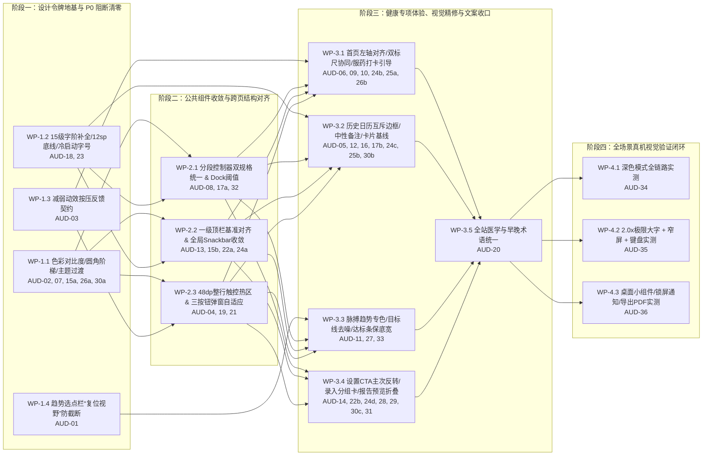

# Blood Pressure Record UI/UX 分阶段优化路线图（Optimization Roadmap）

- **项目名称**：Blood Pressure Record（血压记录，`com.yang.bloodpressure`）
- **基线版本**：v2.3.13（versionCode 54）
- **覆盖问题总量**：**36 项**（`AUD-01` ～ `AUD-36`：其中 **P0 共 3 项**、**P1 共 12 项**、**P2 共 14 项**、**P3 共 7 项**）
- **规划原则**：**“先令牌地基、再公共组件、后业务页面、终真机验收”**——严格按依赖顺序合并同文件修改，杜绝先改页面硬编码、后改全局主题造成的二次返工与合并冲突。

---

## 一、总体分阶段实施架构与依赖关系

### 阶段工期与复杂度总览

| 阶段 | 核心目标 | 覆盖问题数 | 技术复杂度 | 推荐提交粒度 |
| :--- | :--- | :---: | :---: | :--- |
| **阶段一（Phase 1）** | 清零全部 3 项 **P0** 缺陷，完成色彩、圆角、字阶、动效四大底层令牌标准化 | **9 项**（含拆分项） | 低 ～ 中 | 4 个独立原子 PR |
| **阶段二（Phase 2）** | 收敛分段器、顶栏、弹窗、全局 Snackbar 与整行触控热区，打通跨页骨架一致性 | **9 项**（含拆分项） | 中 | 3 个组件级 PR |
| **阶段三（Phase 3）** | 解决健康数据双标尺、脉搏图专色、日历/备注语义、卡片光学对齐与全局术语统一 | **19 项**（含收口项） | 中 | 5 个按模块隔离 PR |
| **阶段四（Phase 4）** | 完成深色模式、`2.0x` 大字号软键盘、桌面小组件与 PDF 打印三大真机待验证闭环 | **3 项** + 全量回归 | 低（测试验证） | 1 轮真机验收清单 |

---

## 二、分阶段工作包详细执行方案

---

### 阶段一：设计令牌地基与 P0 阻断项清零（Foundation & P0 Blockers）

> [!IMPORTANT]
> **为什么必须先做阶段一？**
> 一旦在 `Theme.kt` 中修正 `LightColors.outline`（`#8A8177`）与单调递增 `AppShapes`（`12 / 16 / 20 / 24 / 32.dp`），并在 `Type.kt` 补齐 15 级字阶，全站所有输入框、开关、卡片和小标签将**自动继承合规对比度与圆角**，无需在数十个业务页面逐个打补丁。

#### WP-1.1：色彩对比度修正、圆角阶梯扶正与主题平滑过渡
- **解决审计项**：**`AUD-02` (P0)**、`AUD-07` (P1)、`AUD-15` [主题动画部分] (P1)、`AUD-26` [深色 `low` 调色板部分] (P2)、`AUD-30` [色彩与尺寸死令牌清理] (P3)
- **影响范围**：全局输入框、日期时间胶囊、未选中 `Switch` 轮廓、全站卡片与弹窗圆角、深浅色切换动效、深色“偏低”状态标签。
- **关联源码文件**：
  - `app/src/main/java/com/yang/bloodpressure/ui/theme/Color.kt`
  - `app/src/main/java/com/yang/bloodpressure/ui/theme/Theme.kt`
  - `app/src/main/java/com/yang/bloodpressure/ui/theme/DesignSystem.kt`
  - `app/src/main/java/com/yang/bloodpressure/ui/common/SessionFormComponents.kt`
- **具体实施内容**：
  1. 在 `Color.kt` 新增 `WarmOutline = Color(0xFF8A8177)`、`DarkOutline = Color(0xFF9A9085)`，清理重复常量 `WarmTextFaint` 及未引用色值。
  2. 在 `Theme.kt` 将 `LightColors.outline` 指向 `WarmOutline`（`outlineVariant` 保持 `WarmDivider #E3DDD5`）；移除 `SessionFormComponents.kt` 中 `CompactNumberField` 的 `colors.background.red < 0.5f` 与硬编码 `#B3A99D` 边框，统一读取 `MaterialTheme.colorScheme.outline`。
  3. 在 `Theme.kt` 将 `AppShapes` 修正为 `extraSmall=12.dp, small=16.dp, medium=20.dp, large=24.dp, extraLarge=32.dp`；排查引用 `shapes.medium`（原 `26.dp`）和 `shapes.large`（原 `20.dp`）的组件使其语义归位。
  4. 在 `Theme.kt` 的 `animateColorScheme` 中补齐 `secondary*`、`tertiary*`、`error*`、`outline`、`outlineVariant` 的颜色过渡插值。
  5. 在 `DesignSystem.kt` 将 `DarkBpGradePalette.low.ink` 提亮至 `Color(0xFFA6A3E2)`（对比度 `5.85:1`）。
- **技术复杂度**：低
- **前置依赖**：无（全路线图起点）
- **潜在风险与防护**：`AppShapes.medium` 与 `AppShapes.large` 数值互换后，原使用默认 `Card`（默认绑定 `shapes.medium`）或 `OutlinedTextField`（默认绑定 `shapes.extraSmall` / 显式传参）的组件圆角会变化；修改时同步核对 `AppComponents.kt` 中 `DataCard` 显式指向 `MaterialTheme.shapes.large (24.dp)`、输入框指向 `MaterialTheme.shapes.small (16.dp)`。
- **量化验收标准**：
  - 浅色模式下所有输入框、日期胶囊、未开启 `Switch` 边框相对 `#FFFDFA` 与 `#FAF6EF` 对比度实测 **`≥ 3.55:1`**；
  - 深色模式“偏低”标签文字对比度 **`≥ 5.8:1`**；
  - 切换“深色模式”开关时，全屏徽章与边框同步平滑过渡，无 0ms 瞬跳色块。

#### WP-1.2：15 级字阶补全、`12.sp` 最小字号兜底与冷启动字号防闪跳
- **解决审计项**：`AUD-18` (P2)、`AUD-23` (P2)
- **影响范围**：全局排版系统、底部导航文字、首页四色条与周卡标注、新建记录大数字输入框、应用冷启动首帧。
- **关联源码文件**：
  - `app/src/main/java/com/yang/bloodpressure/ui/theme/Type.kt`
  - `app/src/main/java/com/yang/bloodpressure/ui/theme/BpRangeTokens.kt`
  - `app/src/main/java/com/yang/bloodpressure/ui/common/AppBottomDock.kt`
  - `app/src/main/java/com/yang/bloodpressure/ui/home/WeekCard.kt`
  - `app/src/main/java/com/yang/bloodpressure/ui/common/SessionFormComponents.kt`
  - `app/src/main/java/com/yang/bloodpressure/MainActivity.kt`
  - `app/src/main/java/com/yang/bloodpressure/ui/settings/SettingsViewModel.kt`
- **具体实施内容**：
  1. 在 `Type.kt` 补齐 `displaySmall (32/38sp)`、`headlineSmall (22/28sp)`、`titleSmall (14/20sp, 0.sp)`、`labelSmall (12/16sp, 0.sp)`。
  2. 将 `AppBottomDock` 导航标签、`BpRangeTokens` 四色条标签、`WeekCard` 坐标与数值标注中的 `10.sp–11.sp` 统一提升至 `labelSmall (12.sp)`；为 `CompactNumberField`（`28.sp`）补齐 `lineHeight = 36.sp`。
  3. 在 `SettingsViewModel` / `MainActivity` 初始化阶段同步读取已持久化的 `isLargeTextEnabled` 初始值（或在 DataStore 首帧发射前保持启动态），消除关闭大字模式用户每次冷启动首帧由 `1.15x` 跳回 `1.0x` 的排版抖动。
- **技术复杂度**：低 ～ 中
- **前置依赖**：无（可与 WP-1.1 并行）
- **潜在风险与防护**：`WeekCard` 柱顶/柱底血压数字由 `11.sp` 升至 `12.sp` 后，需确认极近读数（如 `82/78`）防碰撞最小间距偏移同步微调 `1–2.dp`。
- **量化验收标准**：
  - 全局检索 UI 组件不再存在 `< 12.sp` 的硬编码文本（Canvas 密集刻度最低 `≥ 11.sp`）及英文 `0.5.sp` 字距残留；
  - 关闭“大字模式”后杀进程冷启动，录制 60fps 慢动作视频确认首帧无字号缩跳。

#### WP-1.3：减弱动态效果（Reduced Motion）按压视觉反馈契约修复
- **解决审计项**：**`AUD-03` (P0)**
- **影响范围**：主/次按钮、底部导航栏与中央 `+` 按钮、数据卡片、服药打卡按钮、日历格子、滚轮时间选择器。
- **关联源码文件**：
  - `app/src/main/java/com/yang/bloodpressure/ui/common/AppComponents.kt`
  - `app/src/main/java/com/yang/bloodpressure/ui/common/AppBottomDock.kt`
  - `app/src/main/java/com/yang/bloodpressure/ui/common/WheelTimePicker.kt`
- **具体实施内容**：
  1. 升级 `AppComponents.kt` 中的 `Modifier.pressableScale`：当 `LocalReducedMotion.current == true` 且 `isPressed == true` 时，跳过缩放动画但立即施加 `0ms` 瞬时按压态透明度变化（`alpha = 0.84f`）或前景状态层遮罩（`onSurface.copy(alpha = 0.10f)`）。
  2. 为 `WheelTimePicker.kt` 的上下相邻可点击行补充轻量按压态高亮，解决常规模式与减弱动效模式下均无点击反馈的问题。
- **技术复杂度**：低
- **前置依赖**：无
- **潜在风险与防护**：保持原有 `Modifier` 方法签名兼容，不破坏已有调用点的 `interactionSource` 传递与自动化测试点击断言。
- **量化验收标准**：开启系统“移除动画 / 减弱动态效果”后，逐一点按底部导航栏、`+` 按钮、主按钮、卡片及时间滚轮，100% 具备肉眼即时可辨的按压态明暗反馈且无缩放位移。

#### WP-1.4：趋势图选点操作栏“复位视野”文字截断修复
- **解决审计项**：**`AUD-01` (P0)**
- **影响范围**：血压趋势页选点详情区（`TrendSelectionReadout`）。
- **关联源码文件**：
  - `app/src/main/java/com/yang/bloodpressure/ui/common/AppComponents.kt`
  - `app/src/main/java/com/yang/bloodpressure/ui/history/TrendScreen.kt`
- **具体实施内容**：
  1. 在 `AppComponents.kt` 新增 `AppCompactActionPill` 公共紧凑操作胶囊（脱离 M3 `TextButton` 默认 `64.dp` 最小宽度限制，设 `minWidth = 48.dp`、触控高度 `48.dp`、视觉胶囊高 `34.dp`、水平内边距 `8.dp`、`13.sp Medium`）。
  2. 将 `TrendScreen.kt` 中 `TrendSelectionReadout` 的 5 个操作项（`上一条 / 下一条 / 明细 / 最新 / 复位视野`）替换为 `FlowRow(horizontalArrangement = Arrangement.spacedBy(6.dp), verticalArrangement = Arrangement.spacedBy(4.dp))` + `AppCompactActionPill`，移除隐式无提示的 `horizontalScroll`。
- **技术复杂度**：低
- **前置依赖**：WP-1.1、WP-1.2
- **潜在风险与防护**：保留每个操作按钮原有的无障碍 `contentDescription` / 文本匹配及禁用态（如已在最新点时“下一条”置灰不可点且对比度清晰）。
- **量化验收标准**：
  - 在 `360dp` 标准窄屏、`1.0x` 默认字号下，“上一条 / 下一条 / 明细 / 最新 / 复位视野”五个按钮单行完整显示，“复位视野”绝不截断为“复位视”；
  - 在 `1.5x–2.0x` 大字号下自动优雅折为两行，每个按钮触控高度 `≥ 48.dp`。

---

### 阶段二：公共组件收敛与跨页面结构一致性对齐（Shared Components & Structure）

#### WP-2.1：分段控制器双规格统一与底部 Dock 滚动灵敏度调优
- **解决审计项**：`AUD-08` (P1)、`AUD-17` [历史近期双分段器视觉撞色部分] (P2)、`AUD-32` (P3)
- **影响范围**：历史页（`日历/近期`、`本周/本月`）、趋势页（`7天..全部`、`每次测量/每日平均`、`双指标/收缩压/舒张压`）、全局滚动底部导航显隐。
- **关联源码文件**：
  - `app/src/main/java/com/yang/bloodpressure/ui/common/AppComponents.kt`
  - `app/src/main/java/com/yang/bloodpressure/ui/history/TrendScreen.kt`
  - `app/src/main/java/com/yang/bloodpressure/ui/history/HistoryScreen.kt`
  - `app/src/main/java/com/yang/bloodpressure/ui/common/DockScrollState.kt`
- **具体实施内容**：
  1. 在 `AppComponents.kt` 扩展 `SegmentedPillGroup` 支持 `size: SegmentedSize = Primary | Compact`：
     - `Primary`（`48.dp` 高，`15.sp SemiBold`，`primaryContainer` 珊瑚暖滑块）用于 `日历/近期` 与 `每次测量/每日平均`；
     - `Compact`（视觉 `40.dp` / 触控 `48.dp`，`13.sp SemiBold`，纯白/抬升 `surface` 滑块 + 细描边）用于 `本周/本月`、`7天..全部`、`双指标/收缩压/舒张压`。
  2. 删除 `TrendScreen.kt` 底部的私有 `SegmentedControl` 实现，全量切回 `SegmentedPillGroup`。
  3. 将 `DockScrollState.kt` 向上滚动重新展开导航栏的累计阈值由 `18.dp` 调至 `36.dp`（当滚动至顶部 `canScrollBackward == false` 时立即展开）。
- **技术复杂度**：中
- **前置依赖**：WP-1.1、WP-1.2
- **潜在风险与防护**：确认 `SegmentedPillGroup` 在 5 选项（`7天/30天/180天/365天/全部`）下开启大字模式时支持自适应换行或紧凑字重，不发生单字竖排挤压。
- **量化验收标准**：
  - 历史页与趋势页同类分段器高度、圆角、内边距（`4.dp`）、字号完全一致；
  - 历史“近期”模式下上方 `日历/近期`（珊瑚主滑块）与下方 `本周/本月`（白色次级滑块）主次分明；
  - 趋势页微幅上下对齐图表不再频繁误触发底部胶囊遮挡坐标轴。

#### WP-2.2：一级页面顶栏（`AppTopBar`）统一与全局 `Snackbar` 单通道收敛
- **解决审计项**：`AUD-13` (P1)、`AUD-15` [重复 `SnackbarHost` 部分] (P1)、`AUD-22` [趋势页重复“血压趋势”标题] (P2)、`AUD-24` [顶栏右侧按钮光学对齐 & 报告预览页 `20.dp` 边距] (P2)
- **影响范围**：四个一级 Tab 页面顶栏、首页与全局撤销/提示 Snackbar、医生报告预览页边距。
- **关联源码文件**：
  - `app/src/main/java/com/yang/bloodpressure/ui/common/AppComponents.kt`
  - `app/src/main/java/com/yang/bloodpressure/navigation/AppNavigation.kt`
  - `app/src/main/java/com/yang/bloodpressure/ui/home/DashboardScreen.kt`
  - `app/src/main/java/com/yang/bloodpressure/ui/history/HistoryScreen.kt`
  - `app/src/main/java/com/yang/bloodpressure/ui/history/TrendScreen.kt`
  - `app/src/main/java/com/yang/bloodpressure/ui/settings/SettingsScreen.kt`
  - `app/src/main/java/com/yang/bloodpressure/ui/report/ReportPreviewScreen.kt`
- **具体实施内容**：
  1. 标准化 `AppTopBar`（高度 `64.dp`、`headlineLarge 30.sp`、右侧操作区 `offset(x = 8.dp)` 光学右对齐至 `20.dp` 页面右边界、下方固定 `8.dp` 间距）。
  2. 四个一级 Tab 统一接入标准顶栏节奏（修正 `DashboardScreen` `29.sp`、`TrendScreen` 缺 `AppTopBar`、`SettingsScreen` 额外 `top = 16.dp` 及 `HistoryScreen` 单独折叠顶栏的差异）。
  3. 将 `TrendScreen` 首张图表折叠区标题由重复的“血压趋势”调整为具体且不重名的 **`收缩压与舒张压`**（或直接取消冗余首卡外标题）。
  4. 移除 `DashboardScreen` 私有 `SnackbarHost`，通过回调复用 `AppNavigation` 根 `Scaffold` 的唯一 `SnackbarHost`。
  5. 将 `ReportPreviewScreen` 页面水平内边距由 `16.dp` 统一为 `AppSpacing.pageHorizontal (20.dp)`。
- **技术复杂度**：中
- **前置依赖**：WP-1.1、WP-1.2
- **潜在风险与防护**：合并 `SnackbarHost` 时注意区分普通短提示与带“撤销”动作的长时提示（`SnackbarDuration.Short` vs `Long`），新消息到达时先 `currentSnackbarData?.dismiss()` 保证响应干脆。
- **量化验收标准**：
  - 在底部导航栏快速切换四个一级 Tab，主标题基线高度零跳动，右侧🔍搜索与“全屏”文字视觉右缘与下方卡片右缘严丝合缝对齐；
  - 连续执行“删除记录产生撤销提示 + 服药打卡提示”绝不出现双层重叠提示框。

#### WP-2.3：全行触控热区（`≥48dp` / `.toggleable`）与多按钮确认弹窗自适应
- **解决审计项**：`AUD-04` (P1)、`AUD-19` (P2)、`AUD-21` (P2)、`AUD-30` [`primaryButtonHeight = 56.dp` 激活] (P3)
- **影响范围**：我的页顶部个人资料卡、周卡单日热区、提醒删除按钮、报告与数据管理开关/复选框行、桌面小组件 `+ 记一次`、新建/编辑记录离开确认弹窗与错误提示、备份恢复三按钮弹窗。
- **关联源码文件**：
  - `app/src/main/java/com/yang/bloodpressure/ui/common/AppComponents.kt`
  - `app/src/main/java/com/yang/bloodpressure/ui/settings/SettingsScreen.kt`
  - `app/src/main/java/com/yang/bloodpressure/ui/settings/SettingsSubpages.kt`
  - `app/src/main/java/com/yang/bloodpressure/ui/settings/SettingsDataManagementScreen.kt`
  - `app/src/main/java/com/yang/bloodpressure/ui/home/WeekCard.kt`
  - `app/src/main/java/com/yang/bloodpressure/ui/common/SessionFormComponents.kt`
  - `app/src/main/java/com/yang/bloodpressure/ui/record/AddMeasurementScreen.kt`
  - `app/src/main/java/com/yang/bloodpressure/ui/history/EditSessionScreen.kt`
  - `app/src/main/java/com/yang/bloodpressure/ui/report/ReportOptionsScreen.kt`
  - `app/src/main/java/com/yang/bloodpressure/ui/report/ReportPreviewScreen.kt`
  - `app/src/main/java/com/yang/bloodpressure/widget/BloodPressureWidget.kt`
- **具体实施内容**：
  1. 将 `SettingsScreen` 顶部个人资料 `DataCard` 的 `onClick = onOpenProfile` 提升至整张外层卡片（覆盖下方“达标高压/达标低压”两块磁贴）。
  2. 为 `ReportOptionsScreen`、`ReportPreviewScreen`、`SettingsDataManagementScreen` 所有 `Switch`/`Checkbox` 行补齐整行 `.toggleable(...)`；将 `WeekCard` 日期列最小宽度与 `SettingsSubpages` 删除图标热区补足至 `48.dp`；增大 `BloodPressureWidget` 右上角 `+ 记一次` 胶囊内边距确保热区高度 `≥ 40–48dp`。
  3. 封装公共三动作弹窗布局（垂直全宽按钮栈或自适应 `FlowRow`），替换 `SessionFormComponents`（未保存离开弹窗，为“放弃”赋予 `error` 色）与 `SettingsDataManagementScreen`（备份导入“合并/覆盖/取消”弹窗）中塞在 `dismissButton` 里的拥挤 `Row`。
  4. 统一 `AddMeasurementScreen` 与 `EditSessionScreen` 的表单校验错误提示位置至保存按钮正上方，并添加 `LiveRegionMode.Polite`；统一 `AppPrimaryButton` / `AppSecondaryButton` 高度引用 `AppDimensions.primaryButtonHeight (56.dp)`。
- **技术复杂度**：中
- **前置依赖**：WP-1.1、WP-1.3
- **潜在风险与防护**：整行 `.toggleable` 改造后，内部子 `Switch`/`Checkbox` 的 `onCheckedChange` 须置为 `null` 以避免双层无障碍焦点冲突；保留原有测试标签（`testTag`）。
- **量化验收标准**：
  - 点击“我的”页“达标高压 `< 120`”或“达标低压 `< 80`”任意位置均可顺畅进入编辑页；
  - 点击任意开关行的左侧标题文字均可切换开关状态；
  - 在 `2.0x` 大字号下打开“未保存离开”与“恢复备份”弹窗，3 个按钮均单行完整显示、无挤压截断。

---

### 阶段三：健康专项体验、视觉对齐精修与 UX 文案收口（Health UX & Polish）

#### WP-3.1：首页核心卡片左轴对齐、双标尺协同与服药打卡引导
- **解决审计项**：`AUD-06` (P1)、`AUD-09` (P1)、`AUD-10` (P1)、`AUD-24` [服药行同心圆角 & 早晚图标间距] (P2)、`AUD-25` [小压切换提示 & 周卡虚线图例] (P2)、`AUD-26` [四色条微描边分隔] (P2)
- **影响范围**：首页 `DashboardScreen`（`ReadingHero`、`PeriodCard`、`MedicationRow`、`WeekCard`）及服药提醒编辑弹窗。
- **关联源码文件**：
  - `app/src/main/java/com/yang/bloodpressure/ui/home/DashboardScreen.kt`
  - `app/src/main/java/com/yang/bloodpressure/ui/home/BpRangeBar.kt`
  - `app/src/main/java/com/yang/bloodpressure/ui/home/Buddy.kt`
  - `app/src/main/java/com/yang/bloodpressure/ui/home/WeekCard.kt`
  - `app/src/main/java/com/yang/bloodpressure/ui/settings/SettingsSubpages.kt`
- **具体实施内容**：
  1. **左轴对齐（`AUD-06`）**：调整 `ReadingHero` 内外层水平间距结构（外层 `14.dp`，非点击区补 `6.dp`，点击区内部 `6.dp`），使“最近一次…”、`109/77`、`● 正常` 与上方小压、下方四色条严格对齐在同一 `20.dp` 左轴线，右侧 `>` 与气泡右缘齐平。
  2. **双标尺协同（`AUD-10`、`AUD-26`）**：默认 `BpZoneConfig.Default` 下将四色条底部标签对齐为 `偏低 / 正常 / 正常高值 / 偏高`；自定义区间时显示 `个人参考刻度` 微标识；为色条增加柔和细边增强在 `.soft` 底上的辨识度。
  3. **服药打卡与单位引导（`AUD-09`、`AUD-24`）**：`MedicationRow` 圆角规范为外 `20.dp` / 内距 `12.dp` / 内层图标与按钮 `12.dp` 同心圆角；待打卡“打卡”按钮改为 `primaryContainer` 暖色强调态；在 `MedicationEditorDialog` 剂量框下方加入 `片 / 粒 / 丸 / mg / 袋` 快捷单位点击胶囊与常驻辅助提示。
  4. **图例与微交互（`AUD-24`、`AUD-25`）**：替换早晚测量卡 `"☀ "` 字面量空格为标准矢量图标间距；小压气泡右下角增加轻量页码/切换微提示；`WeekCard` 底部图例拆分出独立的 `╌╌ 虚线：正常上界 120/80` 图例项。
- **技术复杂度**：中
- **前置依赖**：WP-1.1 ～ WP-2.3
- **潜在风险与防护**：仅对默认未改动四色条配置对齐文案，不改动用户已持久化的自定义阈值数据，保持 `BpZoneConfig` 存储结构零变更。
- **量化验收标准**：
  - 截图测量首页 `ReadingHero` 左侧小压、时间戳、主读数、色条左端像素级共线（误差 `0px`）；
  - 待打卡“打卡”按钮一眼可识别为可点击主行动点；新建药品时单击“片”即可补全规范剂量单位。

#### WP-3.2：历史页日历互斥描边、中性备注语义与记录卡片基线排版
- **解决审计项**：`AUD-05` (P1)、`AUD-12` (P1)、`AUD-16` (P2)、`AUD-17` [近期摘要卡与组平均卡 `NumberFontFamily` 及紧凑排版] (P2)、`AUD-24` [月份下拉箭头同色] (P2)、`AUD-25` [日历备注跳转显性化] (P2)、`AUD-30` [`CalendarDay` `40dp/12dp` 网格化] (P3)
- **影响范围**：历史记录页（日历视图、近期视图、记录卡片）、历史详情页、表单平均读数卡。
- **关联源码文件**：
  - `app/src/main/java/com/yang/bloodpressure/ui/history/HistoryScreen.kt`
  - `app/src/main/java/com/yang/bloodpressure/ui/history/HistoryDetailScreen.kt`
  - `app/src/main/java/com/yang/bloodpressure/ui/common/SessionFormComponents.kt`
- **具体实施内容**：
  1. **日历格子与图例（`AUD-05`、`AUD-12`、`AUD-30`）**：`CalendarDay` 调整为 `40.dp` 尺寸、`12.dp` 圆角，将 `today` 与 `selected` 双层叠加 `border` 改为 `when` 互斥单层边框；为日历底部图例的 6 个 `.soft` 色块加上 `1.2.dp mid` 描边；将“有备注”圆点与 `HistorySessionCard` 备注底框由珊瑚红/粉改为中性暖灰（`onSurfaceVariant` / `surfaceVariant`），兑现源码注释“避免与高风险警示争夺红色语义”的设计初衷。
  2. **卡片基线与单位一致性（`AUD-16`）**：`HistorySessionCard` 左侧时间改为 `widthIn(min = 52.dp)` 并与中部血压读数 `alignByBaseline()` 基线对齐，补齐读数旁 `mmHg` 与下方 `次/分` 单位。
  3. **近期摘要卡重构与细节（`AUD-17`、`AUD-24`、`AUD-25`）**：将 `RecentSummaryCard` 重构为紧凑的“三列核心指标横排（平均高压 / 平均低压 / 平均脉搏，统一采用 `NumberFontFamily`）+ 底栏测量次数与高风险统计”，同步为 `SessionAverageCard` 应用 `NumberFontFamily`；将 `2026年11月 ▾` 下拉箭头统一为 `primary` 同色；在选中日存在备注时提供显式轻量备注跳转入口替代隐藏双击。
- **技术复杂度**：中
- **前置依赖**：WP-2.1、WP-2.2
- **潜在风险与防护**：保留日历格子原有的单点选日交互，不破坏无障碍日期播报文本。
- **量化验收标准**：
  - 日历默认选中“今天”时边框为干净单一的 `2.dp` 赤陶色，无深褐灰叠色；
  - 含备注的正常血压卡片不再呈现刺眼的粉红警示条，视觉焦点准确回归“正常高值 / 高血压”等级胶囊。

#### WP-3.3：脉搏趋势专色分离、目标参考值去噪与达标率细节优化
- **解决审计项**：`AUD-11` (P1)、`AUD-27` (P2)、`AUD-33` (P3)
- **影响范围**：血压趋势页双折线图、脉搏趋势卡、达标率环形统计卡。
- **关联源码文件**：
  - `app/src/main/java/com/yang/bloodpressure/ui/history/TrendChart.kt`
  - `app/src/main/java/com/yang/bloodpressure/ui/history/TrendChartDrawing.kt`
  - `app/src/main/java/com/yang/bloodpressure/ui/history/TrendScreen.kt`
- **具体实施内容**：
  1. **脉搏专色（`AUD-11`）**：在趋势图调色板新增 `pulse` 角色（浅色 `Sage600 #357D58` / 深色 `Sage400 #AEBF92`），替换 `PulseTrendCard` 中误复用的 `palette.systolic` 赤陶红。
  2. **目标值外置去噪（`AUD-11`）**：将个人目标数值（如 `120/80`）合并展示至图表上方图例行（`·· 个人目标 120/80`），移除画布右侧与密集折线重叠的 `"目标 120"` / `"目标 80"` 浮动文字。
  3. **分段最小宽度与无障碍语序（`AUD-27`、`AUD-33`）**：为达标率分布条非零分段施加 `minWidth = 8.dp` 最小可见宽度保护；修正达标率卡片无障碍语义合并顺序为“达标率 64%，按单次记录计算……”。
- **技术复杂度**：中
- **前置依赖**：WP-1.1、WP-1.4
- **潜在风险与防护**：同步检查全屏趋势页（`TrendFullscreenScreen.kt`）共享的 `TrendChart` 图例组件，确保竖屏与横屏全屏模式同步受益且无重复标注。
- **量化验收标准**：
  - 趋势页上下滚动对比“血压趋势”与“脉搏趋势”时，高压（赤陶红）、低压（深海蓝）、脉搏（鼠尾草绿）三套指标色彩语义一目了然；
  - 30 天 / 180 天密集折线不再压盖文字；`1/184` 的 `1级` 占比段在分段条上清晰可见。

#### WP-3.4：设置页主次纠偏、测量录入分组卡与报告预览渐进披露
- **解决审计项**：`AUD-14` (P1)、`AUD-22` [设置页分区折叠一致性] (P2)、`AUD-24` [`SettingsGroup` 内缩分割线] (P2)、`AUD-28` (P2)、`AUD-29` (P2)、`AUD-30` [`RoundIconBadge` `44.dp` & 文档版本号同步] (P3)、`AUD-31` (P3)
- **影响范围**：我的页（`SettingsScreen`）、数据管理与医生报告页、新建/编辑记录表单、医生报告预览页、项目文档。
- **关联源码文件**：
  - `app/src/main/java/com/yang/bloodpressure/ui/settings/SettingsScreen.kt`
  - `app/src/main/java/com/yang/bloodpressure/ui/settings/SettingsDataManagementScreen.kt`
  - `app/src/main/java/com/yang/bloodpressure/ui/common/AppComponents.kt`
  - `app/src/main/java/com/yang/bloodpressure/ui/common/SessionFormComponents.kt`
  - `app/src/main/java/com/yang/bloodpressure/ui/report/ReportPreviewScreen.kt`
  - `DESIGN.md`、`PRODUCT.md`
- **具体实施内容**：
  1. **备份主次反转与设置图标纠偏（`AUD-14`、`AUD-30`）**：在 `SettingsDataManagementScreen` 中将推荐的“导出加密备份（.bpx）”设为主按钮 `AppPrimaryButton`，将未加密的“导出 Excel 表格（.xlsx）”降为次按钮 `AppSecondaryButton`；在 `SettingsScreen` 中将“高风险保存前确认”徽章底色改为暖色警示底（`primaryContainer`），区分“首页四色条区间”（`Tune` 图标）与“显示小压”（微笑图标），并将 `RoundIconBadge` 规范化为 `44.dp`。
  2. **设置页细节精修（`AUD-22`、`AUD-24`、`AUD-31`）**：取消“显示”分组单独带折叠箭头而其余五组无折叠的不对称设计（默认全展开）；为 `SettingsGroup` 分割线增加 `padding(start = 68.dp, end = 20.dp)`；优化“使用指南与更新”副标题文案消除 `（v2.3.13）` 孤行括号悬挂。
  3. **测量录入分组卡与报告预览收拢（`AUD-28`、`AUD-29`）**：为 `MeasurementReadingCard` 增加 `surface` 卡片容器包裹；将 `ReportPreviewScreen` 顶部的 3 行重复隐私开关折叠为单行摘要入口，把首屏让给 A4 报告预览。
  4. **文档同步（`AUD-30`）**：同步更新 `DESIGN.md` 与 `PRODUCT.md` 版本基线及最新令牌说明。
- **技术复杂度**：低 ～ 中
- **前置依赖**：WP-2.2、WP-2.3
- **潜在风险与防护**：仅互换备份页两个导出按钮的视觉组件类型，绑定的导出回调与文件格式逻辑完全不变。
- **量化验收标准**：
  - 数据管理页最醒目的主按钮明确指向加密备份 `.bpx`；
  - 医生报告预览页在首屏无需滚动即可完整看到 A4 报告上半页核心内容。

#### WP-3.5：全局医学与时间术语统一（UX 文案收口）
- **解决审计项**：`AUD-20` (P2)
- **影响范围**：全应用字符串资源、早晚时段显示名、空值占位符、测量次数单位、PDF 导出报表文案。
- **关联源码文件**：
  - `app/src/main/res/values/strings.xml`
  - `app/src/main/java/com/yang/bloodpressure/domain/time/MeasurementPeriod.kt`
  - `app/src/main/java/com/yang/bloodpressure/ui/home/DashboardScreen.kt`
  - `app/src/main/java/com/yang/bloodpressure/ui/history/HistoryScreen.kt`
  - `app/src/main/java/com/yang/bloodpressure/ui/history/HistoryViewModel.kt`
  - `app/src/main/java/com/yang/bloodpressure/ui/history/TrendScreen.kt`
  - `app/src/main/java/com/yang/bloodpressure/ui/settings/SettingsSubpages.kt`
  - `app/src/main/java/com/yang/bloodpressure/export/report/PdfReportRenderer.kt`
- **具体实施内容**：
  1. 统一两时段对比术语为 **`早间` / `晚间`**（消除 `早上 / 清晨·上午 / 晨间 / 早晨` 五套混用词），单条记录具体时刻标签保留 `凌晨 / 上午 / 下午 / 晚上`。
  2. 统一测量事件计数单位为 **`次`**（修正历史近期摘要卡 `高风险记录：0 条` 为 `0 次`），组内多次读数保留 `组`。
  3. 统一全站无数据占位符为单破折号 **`—`**（替换零散的 `--` 与 `-`）。
- **技术复杂度**：低
- **前置依赖**：WP-3.1 ～ WP-3.4（放在代码改动末尾收口，避免跨分支文案冲突）
- **潜在风险与防护**：仅修改 UI 展示层文案与 `strings.xml`，**严禁修改数据库枚举字段名、JSON 备份键值或偏好设置 Key**，确保历史备份文件 100% 前向/后向兼容；若单元测试断言了旧文案字符串则同步更新对应测试断言。
- **量化验收标准**：全局搜索 UI 展示文案，早晚统计、空值符号与“次/组”量词在首页、历史、趋势、设置与导出 PDF 中 100% 一致。

---

### 阶段四：全场景真机视觉验证与回归验收闭环（Verification & Sign-Off）

本阶段针对本次截图未能覆盖的 3 项待视觉验证事项（`AUD-34` ～ `AUD-36`）以及前三阶段全部改动开展系统性真机走查：

| 工作包 | 关联项 | 实测环境与场景矩阵 | 通过标准（Sign-Off Criteria） |
| :--- | :---: | :--- | :--- |
| **WP-4.1 深色模式全链路视觉走查** | **`AUD-34`** | 开启深色模式，遍历：首页（验证 6 种等级下 `ReadingHero` `0.24f` 透明混色纯度与小压轮廓）、历史日历与备注卡、趋势双图表、我的页、新建弹窗、系统三键导航栏 | 无刺眼泛灰或发脏底色；所有边框 `≥ 3:1`、文字 `≥ 4.5:1`；底部系统导航栏图标对比清晰 |
| **WP-4.2 极端大字号 × 窄屏 × 软键盘实测** | **`AUD-35`** | 设备设 `360dp` 窄屏宽度 + 系统最大字体 + 应用内开启“大字模式”（触发 `2.0x` 有效上限），依次呼出软键盘操作：新建记录、四色条阈值设置抽屉、横屏全屏趋势图、三按钮确认弹窗 | 无文字截断、无单字竖排挤压、软键盘弹出后当前焦点输入框与保存按钮可顺畅滚出不被遮挡 |
| **WP-4.3 桌面小组件、通知与导出文件实测** | **`AUD-36`** | ① 在主流 Android 桌面添加 `2×2 / 4×2 / 4×4` 小组件； ② 锁屏状态触发测量与服药提醒通知并打开确认弹窗； ③ 导出医生报告 PDF 与长图，在微信预览及黑白激光打印机实测 | 小组件无文字裁切且点击热区灵敏；锁屏隐私通知脱敏合规；A4 PDF 分页无断行且黑白打印下虚实线与表格层级清晰可辨 |

---

## 三、高频共享文件防冲突修改顺序表（File Touch Matrix）

为避免多人或多分支并行开发产生代码合并冲突，以下高频核心文件必须严格遵循表中先后批次修改：

| 核心源码文件路径 | 阶段一（令牌/P0） | 阶段二（公共组件） | 阶段三（页面精修/文案） | 防冲突隔离说明 |
| :--- | :--- | :--- | :--- | :--- |
| `ui/theme/Color.kt` | **WP-1.1**（唯一修改） | — | — | 阶段一一次性定稿 |
| `ui/theme/Theme.kt` | **WP-1.1**（唯一修改） | — | — | 阶段一一次性定稿 |
| `ui/theme/Type.kt` | **WP-1.2**（唯一修改） | — | — | 阶段一一次性定稿 |
| `ui/common/AppComponents.kt` | **WP-1.3**, **WP-1.4** | **WP-2.1**, **WP-2.2**, **WP-2.3** | **WP-3.4**（仅 `RoundIconBadge`） | 按独立函数块拆分，阶段二收敛完组件签名后再进阶段三 |
| `ui/common/SessionFormComponents.kt` | **WP-1.1**, **WP-1.2** | **WP-2.3** | **WP-3.2**, **WP-3.4** | WP-1 改输入框边框/行高 $\rightarrow$ WP-2 改离开弹窗 $\rightarrow$ WP-3 改卡片容器与数字字体 |
| `ui/home/DashboardScreen.kt` | — | **WP-2.2**（顶栏 & Snackbar） | **WP-3.1**, **WP-3.5** | WP-2 仅动外层 Scaffold/顶栏；WP-3 改内部卡片布局与文案 |
| `ui/history/HistoryScreen.kt` | — | **WP-2.1**, **WP-2.2** | **WP-3.2**, **WP-3.5** | WP-2 换分段器与顶栏；WP-3 改日历格子、图例与列表卡片 |
| `ui/history/TrendScreen.kt` | **WP-1.4**（选点操作栏） | **WP-2.1**, **WP-2.2** | **WP-3.3**, **WP-3.5** | 按子 Composable 严格隔离，互不交叉 |
| `ui/settings/SettingsScreen.kt` | — | **WP-2.2**, **WP-2.3** | **WP-3.4** | WP-2 改顶栏与顶部资料卡点击；WP-3 改分组列表图标与分割线 |
| `ui/report/ReportPreviewScreen.kt` | — | **WP-2.2**, **WP-2.3** | **WP-3.4** | 也可将 WP-2.3 开关整行化并入 WP-3.4 折叠摘要条一步到位 |

---

## 四、36 项审计问题全量归属追踪表（Master Traceability Matrix）

| 问题编号 | 优先级 | 问题简述 | 归属阶段与工作包 | 验收形式 |
| :---: | :---: | :--- | :--- | :--- |
| `AUD-01` | **P0** | 趋势图选点操作栏“复位视野”被截断为“复位视” | 阶段一 · **WP-1.4** | 窄屏 `1.0x` 与 `2.0x` 截图核验 |
| `AUD-02` | **P0** | 浅色输入框与未开开关轮廓对比度仅 `1.33:1–2.28:1` | 阶段一 · **WP-1.1** | WCAG 亮度公式校验 `≥ 3.55:1` |
| `AUD-03` | **P0** | 开启“减弱动态效果”后核心按钮与卡片按压零视觉反馈 | 阶段一 · **WP-1.3** | 开启系统移除动画实机点按核验 |
| `AUD-04` | **P1** | “我的”页个人资料卡下半部两块达标磁贴点击无响应 | 阶段二 · **WP-2.3** | 点击磁贴跳转个人资料页测试 |
| `AUD-05` | **P1** | 历史日历“今天+选中”叠加双层异色边框覆盖主品牌色 | 阶段三 · **WP-3.2** | 日历默认态放大截图核验 |
| `AUD-06` | **P1** | 首页 `ReadingHero` 主读数区整体向右缩进 `6.dp` 破轴 | 阶段三 · **WP-3.1** | 标尺拉线验证左边缘 `0px` 误差 |
| `AUD-07` | **P1** | `AppShapes` 圆角阶梯倒挂（`medium 26dp > large 20dp`） | 阶段一 · **WP-1.1** | 检查 `Theme.kt` 与跨页圆角一致性 |
| `AUD-08` | **P1** | 分段控制器两套重复实现，字号与内边距跨页分裂 | 阶段二 · **WP-2.1** | 历史页与趋势页切换对比核验 |
| `AUD-09` | **P1** | 服药记录易漏填剂量单位（`08:00 · 1`），待打卡按钮似禁用 | 阶段三 · **WP-3.1** | 首页打卡按钮态与弹窗快捷胶囊验证 |
| `AUD-10` | **P1** | 首页医学六级胶囊与四色条区间同屏术语/阈值潜在冲突 | 阶段三 · **WP-3.1** | 默认态与自定义态双场景核验 |
| `AUD-11` | **P1** | 脉搏趋势图误复用高压赤陶红，且目标文字压盖密集折线 | 阶段三 · **WP-3.3** | 趋势页双图表色彩与图例核验 |
| `AUD-12` | **P1** | 日历图例浅色块难辨（`1.12:1`），备注标记抢占红色警示语义 | 阶段三 · **WP-3.2** | 日历图例对比度与含备注卡片核验 |
| `AUD-13` | **P1** | 四个一级 Tab 顶栏高度、字号、间距与滚动折叠行为不统一 | 阶段二 · **WP-2.2** | 四 Tab 快速切换顶栏基线核验 |
| `AUD-14` | **P1** | 备份导出主次按钮倒置（未加密为主），高风险开关配绿色底 | 阶段三 · **WP-3.4** | 数据管理页与设置页视觉层级核验 |
| `AUD-15` | **P1** | 首页双重 `SnackbarHost` 潜在叠压，深浅色切换动画漏角色 | 阶段一 **WP-1.1** + 阶段二 **WP-2.2** | 切换深色模式及连续触发提示核验 |
| `AUD-16` | **P2** | 历史记录卡时间与血压基线错位 `5dp`、固定宽且缺失单位 | 阶段三 · **WP-3.2** | 历史列表 `1.0x / 2.0x` 排版核验 |
| `AUD-17` | **P2** | 历史近期双珊瑚分段器堆叠，摘要卡与组均卡漏用数字字体 | 阶段二 **WP-2.1** + 阶段三 **WP-3.2** | 历史近期页与录入页字体核验 |
| `AUD-18` | **P2** | `AppTypography` 漏定义 4 个槽位，多处使用 `10–11sp` 微字 | 阶段一 · **WP-1.2** | 全局字阶与最小字号扫描核验 |
| `AUD-19` | **P2** | 多处触控目标 `< 48dp` 且开关/复选框行不支持整行点击 | 阶段二 · **WP-2.3** | 开启“显示布局边界”热区核验 |
| `AUD-20` | **P2** | 早间 5 套同义词混用、`条/次` 混用及空值 `-- / —` 不统一 | 阶段三 · **WP-3.5** | 全站界面与 PDF 导出文案核对 |
| `AUD-21` | **P2** | 三按钮弹窗大字号挤压、放弃缺警示色、表单错误位置不一 | 阶段二 · **WP-2.3** | `2.0x` 大字号弹窗与表单报错核验 |
| `AUD-22` | **P2** | 趋势页“血压趋势”标题上下重复，设置页仅“显示”支持折叠 | 阶段二 **WP-2.2** + 阶段三 **WP-3.4** | 趋势页首屏与我的页分组核验 |
| `AUD-23` | **P2** | `isLargeTextEnabled` 默认值 `true` 导致冷启动首帧字号闪跳 | 阶段一 · **WP-1.2** | 关闭大字模式后冷启动录屏核验 |
| `AUD-24` | **P2** | 顶栏右按钮内缩 `12dp`、服药非同心圆角、通栏分割线等细节 | 阶段二 **WP-2.2** + 阶段三 **WP-3.1/3.2/3.4** | 对应页面网格与同心圆角核验 |
| `AUD-25` | **P2** | 小压点按与日历双击隐式手势难发现，周卡虚线缺独立图例 | 阶段三 · **WP-3.1 / WP-3.2** | 首页与历史日历可发现性核验 |
| `AUD-26` | **P2** | 深色“偏低”对比度 `4.30:1` 未达标，浅色四色条融底 | 阶段一 **WP-1.1** + 阶段三 **WP-3.1** | 深浅色对比度计算与视觉核验 |
| `AUD-27` | **P2** | 达标率横向分布条中 `1/184` 占比段宽 `< 2dp` 几乎不可见 | 阶段三 · **WP-3.3** | 极小占比样本渲染核验 |
| `AUD-28` | **P2** | 测量录入页单组输入区裸露在背景上，缺少卡片分组边界 | 阶段三 · **WP-3.4** | 新建/编辑多组读数页核验 |
| `AUD-29` | **P2** | 医生报告预览页重复铺开 3 行隐私开关，挤压首屏报告预览 | 阶段三 · **WP-3.4** | 报告预览页首屏可视面积核验 |
| `AUD-30` | **P3** | 悬空按钮高度令牌、重复色值、非标奇偶尺寸与文档版本滞后 | 阶段一 **WP-1.1** + 阶段三 **WP-3.2/3.4** | 代码静态检查与文档比对 |
| `AUD-31` | **P3** | “使用指南与更新”副标题换行后产生 `（v2.3.13）` 孤行括号 | 阶段三 · **WP-3.4** | 我的页底部条目排版核验 |
| `AUD-32` | **P3** | 底部导航栏向上微滚 `18.dp` 即弹出，看图微调时易误遮挡 | 阶段二 · **WP-2.1** | 趋势页上下微滚实机手感核验 |
| `AUD-33` | **P3** | 达标率圆环无障碍合并语序先读“64%”再读“达标率”标题 | 阶段三 · **WP-3.3** | 开启 TalkBack 逐项焦点朗读核验 |
| `AUD-34` | **P3** | *(待视觉验证)* 深色模式全页面混色纯度、对比度与系统栏 | 阶段四 · **WP-4.1** | 真机深色模式全页面截图存档 |
| `AUD-35` | **P3** | *(待视觉验证)* `2.0x` 极限字号 × 窄屏 × 软键盘弹出遮挡验证 | 阶段四 · **WP-4.2** | `360dp` 窄屏极限字号交互走查 |
| `AUD-36` | **P3** | *(待视觉验证)* 桌面小组件多尺寸、锁屏通知与 PDF 黑白打印 | 阶段四 · **WP-4.3** | 多桌面启动器、锁屏与打印实测 |
